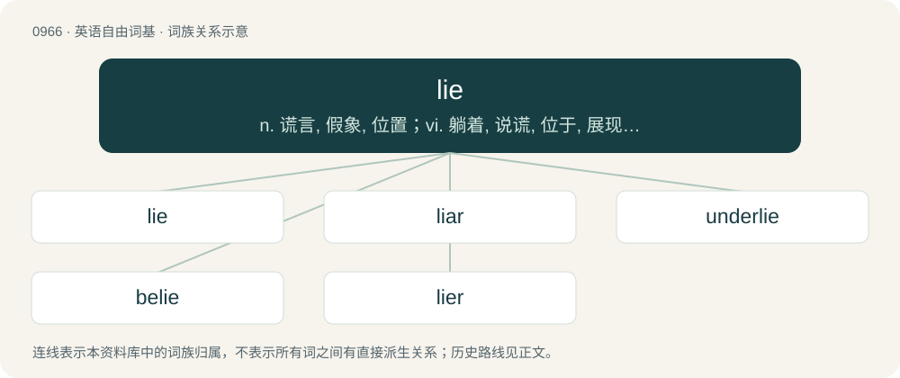

# 1039 · lie — n. 谎言, 假象, 位置；vi. 躺着, 说谎, 位于, 展现, 存在, 停泊；vt. 谎骗

[总目录](../00_总目录_按常用程度.md)

**类型**：英语自由词基　｜　**来源语言**：见词源记录

## 核心含义与来源

- 核心含义：n. 谎言, 假象, 位置；vi. 躺着, 说谎, 位于, 展现, 存在, 停泊；vt. 谎骗
- 英文含义：To rest in a horizontal position on a surface.
- 词形：lie

**多个词源／构词路径**：同一拼写可能有不同来源；以下按词性和含义分别列出。

**来源记录 1**（动词；To rest in a horizontal position on a surface.）

From Middle English lien, liggen, from Old English liċġan, from Proto-West Germanic \*liggjan, from Proto-Germanic \*ligjaną, from Proto-Indo-European \*legʰ-. Cognates Cognate with Yola lee, lidge (“to lie”), North Frisian lade, lai, laie, lei, lii, läde, läie (“to lie; to lay”), Saterland Frisian lääse (“to lie; to lay”), West Frisian lizze (“to lie”), Alemannic German ligge (“to lie”), Central Franconian lijje (“to lie”), Dutch and Dutch Low Saxon liggen (“to lie”), German liegen (“to lie”), German Low German ligge, liggen (“to lie”), Luxembourgish leien (“to lie”), Yiddish ליגן (lign, “to lie”), Danish and Norwegian Bokmål ligge (“to lie”), Faroese and Icelandic liggja (“to lie”), Norwegian Nynorsk ligge, liggja, liggje (“to lie”), Swedish ligga (“to lie”), Gothic 𐌻𐌹𐌲𐌰𐌽 (ligan, “to lie, to rest”); and with Irish laigh, luigh (“to lie”), Manx lhie (“lie; lay”), Scottish Gaelic laigh (“lie; lay”), Faliscan 𐌋𐌄𐌂𐌄𐌕 (lecet, “he lies down”), Latin lectus (“bed”), South Picene 𐌅𐌄𐌉𐌀𐌕 (veiat, “to lie”), Ancient Greek λέχομαι (lékhomai, “to lie down”), Albanian lag (“band, encampment, troop”), Belarusian ляжа́ць (ljažácʹ, “to lie”), Bulgarian лежа́ (ležá, “to lie”), Czech ležet (“to lie”), Macedonian лежи (leži, “to lie”), Polish leżeć (“to lie”), Russian лежа́ть (ležátʹ, “to lie”), Serbo-Croatian лѐжати, lèžati (“to lie”), Slovene ležáti (“to lie”), Ukrainian лежа́ти (ležáty, “to lie”), Tocharian B lyäk- (“to lie”). As a noun for position, the noun has the same etymology above as the verb.

**来源记录 2**（动词；To give false information intentionally with intent to deceive.）

From Middle English lien (“to lie, tell a falsehood”), from Old English lēogan (“to lie”), from Proto-West Germanic \*leugan, from Proto-Germanic \*leuganą (“to lie”), from Proto-Indo-European \*lewgʰ- (“to announce, tell publicly”). Cognates Cognate with Scots lee (“to lie”), North Frisian jooge, leeg, löög (“to lie”), Saterland Frisian ljooge (“to lie”), West Frisian lige (“to lie”), Bavarian liagn (“to lie”), Dutch liegen (“to lie”), German lügen (“to lie”), Luxembourgish léien (“to lie”), Danish lyve (“to lie”), Faroese lúgva (“to lie”), Icelandic ljúga (“to lie”), Norwegian Bokmål juge, lyge, lyve (“to lie”), Norwegian Nynorsk ljuga, ljuge, lyga, lyge (“to lie”), Scanian ljuğa (“to lie”), Swedish ljuga (“to lie”), Gothic 𐌻𐌹𐌿𐌲𐌰𐌽 (liugan, “to lie”); also Breton le (“vow”), Cornish li (“oath”), Welsh llw (“oath, pledge, vow; curse, swear word”), Latvian lùgt (“to ask; to request; to seek; to plead; to solicit; to invoke; to desire”), Belarusian ілга́ць (ilhácʹ), лга́ць (lhácʹ, “to lie”), Bulgarian лъжа (lăža, “to lie”), Czech lhát (“to lie”), Kashubian łżec (“to lie”), Macedonian ла́же (láže, “to lie”), Polish łgać (“to lie”), Russian лгать (lgatʹ, “to lie”), Serbo-Croatian ла̀гати, làgati (“to lie”), Slovak luhať (“to lie”), Slovene lagáti (“to lie”).

**来源记录 3**（名词；An intentionally false statement; an intentional falsehood.）

From Middle English lie, from Old English lyġe (“lie”), from Proto-Germanic \*lugiz (“lie”), from Proto-Indo-European \*lewgʰ- (“to announce, tell publicly”). Cognates Cognate with Saterland Frisian Löägene (“a lie”), Dutch leugen, logen, loogen (“a lie”), German Lug, Lüge, Lügen (“a lie”), German Low German Lögen (“a lie”), Luxembourgish Ligen (“a lie”), Yiddish ליגן (lign, “a lie”), Danish and Norwegian Bokmål løgn (“a lie”), Icelandic lygi, lygn (“a lie”), Norwegian Nynorsk lygn, løgn (“a lie”), Swedish lögn (“a lie”); also Bulgarian лъжа́ (lăžá, “а lie”), Czech lež (“a lie”), Russian ложь (ložʹ, “а lie”), Polish łeż (“a lie”), Serbo-Croatian ла̑ж, laž (“a lie”), Slovak lož (“a lie”), Slovene lȃž (“a lie”).

## 词族图

## 单词速览（常用到不常用）

| 单词 | 音标 | 释义 |
|---|---|---|
| [lie](#w-1) | /laɪ̯/ | n. 谎言, 假象, 位置；vi. 躺着, 说谎, 位于, 展现, 存在, 停泊；vt. 谎骗 |
| [liar](#w-2) | 英 /ˈlaɪ.ə/；美 /ˈlaɪ.ɚ/ | n. 说谎者 |
| [underlie](#w-3) | 英 /ˌʌn.dəˈlaɪ/；美 /ˌʌn.dɚˈlaɪ/ | vt. 位于...之下, 成为...的基础 |
| [belie](#w-4) | 英 /bɪˈlaɪ/；美 /bɪˈlaɪ/ | vt. 掩饰, 与...不符, 使失望 |
| [lier](#w-5) | 英 /ˈlaɪ.ə/；美 /ˈlaɪ.ɚ/ | n. 玻璃退火窑；躺卧者 |

## 逐词详解

### 1. lie

**词性**：动词　｜　**音标**：/laɪ̯/

**中文释义**：n. 谎言, 假象, 位置；vi. 躺着, 说谎, 位于, 展现, 存在, 停泊；vt. 谎骗

**英文义项**：To rest in a horizontal position on a surface. / To be placed or situated.

**词源与演化**：

From Middle English lien, liggen, from Old English liċġan, from Proto-West Germanic \*liggjan, from Proto-Germanic \*ligjaną, from Proto-Indo-European \*legʰ-. Cognates Cognate with Yola lee, lidge (“to lie”), North Frisian lade, lai, laie, lei, lii, läde, läie (“to lie; to lay”), Saterland Frisian lääse (“to lie; to lay”), West Frisian lizze (“to lie”), Alemannic German ligge (“to lie”), Central Franconian lijje (“to lie”), Dutch and Dutch Low Saxon liggen (“to lie”), German liegen (“to lie”), German Low German ligge, liggen (“to lie”), Luxembourgish leien (“to lie”), Yiddish ליגן (lign, “to lie”), Danish and Norwegian Bokmål ligge (“to lie”), Faroese and Icelandic liggja (“to lie”), Norwegian Nynorsk ligge, liggja, liggje (“to lie”), Swedish ligga (“to lie”), Gothic 𐌻𐌹𐌲𐌰𐌽 (ligan, “to lie, to rest”); and with Irish laigh, luigh (“to lie”), Manx lhie (“lie; lay”), Scottish Gaelic laigh (“lie; lay”), Faliscan 𐌋𐌄𐌂𐌄𐌕 (lecet, “he lies down”), Latin lectus (“bed”), South Picene 𐌅𐌄𐌉𐌀𐌕 (veiat, “to lie”), Ancient Greek λέχομαι (lékhomai, “to lie down”), Albanian lag (“band, encampment, troop”), Belarusian ляжа́ць (ljažácʹ, “to lie”), Bulgarian лежа́ (ležá, “to lie”), Czech ležet (“to lie”), Macedonian лежи (leži, “to lie”), Polish leżeć (“to lie”), Russian лежа́ть (ležátʹ, “to lie”), Serbo-Croatian лѐжати, lèžati (“to lie”), Slovene ležáti (“to lie”), Ukrainian лежа́ти (ležáty, “to lie”), Tocharian B lyäk- (“to lie”). As a noun for position, the noun has the same etymology above as the verb.

**例句**：

> The book lies on the table; the snow lies on the roof; he lies in his coffin.

该用例对应义项：To rest in a horizontal position on a surface.

### 2. liar

**词性**：名词　｜　**音标**：英 /ˈlaɪ.ə/；美 /ˈlaɪ.ɚ/

**中文释义**：n. 说谎者

**英文义项**：Someone who tells a lie; especially, a person who frequently lies.

**构词拆分**：lie + -ar

**词源与演化**：

Inherited from Middle English lier, liere, lyere, liȝer, lieȝer, legher, from Old English lēgere, lēogere (“liar, false witness, hypocrite”), from Proto-West Germanic \*leugārī, from Proto-Germanic \*leugārijaz (“liar”), from \*leuganą (“to lie”) + \*-ārijaz, equivalent to lie + -ar. More at lie.

**例句**：

> He told me he was a liar, but I don't believe him.

### 3. underlie

**词性**：动词　｜　**音标**：英 /ˌʌn.dəˈlaɪ/；美 /ˌʌn.dɚˈlaɪ/

**中文释义**：vt. 位于...之下, 成为...的基础

**英文义项**：To lie in a position directly beneath something. / To lie under or beneath.

**构词拆分**：under- + lie

**词源与演化**：

From Middle English underlien, underliggen, from Old English underliċġan (“to underlie, to be subject to, give way to”), equivalent to under- + lie. Cognate with Dutch onderliggen (“to lie below, lie on the bottom of”), German unterliegen (“to lie under, be subject to, succumb”).

**例句**：

> A stratum of clay underlies the surface gravel.

该用例对应义项：To lie under or beneath.

### 4. belie

**词性**：动词　｜　**音标**：英 /bɪˈlaɪ/；美 /bɪˈlaɪ/

**中文释义**：vt. 掩饰, 与...不符, 使失望

**英文义项**：To lie around; encompass.

**构词拆分**：be- (“around, by”) + lie (“to be positioned”)

**词源与演化**：

From Middle English belyen, beliggen, from Old English beliċġan, biliċġan (“to lie around, surround, hedge in, encompass”), from Proto-West Germanic \*biliggjan, from Proto-Germanic \*biligjaną (“to lie around”). Equivalent to be- (“around, by”) + lie (“to be positioned”).

**例句**：

> Tom was whistling in the dark to belie how terrified he was to be alone in the house which was rumoured to be haunted.

### 5. lier

**词性**：名词　｜　**音标**：英 /ˈlaɪ.ə/；美 /ˈlaɪ.ɚ/

**中文释义**：n. 玻璃退火窑；躺卧者

**英文义项**：A person or thing that lies, in the sense of being horizontal. / A lie-abed; one who stays in bed late.

**构词拆分**：lie + -er

**词源与演化**：

From Middle English lier, equivalent to lie + -er. Compare ligger, lidger, ledger.
