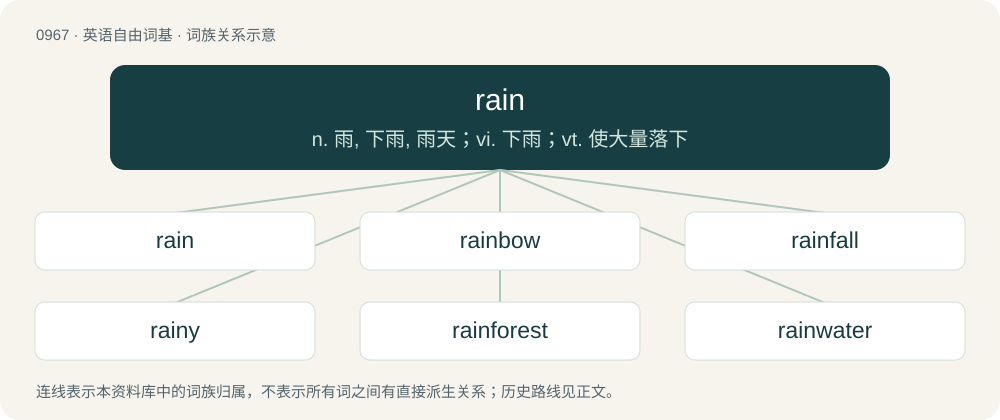

# 1040 · rain — n. 雨, 下雨, 雨天；vi. 下雨；vt. 使大量落下

[总目录](../00_总目录_按常用程度.md)

**类型**：英语自由词基　｜　**来源语言**：见词源记录

## 核心含义与来源

- 核心含义：n. 雨, 下雨, 雨天；vi. 下雨；vt. 使大量落下
- 英文含义：Condensed water falling from a cloud.
- 词形：rain

**多个词源／构词路径**：同一拼写可能有不同来源；以下按词性和含义分别列出。

**来源记录 1**（名词；Condensed water falling from a cloud.）

Inherited from Middle English reyn, rein, from Old English reġn, from Proto-West Germanic \*regn, from Proto-Germanic \*regną, of uncertain origin. Possibly from pre-Germanic \*Hréǵ-no-, from Proto-Indo-European \*Hreǵ- (“to flow”), although the consonant reflexes don't match. Cognates Cognate with Yola rhyne, ryne (“rain”), North Frisian Riin, rin (“rain”), Saterland Frisian Rien (“rain”), West Frisian rein (“rain”), Dutch regen (“rain”), Limburgish raenger, Rään (“rain”), German Low German Regen, Ręgen, Rägen (“rain”), Luxembourgish Reen (“rain”), German Regen (“rain”), Mòcheno reng (“rain”), Vilamovian raan (“rain”), Alemannic German regu, räge, rägä (“rain”), Bavarian Regn, rein (“rain”), Cimbrian regan, réego, reng (“rain”), Yiddish רעגן (regn, “rain”), Danish, Faroese, Icelandic, Norwegian Bokmål, Norwegian Nynorsk, and Swedish regn (“rain”), Crimean Gothic reghen (“rain”), Gothic 𐍂𐌹𐌲𐌽 (rign, “rain”).

**来源记录 2**（动词；To have rain fall from the sky.）

From Middle English reinen, from Old English reġnian, from Proto-West Germanic \*regnōn, from Proto-Germanic \*regnōną, from \*regną (“rain”), as above. Cognates Cognate with Cimbrian règhenan, rengen (“to rain”), Dutch regenen (“to rain”), German regnen (“to rain”), Limburgish raengere, rääne (“to rain”), Low German regen (“to rain”), Luxembourgish reenen (“to rain”), Yiddish רעגענען (regenen, “to rain”), Danish, Norwegian Bokmål regne (“to rain”), Faroese, Swedish regna (“to rain”), Icelandic rigna (“to rain”), Norwegian Nynorsk regna, regne (“to rain”).

## 词族图

## 单词速览（常用到不常用）

| 单词 | 音标 | 释义 |
|---|---|---|
| [rain](#w-1) | 英 /ɹeɪn/ | n. 雨, 下雨, 雨天；vi. 下雨；vt. 使大量落下 |
| [rainbow](#w-2) | 英 /ˈɹeɪnbəʊ/；美 /ˈɹeɪnboʊ/ | n. 彩虹；a. 五彩缤纷的 |
| [rainfall](#w-3) | /ˈreinfɒːl/ | n. 降雨, 降雨量；\[经\] 降雨量 |
| [rainy](#w-4) | /ˈɹeɪni/ | a. 下雨的, 多雨的 |
| [rainforest](#w-5) | 英 /ˈɹeɪn.fɒɹ.ɪst/；美 /ˈɹeɪn.fɔɹ.ɪst/ | \[生态\]雨林 |
| [rainwater](#w-6) | /ˈreinwɒːtə/ | n. 雨水 |
| [rainer](#w-7) | /ˈreinə/ | n. 人工降雨装置；喷灌装置 |
| [raincoat](#w-8) | 英 /ˈɹeɪnkəʊt/；美 /ˈɹeɪnkoʊt/ | n. 雨衣 |
| [rainstorm](#w-9) | 英 /ˈɹeɪnstɔːm/；美 /ˈɹeɪnstɔɹm/ | n. 雨暴 |
| [rainmaker](#w-10) | 英 /ˈɹeɪnmeɪkə/；美 /ˈɹeɪnˌmeɪkɚ/ | n. 唤雨巫师, 人工雨工作者 |
| [raindrop](#w-11) | 英 /ˈɹeɪndɹɒp/；美 /ˈɹeɪndɹɑp/ | n. 雨滴, 雨点 |

## 逐词详解

### 1. rain

**词性**：名词　｜　**音标**：英 /ɹeɪn/

**中文释义**：n. 雨, 下雨, 雨天；vi. 下雨；vt. 使大量落下

**英文义项**：Condensed water falling from a cloud. / Any matter moving or falling, usually through air, and especially if liquid or otherwise figuratively identifiable with raindrops.

**词源与演化**：

Inherited from Middle English reyn, rein, from Old English reġn, from Proto-West Germanic \*regn, from Proto-Germanic \*regną, of uncertain origin. Possibly from pre-Germanic \*Hréǵ-no-, from Proto-Indo-European \*Hreǵ- (“to flow”), although the consonant reflexes don't match. Cognates Cognate with Yola rhyne, ryne (“rain”), North Frisian Riin, rin (“rain”), Saterland Frisian Rien (“rain”), West Frisian rein (“rain”), Dutch regen (“rain”), Limburgish raenger, Rään (“rain”), German Low German Regen, Ręgen, Rägen (“rain”), Luxembourgish Reen (“rain”), German Regen (“rain”), Mòcheno reng (“rain”), Vilamovian raan (“rain”), Alemannic German regu, räge, rägä (“rain”), Bavarian Regn, rein (“rain”), Cimbrian regan, réego, reng (“rain”), Yiddish רעגן (regn, “rain”), Danish, Faroese, Icelandic, Norwegian Bokmål, Norwegian Nynorsk, and Swedish regn (“rain”), Crimean Gothic reghen (“rain”), Gothic 𐍂𐌹𐌲𐌽 (rign, “rain”).

**例句**：

> A rain of mortar fire fell on our trenches.

该用例对应义项：An instance of particles or larger pieces of matter moving or falling through air.

### 2. rainbow

**词性**：名词　｜　**音标**：英 /ˈɹeɪnbəʊ/；美 /ˈɹeɪnboʊ/

**中文释义**：n. 彩虹；a. 五彩缤纷的

**英文义项**：A multicoloured arch in the sky, produced by prismatic refraction of light within droplets of rain in the air. / Any prismatic refraction of light showing a spectrum of colours.

**构词拆分**：rain + bow (“arch”)

**词源与演化**：

From Middle English reynbowe, raynbowe, from Old English reġnboga (“rainbow”), from Proto-West Germanic \*regnabogō, from Proto-Germanic \*regnabugô (“rainbow”), equivalent to rain + bow (“arch”). Cognate with West Frisian reinbôge (“rainbow”), Dutch regenboog (“rainbow”), German Regenbogen (“rainbow”), Danish regnbue (“rainbow”), Swedish regnbåge (“rainbow”), Icelandic regnbogi (“rainbow”).

**例句**：

> Many electoral promises are rainbows, vanishing soon after poll day.

该用例对应义项：An illusion; a mirage.

### 3. rainfall

**词性**：名词　｜　**音标**：/ˈreinfɒːl/

**中文释义**：n. 降雨, 降雨量；\[经\] 降雨量

**英文义项**：The amount of rain that falls on a single occasion / The occurrence of liquid precipitation, the fall of rain.

**构词拆分**：rain + fall

**词源与演化**：

From rain + fall.

**例句**：

> Asia possesses 12 of the Top 19 world single-day rainfall records.

### 4. rainy

**词性**：形容词　｜　**音标**：/ˈɹeɪni/

**中文释义**：a. 下雨的, 多雨的

**英文义项**：Pouring with rain; wet; showery

**构词拆分**：rain + -y

**词源与演化**：

From Middle English reyny, from Old English reġniġ, from Proto-West Germanic \*regnag, from Proto-Germanic \*regnagaz (“rainy”), equivalent to rain + -y. Cognate with Saterland Frisian rienig (“rainy”), West Frisian reinich (“rainy”), Dutch regenig (“rainy”), German regnig (“rainy”), Swedish regnig (“rainy”).

**例句**：

> Due to the rainy weather, we decided not to play in the park.

该用例对应义项：Pouring with rain; wet; showery

### 5. rainforest

**词性**：名词　｜　**音标**：英 /ˈɹeɪn.fɒɹ.ɪst/；美 /ˈɹeɪn.fɔɹ.ɪst/

**中文释义**：\[生态\]雨林

**英文义项**：A forest in a climate with high annual rainfall and no dry season.

**构词拆分**：rain + forest

**词源与演化**：

From rain + forest, a calque of German Regenwald.

**例句**：

> Most accidents, after all, happen around the corner, not in the rainforest.

### 6. rainwater

**词性**：名词　｜　**音标**：/ˈreinwɒːtə/

**中文释义**：n. 雨水

**英文义项**：Rainfall. / Water (for a house, etc.) sourced from rain which has not joined a spring, stream or river, pond, lake or sea.

**构词拆分**：rain + water

**词源与演化**：

From Middle English reinwater, from Old English reġnwæter, equivalent to rain + water. Cognate with West Frisian reinwetter, Dutch regenwater, German Regenwasser, Swedish regnvatten.

**例句**：

> Rainwater flows from the gutter, down the downpipe and into the sewer.

### 7. rainer

**词性**：名词　｜　**音标**：/ˈreinə/

**中文释义**：n. 人工降雨装置；喷灌装置

**英文义项**：That which rains, or dispenses something in a shower.

**构词拆分**：rain + -er

**词源与演化**：

From rain + -er.

**例句**：

> Rainer inherited a small stack of gold bullion from his grandfather instead of cash.

### 8. raincoat

**词性**：名词　｜　**音标**：英 /ˈɹeɪnkəʊt/；美 /ˈɹeɪnkoʊt/

**中文释义**：n. 雨衣

**英文义项**：A waterproof coat to be worn in the rain; (loosely) any coat or jacket with this purpose. / A condom.

**构词拆分**：rain + coat

**词源与演化**：

From rain + coat.

**例句**：

> Today I bought a raincoat and wore it on a sunny day.

### 9. rainstorm

**词性**：名词　｜　**音标**：英 /ˈɹeɪnstɔːm/；美 /ˈɹeɪnstɔɹm/

**中文释义**：n. 雨暴

**英文义项**：A storm characterized by substantial, heavy rainfall.

**构词拆分**：rain + storm

**词源与演化**：

From rain + storm.

**例句**：

> Due to the rainstorm, the river water surged over the river banks.

### 10. rainmaker

**词性**：名词　｜　**音标**：英 /ˈɹeɪnmeɪkə/；美 /ˈɹeɪnˌmeɪkɚ/

**中文释义**：n. 唤雨巫师, 人工雨工作者

**英文义项**：Someone or something that causes or attempts to cause rain to fall. / A medicine man, shaman, or the like, who seeks to induce rain through performing rituals, as in African or Native American cultures.

**构词拆分**：rain + maker

**词源与演化**：

From rain + maker.

**例句**：

> The law firm relied heavily on Charlotte as its main rainmaker to bring in new clients.

该用例对应义项：A person having the ability to generate business, raise funds, or otherwise engineer success for a company, organization, etc.

### 11. raindrop

**词性**：名词　｜　**音标**：英 /ˈɹeɪndɹɒp/；美 /ˈɹeɪndɹɑp/

**中文释义**：n. 雨滴, 雨点

**英文义项**：A single droplet of rainwater that has just fallen or is falling from the sky.

**构词拆分**：rain + drop

**词源与演化**：

From Middle English rein-drope, reyn-drope, reyn drope, from Old English reġndropa, from Proto-Germanic \*regnadrupô. Equivalent to rain + drop. Cognate with Saterland Frisian Riendruppe, West Frisian reindrip, Dutch regendroppel, regendruppel, German Low German Regendrüpp, German Regentropfen, Swedish regndroppe, Icelandic regndropi.

**例句**：

> A raindrop splashed on her cheek.
