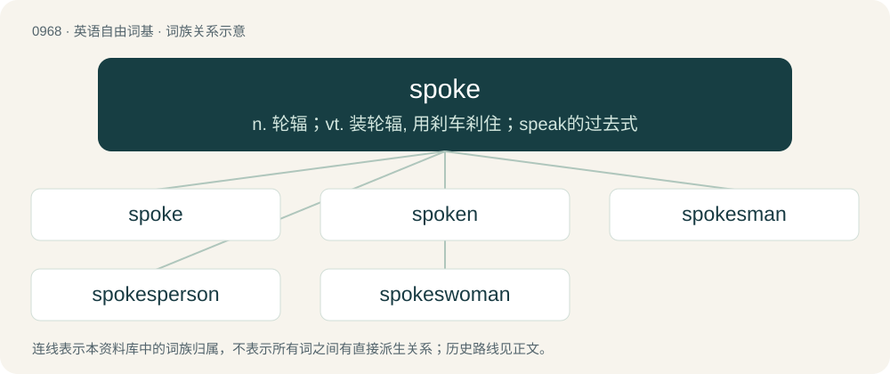

# 1041 · spoke — n. 轮辐；vt. 装轮辐, 用刹车刹住；speak的过去式

[总目录](../00_总目录_按常用程度.md)

**类型**：英语自由词基　｜　**来源语言**：见词源记录

## 核心含义与来源

- 核心含义：n. 轮辐；vt. 装轮辐, 用刹车刹住；speak的过去式
- 英文含义：A support structure that connects the axle or the hub of a wheel to the rim.
- 词形：spoke

**来源记录 1**（名词；A support structure that connects the axle or the hub of a wheel to the rim.）

From Middle English spoke, from Old English spāca, from Proto-West Germanic \*spaikā, from Proto-Germanic \*spaikō. Compare Scots spaik (“spoke”), Dutch spaak and English spike.

## 词族图

## 单词速览（常用到不常用）

| 单词 | 音标 | 释义 |
|---|---|---|
| [spoke](#w-1) | 英 /spəʊk/；美 /spoʊk/ | n. 轮辐；vt. 装轮辐, 用刹车刹住；speak的过去式 |
| [spoken](#w-2) | 英 /ˈspəʊ.k(ə)n/；美 /ˈspoʊ.kən/ | a. 口头讲的, 口语的；speak的过去分词 |
| [spokesman](#w-3) | /ˈspəuksmən/ | n. 发言人, 代言者 |
| [spokesperson](#w-4) | 英 /ˈspəʊkspɜːɹsən/；美 /ˈspoʊksˌpɝsən/ | n. 发言人, 代言人 |
| [spokeswoman](#w-5) | /ˈspəuks,wumən/ | n. 女发言人, 女代言人 |

## 逐词详解

### 1. spoke

**词性**：名词　｜　**音标**：英 /spəʊk/；美 /spoʊk/

**中文释义**：n. 轮辐；vt. 装轮辐, 用刹车刹住；speak的过去式

**英文义项**：A support structure that connects the axle or the hub of a wheel to the rim. / A projecting handle of a steering wheel.

**词源与演化**：

From Middle English spoke, from Old English spāca, from Proto-West Germanic \*spaikā, from Proto-Germanic \*spaikō. Compare Scots spaik (“spoke”), Dutch spaak and English spike.

**例句**：

> Mr Smith spoke so fast I couldn't take in what he said.

### 2. spoken

**词性**：形容词　｜　**音标**：英 /ˈspəʊ.k(ə)n/；美 /ˈspoʊ.kən/

**中文释义**：a. 口头讲的, 口语的；speak的过去分词

**英文义项**：Expressed in speech. / Speaking in a specified way.

**构词拆分**：spoke + -n

**词源与演化**：

Morphologically spoke + -n.

**用法示例／搭配（非完整句）**：

> soft-spoken

该用例对应义项：Speaking in a specified way.

### 3. spokesman

**词性**：名词　｜　**音标**：/ˈspəuksmən/

**中文释义**：n. 发言人, 代言者

**英文义项**：One who speaks as the voice of another person or a group of people.

**构词拆分**：spoke (“past participle of speak”) + -s- + man

**词源与演化**：

From spoke (“past participle of speak”) + -s- + man.

**例句**：

> Tom wasn't sure why he was considered the spokesman for the group.

### 4. spokesperson

**词性**：名词　｜　**音标**：英 /ˈspəʊkspɜːɹsən/；美 /ˈspoʊksˌpɝsən/

**中文释义**：n. 发言人, 代言人

**英文义项**：A person who acts as the voice of another person or a group of people.

**构词拆分**：spoke (“past participle of speak”) + -s- + person

**词源与演化**：

From spoke (“past participle of speak”) + -s- + person.

**例句**：

> Tom's voluble enthusiasm for the company's product made him a natural spokesperson.

### 5. spokeswoman

**词性**：名词　｜　**音标**：/ˈspəuks,wumən/

**中文释义**：n. 女发言人, 女代言人

**英文义项**：A woman who speaks as the voice of a group of people.

**构词拆分**：spoke (“past participle of speak”) + -s- + woman

**词源与演化**：

From spoke (“past participle of speak”) + -s- + woman.

**例句**：

> The high commissioner’s spokeswoman said the government had shown some willingness to initiate reforms.
