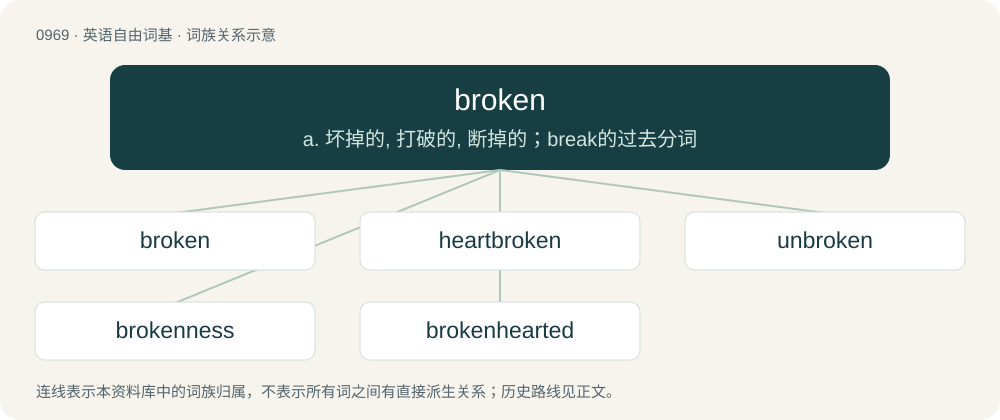

# 1042 · broken — a. 坏掉的, 打破的, 断掉的；break的过去分词

[总目录](../00_总目录_按常用程度.md)

**类型**：英语自由词基　｜　**来源语言**：见词源记录

## 核心含义与来源

- 核心含义：a. 坏掉的, 打破的, 断掉的；break的过去分词
- 英文含义：Fragmented; in separate pieces.
- 词形：broken

**来源记录 1**（形容词；Fragmented; in separate pieces.）

From Middle English broken, from Old English brocen, ġebrocen, from Proto-Germanic \*brukanaz, past participle of Proto-Germanic \*brekaną (“to break”). Cognate with Dutch gebroken (“broken”), German Low German broken (“broken”), German gebrochen (“broken”). Morphologically broke + -n.

## 词族图

## 单词速览（常用到不常用）

| 单词 | 音标 | 释义 |
|---|---|---|
| [broken](#w-1) | 英 /ˈbɹəʊ.kn̩/；美 /ˈbɹoʊ.kɪn/ | a. 坏掉的, 打破的, 断掉的；break的过去分词 |
| [heartbroken](#w-2) | /ˈhɑːtbrəukən/ | a. 心碎的 |
| [unbroken](#w-3) | 英 /ʌnˈbɹəʊkn̩/；美 /ʌnˈbɹoʊkn̩/ | a. 未破损的, 未被征服的, 未打垮的, 不屈服的, 不涣散的, 整齐的, 未中断的；\[法\] 未被阻断的, 未破损的, 完好的 |
| [brokenness](#w-4) |  | 破碎（broken的名词形式） |
| [brokenhearted](#w-5) | /ˈbrəukənˈhɑːtid/ | a. 没有精神的, 灰心的, 心碎的 |

## 逐词详解

### 1. broken

**词性**：形容词　｜　**音标**：英 /ˈbɹəʊ.kn̩/；美 /ˈbɹoʊ.kɪn/

**中文释义**：a. 坏掉的, 打破的, 断掉的；break的过去分词

**英文义项**：Fragmented; in separate pieces. / Fractured; having the bone in pieces.

**构词拆分**：broke + -n

**词源与演化**：

From Middle English broken, from Old English brocen, ġebrocen, from Proto-Germanic \*brukanaz, past participle of Proto-Germanic \*brekaną (“to break”). Cognate with Dutch gebroken (“broken”), German Low German broken (“broken”), German gebrochen (“broken”). Morphologically broke + -n.

**例句**：

> The bankruptcy and divorce, together with the death of his son, left him completely broken.

该用例对应义项：Completely defeated and dispirited; shattered; destroyed.

### 2. heartbroken

**词性**：形容词　｜　**音标**：/ˈhɑːtbrəukən/

**中文释义**：a. 心碎的

**英文义项**：Suffering from grief, especially after a failed romance.

**构词拆分**：heart + broken

**词源与演化**：

From heart + broken.

**例句**：

> When he told me he didn't want to see me anymore, I was heartbroken.

该用例对应义项：Suffering from grief, especially after a failed romance.

### 3. unbroken

**词性**：形容词　｜　**音标**：英 /ʌnˈbɹəʊkn̩/；美 /ʌnˈbɹoʊkn̩/

**中文释义**：a. 未破损的, 未被征服的, 未打垮的, 不屈服的, 不涣散的, 整齐的, 未中断的；\[法\] 未被阻断的, 未破损的, 完好的

**英文义项**：Whole, not divided into parts. / Of a horse, not tamed.

**构词拆分**：un- + broken

**词源与演化**：

From Middle English unbroken, from Old English unġebrocen (“unbroken”), equivalent to un- + broken. Cognate with Dutch ongebroken (“unbroken”), German Low German unbroken (“unbroken”), German ungebrochen (“unbroken”).

**例句**：

> After the vase had fallen down the flight of stairs we were amazed to find it still unbroken.

该用例对应义项：Whole, not divided into parts.

### 4. brokenness

**词性**：名词

**中文释义**：破碎（broken的名词形式）

**英文义项**：The characteristic of being broken.

**构词拆分**：broken + -ness

**词源与演化**：

From broken + -ness.

### 5. brokenhearted

**词性**：形容词　｜　**音标**：/ˈbrəukənˈhɑːtid/

**中文释义**：a. 没有精神的, 灰心的, 心碎的

**英文义项**：Grieved and disappointed, especially by the loss of a beloved person or thing, such as the end of a romantic relationship.

**构词拆分**：broken + hearted

**词源与演化**：

From broken + hearted.
