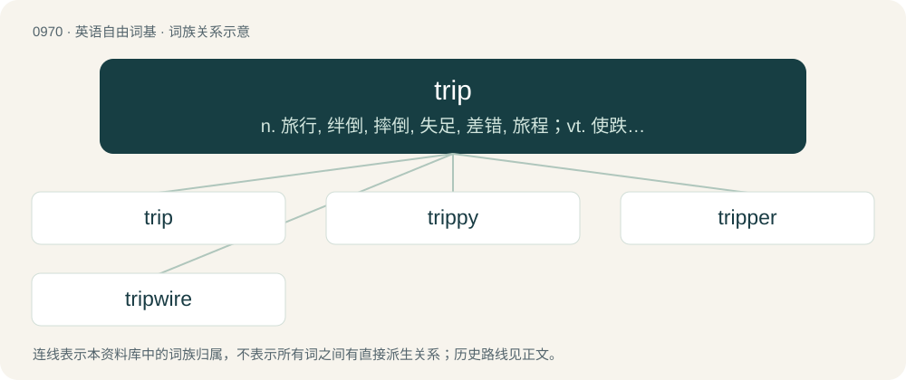

# 1043 · trip — n. 旅行, 绊倒, 摔倒, 失足, 差错, 旅程；vt. 使跌倒, 使犯错, 使失败；vi. 轻快地走, 绊倒, 失误, 犯错, 结巴, 旅行, 远足

[总目录](../00_总目录_按常用程度.md)

**类型**：英语自由词基　｜　**来源语言**：见词源记录

## 核心含义与来源

- 核心含义：n. 旅行, 绊倒, 摔倒, 失足, 差错, 旅程；vt. 使跌倒, 使犯错, 使失败；vi. 轻快地走, 绊倒, 失误, 犯错, 结巴, 旅行, 远足
- 英文含义：A journey; an excursion or jaunt.
- 词形：trip

**多个词源／构词路径**：同一拼写可能有不同来源；以下按词性和含义分别列出。

**来源记录 1**（名词；A journey; an excursion or jaunt.）

From Middle English trippen (“tread or step lightly and nimbly, skip, dance”), perhaps from Old French triper (“to hop or dance around, strike with the feet”), from a Frankish source; or alternatively from Middle Dutch trippen (“to skip, trip, hop, stamp, trample”) (&gt; Modern Dutch trippelen (“to toddle, patter, trip”)). Akin to Middle Low German trippen ( &gt; Danish trippe (“to trip”), Swedish trippa (“to mince, trip”)), West Frisian tripje (“to toddle, trip”), German trippeln (“to scurry”), Old English treppan (“to trample, tread”). Related also to trap, tramp.

**来源记录 2**（名词；A flock of wigeons.）

From Middle English tryppe, from Old French trippe. Possibly related to troop.

## 词族图

## 单词速览（常用到不常用）

| 单词 | 音标 | 释义 |
|---|---|---|
| [trip](#w-1) | 英 /tɹɪp/ | n. 旅行, 绊倒, 摔倒, 失足, 差错, 旅程；vt. 使跌倒, 使犯错, 使失败；vi. 轻快地走, 绊倒, 失误, 犯错, 结巴, 旅行, 远足 |
| [trippy](#w-2) | /ˈtɹɪ.pi/ | a. (如)由致幻药引起幻觉的 |
| [tripper](#w-3) | 英 /ˈtɹɪpə/；美 /ˈtɹɪpɚ/ | n. 绊跌者, 旅行者, 远足者 |
| [tripwire](#w-4) | /ˈtrip,waiə/ | 绊网 |

## 逐词详解

### 1. trip

**词性**：名词　｜　**音标**：英 /tɹɪp/

**中文释义**：n. 旅行, 绊倒, 摔倒, 失足, 差错, 旅程；vt. 使跌倒, 使犯错, 使失败；vi. 轻快地走, 绊倒, 失误, 犯错, 结巴, 旅行, 远足

**英文义项**：A journey; an excursion or jaunt. / A short outing for a specified purpose.

**词源与演化**：

From Middle English trippen (“tread or step lightly and nimbly, skip, dance”), perhaps from Old French triper (“to hop or dance around, strike with the feet”), from a Frankish source; or alternatively from Middle Dutch trippen (“to skip, trip, hop, stamp, trample”) (&gt; Modern Dutch trippelen (“to toddle, patter, trip”)). Akin to Middle Low German trippen ( &gt; Danish trippe (“to trip”), Swedish trippa (“to mince, trip”)), West Frisian tripje (“to toddle, trip”), German trippeln (“to scurry”), Old English treppan (“to trample, tread”). Related also to trap, tramp.

**例句**：

> His whole celebrity trip made it hard to relate to him.

该用例对应义项：A lifestyle; a preoccupation.

### 2. trippy

**词性**：形容词　｜　**音标**：/ˈtɹɪ.pi/

**中文释义**：a. (如)由致幻药引起幻觉的

**英文义项**：Strange, surreal, similar to the effects of a hallucinogen.

**构词拆分**：trip + -y

**词源与演化**：

From trip (“psychedelic trip”) + -y.

### 3. tripper

**词性**：名词　｜　**音标**：英 /ˈtɹɪpə/；美 /ˈtɹɪpɚ/

**中文释义**：n. 绊跌者, 旅行者, 远足者

**英文义项**：One who trips or stumbles. / A person experiencing a hallucinogenic trip.

**构词拆分**：From trip + -er.

**词源与演化**：

From trip + -er.

### 4. tripwire

**词性**：名词　｜　**音标**：/ˈtrip,waiə/

**中文释义**：绊网

**英文义项**：A cord or wire arranged so that when snagged or pulled by an intruder, it will trigger a detector or trap or a device, such as a land mine. / Any means of detecting intruders or attackers.

**构词拆分**：trip + wire

**词源与演化**：

From trip + wire.

**例句**：

> Seeing the tripwire of a nearby bouncing Betty gave us cold chills, and we moved all the more slowly through the woods.

该用例对应义项：A cord or wire arranged so that when snagged or pulled by an intruder, it will trigger a detector or trap or a device, such as a land mine.
