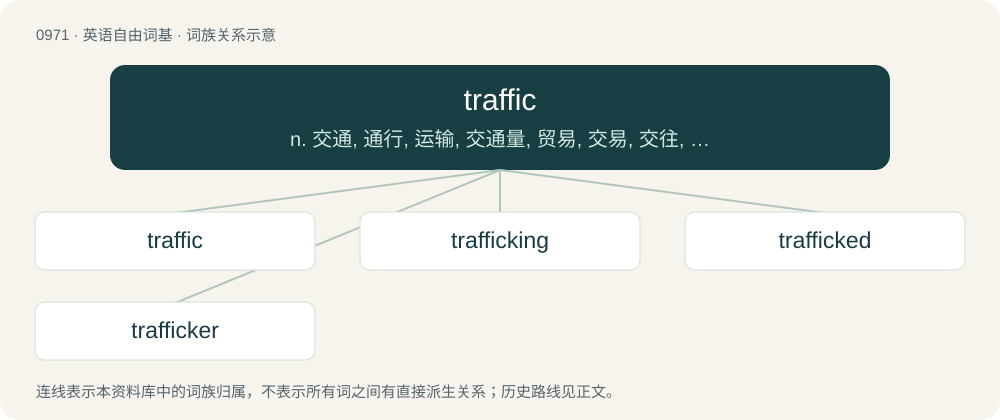

# 1045 · traffic — n. 交通, 通行, 运输, 交通量, 贸易, 交易, 交往, 通信量；vi. 交易, 做买卖；vt. 用...作交换

[总目录](../00_总目录_按常用程度.md)

**类型**：英语自由词基　｜　**来源语言**：见词源记录

## 核心含义与来源

- 核心含义：n. 交通, 通行, 运输, 交通量, 贸易, 交易, 交往, 通信量；vi. 交易, 做买卖；vt. 用...作交换
- 英文含义：Moving pedestrians or vehicles, or the flux or passage thereof.
- 词形：traffic

**来源记录 1**（名词；Moving pedestrians or vehicles, or the flux or passage thereof.）

From Middle French trafique, traffique (“traffic”), from Italian traffico (“traffic”) from trafficare (“to carry on trade”). Potentially from Vulgar Latin \*trānsfrīcāre (“to rub across”); Klein instead suggests the Italian has ultimate origin in Arabic تَفْرِيق (tafrīq, “distribution, dispersion”), reshaped to match the native prefix tra- (“trans-”). The adjectival sense is possibly influenced by Tagalog trapik and follows a general trend in Philippine English to construct a noun from an adjective.

## 词族图

## 单词速览（常用到不常用）

| 单词 | 音标 | 释义 |
|---|---|---|
| [traffic](#w-1) | 英 /ˈtɹæfɪk/ | n. 交通, 通行, 运输, 交通量, 贸易, 交易, 交往, 通信量；vi. 交易, 做买卖；vt. 用...作交换 |
| [trafficking](#w-2) | /ˈtræfikɪŋ/ | n. 非法交易 |
| [trafficked](#w-3) |  | vt. 用…作交换（traffic的过去式与过去分词形式） |
| [trafficker](#w-4) | /ˈtræfikə/ | n. 商人, 贩子；\[法\] 贩卖者, 买卖者, 商人 |

## 逐词详解

### 1. traffic

**词性**：名词　｜　**音标**：英 /ˈtɹæfɪk/

**中文释义**：n. 交通, 通行, 运输, 交通量, 贸易, 交易, 交往, 通信量；vi. 交易, 做买卖；vt. 用...作交换

**英文义项**：Moving pedestrians or vehicles, or the flux or passage thereof. / The commercial transportation or exchange of goods, or the movement of passengers or people.

**词源与演化**：

From Middle French trafique, traffique (“traffic”), from Italian traffico (“traffic”) from trafficare (“to carry on trade”). Potentially from Vulgar Latin \*trānsfrīcāre (“to rub across”); Klein instead suggests the Italian has ultimate origin in Arabic تَفْرِيق (tafrīq, “distribution, dispersion”), reshaped to match the native prefix tra- (“trans-”). The adjectival sense is possibly influenced by Tagalog trapik and follows a general trend in Philippine English to construct a noun from an adjective.

**例句**：

> Sales are down due to a decline in store traffic.

该用例对应义项：A flow of customers for a store or restaurant.

### 2. trafficking

**词性**：名词　｜　**音标**：/ˈtræfikɪŋ/

**中文释义**：n. 非法交易

**英文义项**：The illegal trade or exchange of goods. / The movement of an enzyme (or other protein) through tissue.

**构词拆分**：From traffic + -ing.

**词源与演化**：

From traffic + -ing.

**例句**：

> The real-life Five Families were involved in drug trafficking from day one.

### 3. trafficked

**词性**：形容词

**中文释义**：vt. 用…作交换（traffic的过去式与过去分词形式）

**英文义项**：Carrying traffic; subject to traffic.

**构词拆分**：From traffic + -ed.

**词源与演化**：

From traffic + -ed.

**例句**：

> Pangolins are said to be the world's most trafficked mammal.

### 4. trafficker

**词性**：名词　｜　**音标**：/ˈtræfikə/

**中文释义**：n. 商人, 贩子；\[法\] 贩卖者, 买卖者, 商人

**英文义项**：Someone who traffics; a trader or merchant of illegal products, or of legal products in an illegal setting.

**构词拆分**：From traffic + -er.

**词源与演化**：

From traffic + -er.

**用法示例／搭配（非完整句）**：

> human trafficker

该用例对应义项：Someone who traffics; a trader or merchant of illegal products, or of legal products in an illegal setting.
