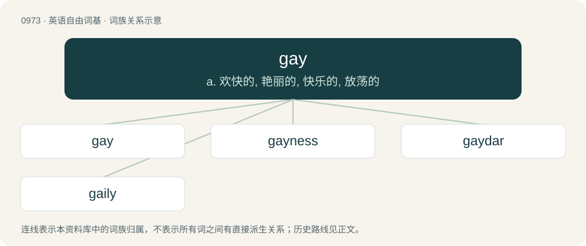

# 1047 · gay — a. 欢快的, 艳丽的, 快乐的, 放荡的

[总目录](../00_总目录_按常用程度.md)

**类型**：英语自由词基　｜　**来源语言**：见词源记录

## 核心含义与来源

- 核心含义：a. 欢快的, 艳丽的, 快乐的, 放荡的
- 英文含义：Only possessing sexual and/or romantic attraction towards people one perceives to be the same sex or gender as oneself.
- 词形：gay

**多个词源／构词路径**：同一拼写可能有不同来源；以下按词性和含义分别列出。

**来源记录 1**（形容词；Only possessing sexual and/or romantic attraction towards people one perceives to be the same sex or gender as oneself.）

From Middle English gay, from Old French gai (“joyful, laughing, merry”), usually thought to be a borrowing of Old Occitan gai (“impetuous, lively”), from Gothic \*𐌲𐌰𐌷𐌴𐌹𐍃 (\*gaheis, “impetuous”), merging with earlier Old French jai ("merry"; see jay), from Frankish \*gāhi; both from Proto-Germanic \*ganhuz, \*ganhwaz (“sudden”). This is possibly derived from Proto-Indo-European \*ǵʰengʰ- (“to stride, step”), from \*ǵʰeh₁- (“to leave”), but Kroonen rejects this derivation and treats the Germanic word as having no known etymology. cognates and sense derivation Cognate with Dutch gauw (“fast, quickly”), Westphalian Low German gau, gai (“fast, quick”), German jäh (“abrupt, sudden”). Anatoly Liberman, following Frank Chance and Harri Meier, believes Old French gai was instead a native development from Latin vagus (“wandering, inconstant, flighty”), with \*\[w\] &gt; \[g\] as in French gaine. The sense of homosexual (first recorded no later than 1937 by Cary Grant in the film Bringing Up Baby, and possibly earlier in 1922 in the poem "Miss Furr and Miss Skeene" by Gertrude Stein) was shortened from earlier gay boy ("young male prostitute") and gay cat ("homosexual boy") in underworld and prison slang, itself first attested about 1935, but used earlier for a young tramp or hobo attached to an older one. Pejorative usage is due to hostility towards homosexuality. The sense of ‘upright’, used in reference to a dog’s tail, probably derives from the ‘happy’ sense of the word.

**来源记录 2**（名词；The letter —, which stands for the sound /ɡ/, in Pitman shorthand.）

From Pitman kay, which it is derived from graphically, and the sound it represents. The traditional name gee was considered inappropriate, as the Pitman letter never has the sound of that name.

## 词族图

## 单词速览（常用到不常用）

| 单词 | 音标 | 释义 |
|---|---|---|
| [gay](#w-1) | /ɡeɪ/ | a. 欢快的, 艳丽的, 快乐的, 放荡的 |
| [gayness](#w-2) | /ˈɡeɪ.nəs/ | n. 欢乐, （尤指）同性恋 |
| [gaydar](#w-3) | 英 /ˈɡeɪdɑː/；美 /ˈɡeɪˌdɑɹ/ | n. 同性恋行为 |
| [gaily](#w-4) | /ˈɡeɪli/ | adv. 华丽地, 欢乐地 |

## 逐词详解

### 1. gay

**词性**：形容词　｜　**音标**：/ɡeɪ/

**中文释义**：a. 欢快的, 艳丽的, 快乐的, 放荡的

**英文义项**：Only possessing sexual and/or romantic attraction towards people one perceives to be the same sex or gender as oneself. / Of a man, only romantically and/or sexually attracted to other men.

**词源与演化**：

From Middle English gay, from Old French gai (“joyful, laughing, merry”), usually thought to be a borrowing of Old Occitan gai (“impetuous, lively”), from Gothic \*𐌲𐌰𐌷𐌴𐌹𐍃 (\*gaheis, “impetuous”), merging with earlier Old French jai ("merry"; see jay), from Frankish \*gāhi; both from Proto-Germanic \*ganhuz, \*ganhwaz (“sudden”). This is possibly derived from Proto-Indo-European \*ǵʰengʰ- (“to stride, step”), from \*ǵʰeh₁- (“to leave”), but Kroonen rejects this derivation and treats the Germanic word as having no known etymology. cognates and sense derivation Cognate with Dutch gauw (“fast, quickly”), Westphalian Low German gau, gai (“fast, quick”), German jäh (“abrupt, sudden”). Anatoly Liberman, following Frank Chance and Harri Meier, believes Old French gai was instead a native development from Latin vagus (“wandering, inconstant, flighty”), with \*\[w\] &gt; \[g\] as in French gaine. The sense of homosexual (first recorded no later than 1937 by Cary Grant in the film Bringing Up Baby, and possibly earlier in 1922 in the poem "Miss Furr and Miss Skeene" by Gertrude Stein) was shortened from earlier gay boy ("young male prostitute") and gay cat ("homosexual boy") in underworld and prison slang, itself first attested about 1935, but used earlier for a young tramp or hobo attached to an older one. Pejorative usage is due to hostility towards homosexuality. The sense of ‘upright’, used in reference to a dog’s tail, probably derives from the ‘happy’ sense of the word.

**例句**：

> She professes an undying love for gay bars and gay movies, and even admits to having watched gay porn.

该用例对应义项：Intended for gay people, especially gay men.

### 2. gayness

**词性**：名词　｜　**音标**：/ˈɡeɪ.nəs/

**中文释义**：n. 欢乐, （尤指）同性恋

**英文义项**：The state of being gay (colorful or festive); display or dressiness. / The state of being gay (cheerful); gaiety.

**构词拆分**：gay + -ness

**词源与演化**：

From Middle English gaynesse, equivalent to gay + -ness.

**例句**：

> I told Tom to tone down his gayness.

### 3. gaydar

**词性**：名词　｜　**音标**：英 /ˈɡeɪdɑː/；美 /ˈɡeɪˌdɑɹ/

**中文释义**：n. 同性恋行为

**英文义项**：The supposed ability to detect whether or not a person is gay by observing that person's appearance, mannerisms, etc.

**构词拆分**：gay + -dar

**词源与演化**：

Blend of gay + radar, equivalent to gay + -dar.

**例句**：

> Where was Rima's gaydar when she started dating Ziri?

### 4. gaily

**词性**：副词　｜　**音标**：/ˈɡeɪli/

**中文释义**：adv. 华丽地, 欢乐地

**英文义项**：Merrily. / Showily.

**构词拆分**：gay + -ly

**词源与演化**：

From gay + -ly.

**例句**：

> How gaily the kids skip and play, whilst I sink into listless repose!
