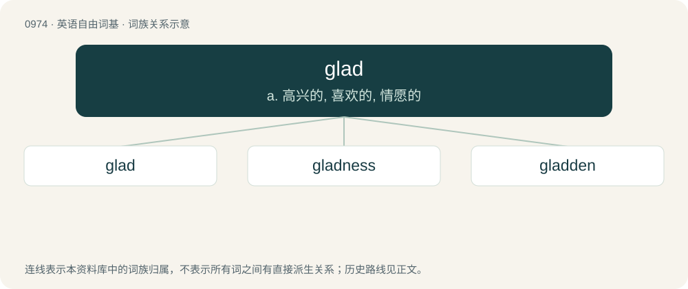

# 1048 · glad — a. 高兴的, 喜欢的, 情愿的

[总目录](../00_总目录_按常用程度.md)

**类型**：英语自由词基　｜　**来源语言**：见词源记录

## 核心含义与来源

- 核心含义：a. 高兴的, 喜欢的, 情愿的
- 英文含义：Pleased; happy; gratified.
- 词形：glad

**多个词源／构词路径**：同一拼写可能有不同来源；以下按词性和含义分别列出。

**来源记录 1**（形容词；Pleased; happy; gratified.）

From Middle English glad, gled, from Old English glæd (“shining; bright; cheerful; glad”), from Proto-Germanic \*gladaz (“shiny; gleaming; radiant; happy; glossy; smooth; flat”), from Proto-Indo-European \*gʰladʰ-, from \*ǵʰelh₂- (“to shine”). Cognate with Scots gled, glaid (“shining; bright; glad”), Saterland Frisian glääd (“smooth; sleek”), West Frisian glêd (“smooth”), Dutch glad (“smooth; sleek; slippery”), German glatt (“smooth; sleek; slippery”), Danish, Norwegian and Swedish glad (“glad; happy; cheerful”), Icelandic glaður (“glad; joyful; cheery”), Latin glaber (“smooth; hairless; bald”), Russian гла́дкий (gládkij, “smooth”). Doublet of glatt.

**来源记录 2**（名词；A gladiolus (plant).）

Abbreviation of gladiolus.

## 词族图

## 单词速览（常用到不常用）

| 单词 | 音标 | 释义 |
|---|---|---|
| [glad](#w-1) | 英 /ɡlæd/；/ˈɡlɛəd/ | a. 高兴的, 喜欢的, 情愿的 |
| [gladness](#w-2) | /ˈɡlædnəs/ | n. 欢乐, 欢喜, 喜悦 |
| [gladden](#w-3) | /ˈɡlædən/ | vt. 使喜悦；vi. 喜悦 |

## 逐词详解

### 1. glad

**词性**：形容词　｜　**音标**：英 /ɡlæd/；/ˈɡlɛəd/

**中文释义**：a. 高兴的, 喜欢的, 情愿的

**英文义项**：Pleased; happy; gratified.

**词源与演化**：

From Middle English glad, gled, from Old English glæd (“shining; bright; cheerful; glad”), from Proto-Germanic \*gladaz (“shiny; gleaming; radiant; happy; glossy; smooth; flat”), from Proto-Indo-European \*gʰladʰ-, from \*ǵʰelh₂- (“to shine”). Cognate with Scots gled, glaid (“shining; bright; glad”), Saterland Frisian glääd (“smooth; sleek”), West Frisian glêd (“smooth”), Dutch glad (“smooth; sleek; slippery”), German glatt (“smooth; sleek; slippery”), Danish, Norwegian and Swedish glad (“glad; happy; cheerful”), Icelandic glaður (“glad; joyful; cheery”), Latin glaber (“smooth; hairless; bald”), Russian гла́дкий (gládkij, “smooth”). Doublet of glatt.

**例句**：

> I'm very glad at this decision because we'd been on the ropes for a while.

该用例对应义项：Pleased; happy; gratified.

### 2. gladness

**词性**：名词　｜　**音标**：/ˈɡlædnəs/

**中文释义**：n. 欢乐, 欢喜, 喜悦

**英文义项**：The state of being glad; joy.

**构词拆分**：glad + -ness

**词源与演化**：

From glad + -ness.

**例句**：

> The rose and the thorn, and sorrow and gladness are linked together.

### 3. gladden

**词性**：动词　｜　**音标**：/ˈɡlædən/

**中文释义**：vt. 使喜悦；vi. 喜悦

**英文义项**：To cause (something) to become more glad.

**构词拆分**：From glad + -en.

**词源与演化**：

From glad + -en.
