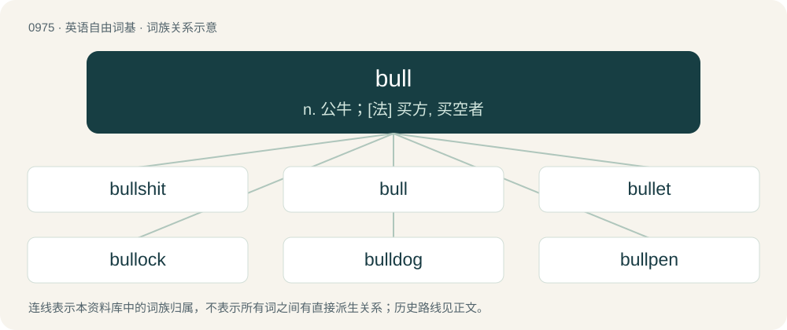

# 1049 · bull — n. 公牛；\[法\] 买方, 买空者

[总目录](../00_总目录_按常用程度.md)

**类型**：英语自由词基　｜　**来源语言**：见词源记录

## 核心含义与来源

- 核心含义：n. 公牛；\[法\] 买方, 买空者
- 英文含义：Specifically, one that is uncastrated.
- 词形：bull

**多个词源／构词路径**：同一拼写可能有不同来源；以下按词性和含义分别列出。

**来源记录 1**（名词；Specifically, one that is uncastrated.）

From Middle English bole, bul, bule, from a conflation of Old English bula (“bull, steer”) and Old Norse boli, both from Proto-Germanic \*bulô (“bull”), from Proto-Indo-European \*bʰl̥no-, from \*bʰel- (“to blow, swell up”). Cognate with West Frisian bolle, Dutch bul, German Low German Bull, German Bulle, Swedish bulla; also Old Irish ball (“limb”), Latin follis (“bellows, leather bag”), Albanian bolle (“testicles”), Ancient Greek φαλλός (phallós, “penis”). Of sense 11, (a man or boy), derived from the Philadelphia English pronunciation of boy, which is practically a homophone of bull.

**来源记录 2**（名词；A papal bull, an official document or edict from the Pope.）

From Middle English bulle, from Old French bulle, from Latin bulla, from Gaulish. Doublet of bull (“bubble”) and bulla.

**来源记录 3**（名词；A lie.）

From Middle English bull, bul, boule (“falsehood, deceit”), probably from Old French boul, boule, bole (“fraud, deceit, cunning”), from Old French bouler, boler (“to deceive, delude, lure, take in”), from Middle Low German bôlen (“to court, to woo”). Cognate with German buhlen (“to woo”). Doublet of bully. Often reanalyzed by surface analysis to be an expurgated clipping of bullshit.

## 词族图

## 单词速览（常用到不常用）

| 单词 | 音标 | 释义 |
|---|---|---|
| [bullshit](#w-1) | /ˈbʊɫʃɪt/ | n. 胡说 |
| [bull](#w-2) | /bʊl/ | n. 公牛；\[法\] 买方, 买空者 |
| [bullet](#w-3) | /ˈbulit/ | 【英文】A young or little bull; a male calf. |
| [bullock](#w-4) | /ˈbʊlək/ | n. 阉牛 |
| [bulldog](#w-5) | 英 /ˈbʊl.dɒɡ/；美 /ˈbʊl.dɔɡ/ | n. 喇叭狗 |
| [bullpen](#w-6) | /ˈbjlpen/ | n. &lt;美&gt;牛栏,&lt;口&gt;大房间(尤指候审犯人用的),\[棒球\]候补队员区 |
| [bullish](#w-7) | /ˈbʊlɪʃ/ | a. 似公牛的, 看涨的, 上扬的；\[经\] 行情看涨的 |
| [bullseye](#w-8) | 英 /ˈbʊlzaɪ/ | n. 靶眼；圆心；牛眼灯 |
| [buller](#w-9) | 英 /ˈbʊlə(ɹ)/；美 /ˈbʊlɚ/ | 【英文】A steer that allows itself to be mounted by bulls when in the crowded conditions of a feedlot. |
| [bullfighting](#w-10) | /ˈbʊlˌfaɪ.tɪŋ/ | n. 斗牛表演 |
| [bullfrog](#w-11) | 英 /ˈbʊlfɹɒɡ/；美 /ˈbʊlfɹɑɡ/ | n. 牛蛙, 喧蛙 |
| [bulldoze](#w-12) | 英 /ˈbʊldəʊz/；美 /ˈbʊldoʊz/ | vt. 强迫, 用推土机推平/削平, 用推土机清除, 压倒, 威胁 |
| [bullhorn](#w-13) | 美 /ˈbʊlˌhɔɹn/ | n. 手提式电子扩音器 |
| [bullfighter](#w-14) | /ˈbʊlfaɪtə(r)/ | n. 斗牛士 |
| [bullfight](#w-15) | /ˈbulfait/ | n. 斗牛 |
| [bullcrap](#w-16) | /ˈbʊlkɹæp/ | 【英文】Bullshit. |
| [bullhead](#w-17) | 英 /ˈbʌlˌhɛd/ | n. 大头鱼, 顽固的人 |

## 逐词详解

### 1. bullshit

**词性**：名词　｜　**音标**：/ˈbʊɫʃɪt/

**中文释义**：n. 胡说

**英文义项**：Feces produced by a bull. / Statements that are false or exaggerated to impress or cheat the listener.

**构词拆分**：bull + shit

**词源与演化**：

From bull + shit. Figurative use as a noun referring to useless or untrue information is attested from the 1910s.

**例句**：

> That's total bullshit! I called your office and they said that you didn't come in!

该用例对应义项：Statements that are transparently or offensively false.

### 2. bull

**词性**：形容词　｜　**音标**：/bʊl/

**中文释义**：n. 公牛；\[法\] 买方, 买空者

**英文义项**：Large and strong, like a bull. / Of large mammals, adult male.

**词源与演化**：

From Middle English bole, bul, bule, from a conflation of Old English bula (“bull, steer”) and Old Norse boli, both from Proto-Germanic \*bulô (“bull”), from Proto-Indo-European \*bʰl̥no-, from \*bʰel- (“to blow, swell up”). Cognate with West Frisian bolle, Dutch bul, German Low German Bull, German Bulle, Swedish bulla; also Old Irish ball (“limb”), Latin follis (“bellows, leather bag”), Albanian bolle (“testicles”), Ancient Greek φαλλός (phallós, “penis”). Of sense 11, (a man or boy), derived from the Philadelphia English pronunciation of boy, which is practically a homophone of bull.

**用法示例／搭配（非完整句）**：

> a bull elephant

该用例对应义项：Of large mammals, adult male.

### 3. bullet

**词性**：名词　｜　**音标**：/ˈbulit/

**英文义项**：A young or little bull; a male calf.

**构词拆分**：bull + -et

**词源与演化**：

From bull + -et.

### 4. bullock

**词性**：名词　｜　**音标**：/ˈbʊlək/

**中文释义**：n. 阉牛

**英文义项**：A castrated bull; an ox.

**构词拆分**：bull + -ock (diminutive suffix)

**词源与演化**：

From Middle English bullok, from Old English bulluc, from Proto-West Germanic \*bulluk, corresponding to bull + -ock (diminutive suffix). Compare Old Dutch bullok (“bullock”).

### 5. bulldog

**词性**：名词　｜　**音标**：英 /ˈbʊl.dɒɡ/；美 /ˈbʊl.dɔɡ/

**中文释义**：n. 喇叭狗

**英文义项**：A breed of dog developed in England by the crossing of the bullbaiting dog and the Pug to produce a ladies' companion dog, having a very smooth coat, a flattened face, wrinkly cheeks, powerful front legs, and smaller hind legs. / The original form of this breed, the English bulldog.

**构词拆分**：bull + dog

**词源与演化**：

From bull + dog, in reference to bullbaiting.

**例句**：

> His bulldog determination was destined to bring him the opportunity he was seeking.

该用例对应义项：A stubborn or determined person.

### 6. bullpen

**词性**：名词　｜　**音标**：/ˈbjlpen/

**中文释义**：n. &lt;美&gt;牛栏,&lt;口&gt;大房间(尤指候审犯人用的),\[棒球\]候补队员区

**英文义项**：An enclosed area used to hold bulls. / An enclosed area for pitchers to warm up in during a game.

**构词拆分**：From bull + pen.

**词源与演化**：

From bull + pen.

**例句**：

> Their bullpen is worn out after yesterday's doubleheader where both games went 12 innings.

该用例对应义项：The relief pitchers of a team collectively.

### 7. bullish

**词性**：形容词　｜　**音标**：/ˈbʊlɪʃ/

**中文释义**：a. 似公牛的, 看涨的, 上扬的；\[经\] 行情看涨的

**英文义项**：Having a muscular physique, built ‘like a bull’. / Aggressively self-confident or assertive; bullheaded.

**构词拆分**：bull + -ish

**词源与演化**：

From bull + -ish.

**例句**：

> He was heavily criticised for his bullish behaviour.

该用例对应义项：Aggressively self-confident or assertive; bullheaded.

### 8. bullseye

**词性**：名词　｜　**音标**：英 /ˈbʊlzaɪ/

**中文释义**：n. 靶眼；圆心；牛眼灯

**英文义项**：The centre of a target, inside the inner and magpie. / A shot which hits the centre of a target.

**构词拆分**：bull's + eye

**词源与演化**：

From bull's + eye. May have come from the practice of English archers shooting an arrow through the eye socket of a bull's skull as a test of skill. The connection to philately comes from the shape of the key plate or vignette.

**例句**：

> Yanni emptied three quarters of the resin tube into the windshield bullseye.

### 9. buller

**词性**：名词　｜　**音标**：英 /ˈbʊlə(ɹ)/；美 /ˈbʊlɚ/

**英文义项**：A steer that allows itself to be mounted by bulls when in the crowded conditions of a feedlot. / A homosexual man.

**构词拆分**：bull + -er

**词源与演化**：

From bull + -er.

### 10. bullfighting

**词性**：名词　｜　**音标**：/ˈbʊlˌfaɪ.tɪŋ/

**中文释义**：n. 斗牛表演

**英文义项**：A traditional spectacle, popular in Spain and many former Spanish colonies, in which a matador manipulates and ultimately kills a bull at close range.

**构词拆分**：bull + fighting

**词源与演化**：

From bull + fighting.

**例句**：

> Bullfighting is so cruel and barbaric.

### 11. bullfrog

**词性**：名词　｜　**音标**：英 /ˈbʊlfɹɒɡ/；美 /ˈbʊlfɹɑɡ/

**中文释义**：n. 牛蛙, 喧蛙

**英文义项**：Any of various frogs having a croak that resembles the bellow of a cow or bull.

**构词拆分**：bull + frog

**词源与演化**：

From bull + frog.

**例句**：

> Still to come... buttermilk-fried bullfrog legs, braised wild boar with Himalayan blackberry glaze and Asian carp boulettes.

### 12. bulldoze

**词性**：动词　｜　**音标**：英 /ˈbʊldəʊz/；美 /ˈbʊldoʊz/

**中文释义**：vt. 强迫, 用推土机推平/削平, 用推土机清除, 压倒, 威胁

**英文义项**：To destroy with a bulldozer. / To push someone over by heading straight over them. Often used in conjunction with "over".

**构词拆分**：bull + dose

**词源与演化**：

From earlier bulldose (noun, literally “bull-dose, a dose fit for a bull”), equivalent to bull + dose.

**例句**：

> They know that they can bulldoze their way out of the situation.

### 13. bullhorn

**词性**：名词　｜　**音标**：美 /ˈbʊlˌhɔɹn/

**中文释义**：n. 手提式电子扩音器

**英文义项**：A megaphone which electronically amplifies a person’s natural voice.

**构词拆分**：bull + horn

**词源与演化**：

From bull + horn, attested since the 1950s.

### 14. bullfighter

**词性**：名词　｜　**音标**：/ˈbʊlfaɪtə(r)/

**中文释义**：n. 斗牛士

**英文义项**：One who engages in bullfighting; a toreador or matador.

**构词拆分**：bull + fighter

**词源与演化**：

From bull + fighter.

**例句**：

> The bull is stronger than the bullfighter, but he almost always loses.

### 15. bullfight

**词性**：名词　｜　**音标**：/ˈbulfait/

**中文释义**：n. 斗牛

**英文义项**：A public spectacle, in Spain and some other Latin countries, in which a person baits and often kills a bull.

**构词拆分**：bull + fight

**词源与演化**：

From bull + fight.

**例句**：

> I've never seen a bullfight and I hope to never see one.

### 16. bullcrap

**词性**：名词　｜　**音标**：/ˈbʊlkɹæp/

**英文义项**：Bullshit.

**构词拆分**：bull + crap

**词源与演化**：

From bull + crap.

### 17. bullhead

**词性**：名词　｜　**音标**：英 /ˈbʌlˌhɛd/

**中文释义**：n. 大头鱼, 顽固的人

**英文义项**：The black bullhead, Ameiurus melas. / The brown bullhead, Ameiurus nebulosus.

**构词拆分**：bull + head

**词源与演化**：

From bull + head.
