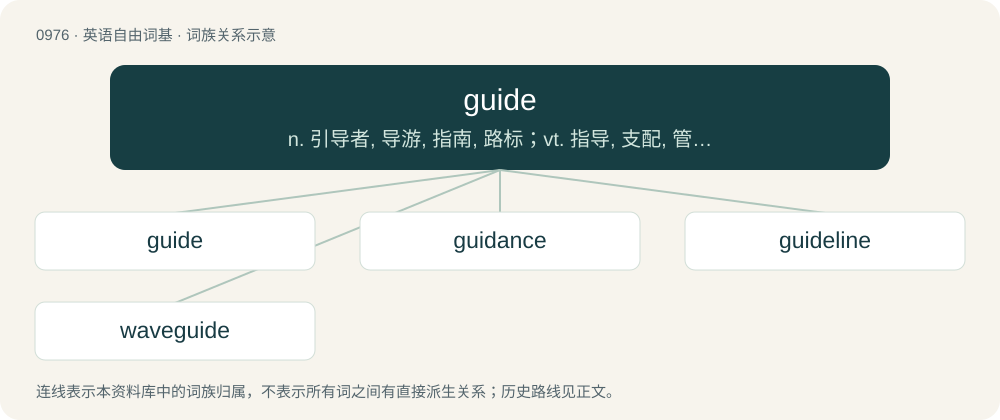

# 1050 · guide — n. 引导者, 导游, 指南, 路标；vt. 指导, 支配, 管理, 带领, 操纵；vi. 任向导

[总目录](../00_总目录_按常用程度.md)

**类型**：英语自由词基　｜　**来源语言**：见词源记录

## 核心含义与来源

- 核心含义：n. 引导者, 导游, 指南, 路标；vt. 指导, 支配, 管理, 带领, 操纵；vi. 任向导
- 英文含义：To serve as a guide for someone or something; to lead or direct in a way; to conduct in a course or path.
- 词形：guide

**来源记录 1**（动词；To serve as a guide for someone or something; to lead or direct in a way; to conduct in a course or path.）

From Middle English guiden, from Old French guider, from Old Occitan guidar, from Frankish \*wītan (“to show the way, lead”), from Proto-Germanic \*wītaną (“to see, know; go, depart”), from Proto-Indo-European \*weyd- (“to see, know”).

## 词族图

## 单词速览（常用到不常用）

| 单词 | 音标 | 释义 |
|---|---|---|
| [guide](#w-1) | /ɡaɪd/ | n. 引导者, 导游, 指南, 路标；vt. 指导, 支配, 管理, 带领, 操纵；vi. 任向导 |
| [guidance](#w-2) | /ˈɡaɪdəns/ | n. 指导, 领导；\[医\] 导 |
| [guideline](#w-3) | 美 /ˈɡaɪdˌlaɪn/ | n. 指导路线, 方针, 指标；\[经\] 指导路线, 方针, 准则 |
| [waveguide](#w-4) | /ˈweiv^aid/ | \[计\] 波导, 波导管；\[化\] 波导 |

## 逐词详解

### 1. guide

**词性**：动词　｜　**音标**：/ɡaɪd/

**中文释义**：n. 引导者, 导游, 指南, 路标；vt. 指导, 支配, 管理, 带领, 操纵；vi. 任向导

**英文义项**：To serve as a guide for someone or something; to lead or direct in a way; to conduct in a course or path. / To steer or navigate, especially a ship or as a pilot.

**词源与演化**：

From Middle English guiden, from Old French guider, from Old Occitan guidar, from Frankish \*wītan (“to show the way, lead”), from Proto-Germanic \*wītaną (“to see, know; go, depart”), from Proto-Indo-European \*weyd- (“to see, know”).

**例句**：

> They had the lights to guide on.

该用例对应义项：use as a guide

### 2. guidance

**词性**：名词　｜　**音标**：/ˈɡaɪdəns/

**中文释义**：n. 指导, 领导；\[医\] 导

**英文义项**：The act or process of guiding. / Advice or counselling on some topic.

**构词拆分**：guide + -ance

**词源与演化**：

From guide + -ance. Displaced native Old English lādtēowdōm.

**用法示例／搭配（非完整句）**：

> divine guidance

该用例对应义项：Advice or counselling on some topic.

### 3. guideline

**词性**：名词　｜　**音标**：美 /ˈɡaɪdˌlaɪn/

**中文释义**：n. 指导路线, 方针, 指标；\[经\] 指导路线, 方针, 准则

**英文义项**：A non-specific rule or principle that provides direction to action or behaviour. / A plan or explanation to guide one in setting standards or determining a course of action.

**构词拆分**：guide + line

**词源与演化**：

From guide + line.

**例句**：

> He considered the Ten Commandments more as a guideline than a requirement.

该用例对应义项：A non-specific rule or principle that provides direction to action or behaviour.

### 4. waveguide

**词性**：名词　｜　**音标**：/ˈweiv^aid/

**中文释义**：\[计\] 波导, 波导管；\[化\] 波导

**英文义项**：A structure which guides waves, such as electromagnetic waves, light, or sound waves.

**构词拆分**：wave + guide

**词源与演化**：

From wave + guide.
