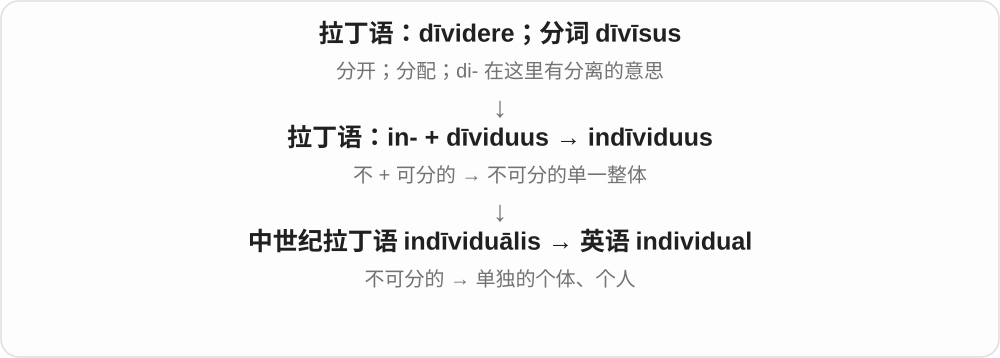
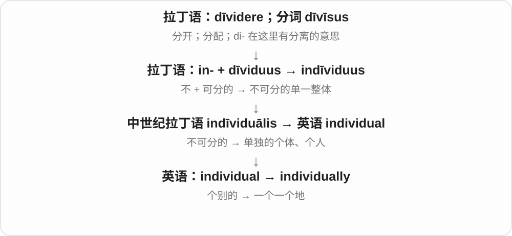
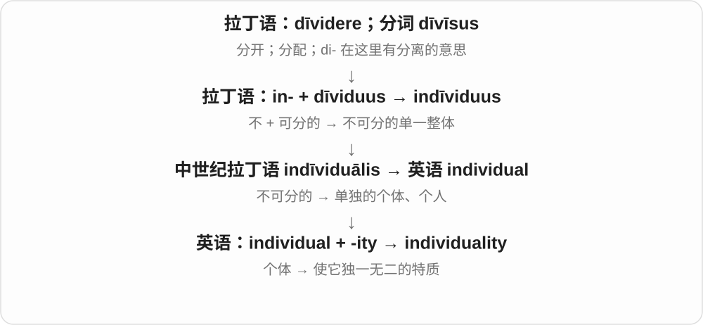
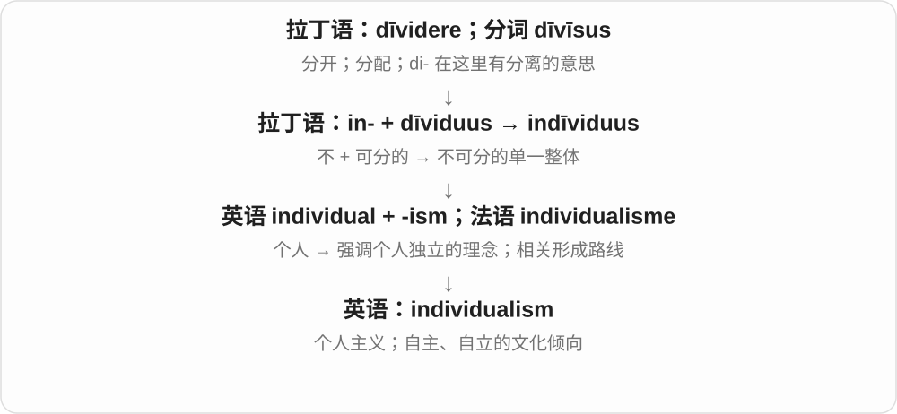
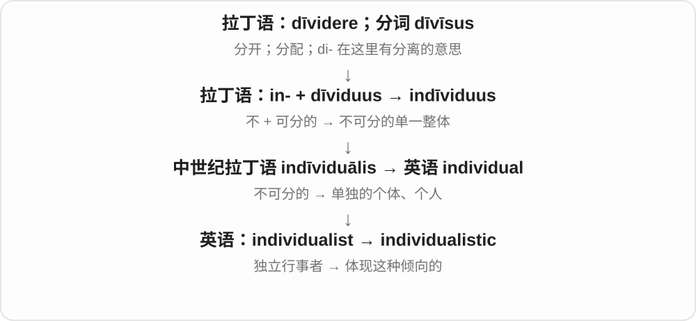

# 1051 · individual — 个人；单独个体

[逐词精讲目录](../00_逐词精讲目录.md) · [总目录](../00_总目录_按常用程度.md)

## 核心词根与来源

individual 的历史来源联系不可分的一体，后成为单独个体的名称。individually 分别地，individuality 个性，individualism 个人主义，individualist 指相应立场的人。

**INDIVIDUAL：把整体中的一个单独拿出来看**

人群里每个人有自己的身份与特点。

- **个体与分别处理**：individual · individually
- **个性与思想立场**：individuality · individualism · individualist · individualistic

## 词形与演化规律

individual + -ity、-ism、-ist 形成不同名词；individualistic 是相关形容词。历史 in- 的不可分义不表示现代 individual 不能被单独分析。

## 单词速览（按词族由简到繁）

同一基础词的相关扩展放在一起，先读基础形式，再读扩展；各组之间优先读常用的。具体词源关系见各词讲解。

| 单词 | 音标 | 核心意思 |
|---|---|---|
| [individual](#w-1) | /ˌɪndɪˈvɪdʒuəl/ | 个人；个体；单独的；各自的 |
| [individually](#w-2) | /ˌɪndɪˈvɪdʒuəli/ | 分别地；单独地；逐个地 |
| [individuality](#w-3) | /ˌɪndɪvɪdʒuˈæləti/ | 个性；独特性 |
| [individualism](#w-4) | /ˌɪndɪˈvɪdʒuəlɪzəm/ | 个人主义；强调个人自主的倾向 |
| [individualist](#w-6) | /ˌɪndɪˈvɪdʒuəlɪst/ | 独立行事的人；个人主义者 |
| [individualistic](#w-5) | /ˌɪndɪvɪdʒuəˈlɪstɪk/ | 强调个人独立的；富有个人风格的 |

## 逐词讲解

### 1. individual — 个人；个体；单独的；各自的

**音标**：/ˌɪndɪˈvɪdʒuəl/

**先抓住这个画面**

从一群人中看出完整的“这一个人”。这里的完整，是把他当一个独立单位，而不是当人群里模糊的一小块。

**怎么拆**

来自中世纪拉丁 indīviduālis，源于 in- 不 + dīviduus 可分。“不可分的整体”后来发展为“单一、独立的个体”。

**怎么变成今天的意思**

individual needs 是每个人各自的需要；an individual 可以是一个人，也可以是某物种的一个个体。现代 individual 不表示这个东西物理上绝对拆不开。

**常见搭配与例句**

an individual choice；individual differences；each individual。

> The teacher gave each student individual feedback.

老师分别给每位学生提供了反馈。

> Every individual in the group had a different reason for joining.

组里的每个人加入的原因都不同。

**别混淆**

individual 关注一个个体；personal 关注与某人私下有关。individual seats 是独立座位，不是私人秘密座位。

### 2. individually — 分别地；单独地；逐个地

**音标**：/ˌɪndɪˈvɪdʒuəli/

**先抓住这个画面**

把镜头从全班拉到一个人，再移到下一个人。事情是逐个处理，而不是整组一起处理。

**怎么拆**

individual + -ly。

**怎么变成今天的意思**

individually wrapped 是每个都单独包装；assess individually 是逐个评估。它不一定强调一个人孤单。

**常见搭配与例句**

packed individually；interview individually；individually designed。

> The chocolates are individually wrapped.

这些巧克力每颗都单独包装。

> We spoke to the students individually.

我们分别与学生们谈了话。

**别混淆**

alone 强调没有别人相伴；individually 强调分别处理每一个。

### 3. individuality — 个性；独特性

**音标**：/ˌɪndɪvɪdʒuˈæləti/

**先抓住这个画面**

同样穿校服，仍能看出每个人不同的说话方式、爱好和想法。这些让“你就是你”的特点，是 individuality。

**怎么拆**

individual + -ity，变成表示个体特质的名词；词尾处重读。

**怎么变成今天的意思**

常与 express、preserve、respect 搭配。它既可说人，也可说建筑、作品等各自的风格。

**常见搭配与例句**

express individuality；a sense of individuality；lose individuality。

> The school encourages students to express their individuality.

学校鼓励学生表现自己的个性。

> Small details give each room its individuality.

小细节让每个房间都有自己的特点。

**别混淆**

individuality 是独特性；individualism 是重视个人自主的理念或倾向。

### 4. individualism — 个人主义；强调个人自主的倾向

**音标**：/ˌɪndɪˈvɪdʒuəlɪzəm/

**先抓住这个画面**

作决定时，把“个人有自己的判断和选择”放在前面，而不是默认所有人都按群体安排走。

**怎么拆**

individual + -ism；有英语派生与法语 individualisme 借入的不同词源分析。都建立在“个人”这个词族上。

**怎么变成今天的意思**

这个词可以是中性的制度或文化描述，也可能在特定批评中带负面意味；它本身并不等于 selfishness“自私”。

**常见搭配与例句**

personal freedom and individualism；a culture of individualism。

> The book explores the tension between individualism and community life.

这本书探讨个人主义与共同体生活之间的张力。

> Her individualism did not stop her from helping her neighbours.

她重视个人独立，同时也愿意帮助邻居。

**别混淆**

individuality 是一个人的独特性；individualism 是重视个人自主的一种立场。

### 5. individualist — 独立行事的人；个人主义者

**音标**：/ˌɪndɪˈvɪdʒuəlɪst/

**先抓住这个画面**

别人都走同一条路，他会先想“这条路适不适合我”。individualist 强调自己判断、按自己的方式做事。

**怎么拆**

individual + -ist，-ist 表示具有某种立场或特点的人。

**怎么变成今天的意思**

可以赞一个人有独立精神，也可能说他不容易随大流；褒贬取决于上下文。

**常见搭配与例句**

a strong individualist；a committed individualist。

> As an individualist, she preferred to develop her own style.

她很有独立精神，更愿意发展自己的风格。

> The team included several individualists with unusual ideas.

团队里有几位主意独特、喜欢独立思考的人。

**别混淆**

individual 是任何一个人；individualist 则特意说这个人倾向于独立思考或支持个人主义。

### 6. individualistic — 强调个人独立的；富有个人风格的

**音标**：/ˌɪndɪvɪdʒuəˈlɪstɪk/

**先抓住这个画面**

一幅画、一种生活方式或一套观念，都很明显地把个人选择放在中心，可以说 individualistic。

**怎么拆**

individualist + -ic；也可按 individual + -istic 分析，表示这种倾向的形容词。

**怎么变成今天的意思**

它比 individual 多了一层倾向评价。individual work 是个人作业；an individualistic style 是很有个人风格的样式。

**常见搭配与例句**

an individualistic approach；an individualistic culture；individualistic art。

> His individualistic approach produced an unusual design.

他独立而有个人风格的做法带来了一个不同寻常的设计。

> The essay discusses individualistic values in the novel.

这篇文章讨论了小说中强调个人自主的价值观。

**别混淆**

individual 只说个别、单独；individualistic 说强调独立或有强烈个人特点。

## 这一组要分清什么

individuality 是独特个性，individualism 是思想或行为倾向；有个性不自动等于持个人主义立场。

## 串起来练习

The teacher spoke to each individual separately and respected their individuality.

老师分别与每个人交谈，并尊重他们的个性。
