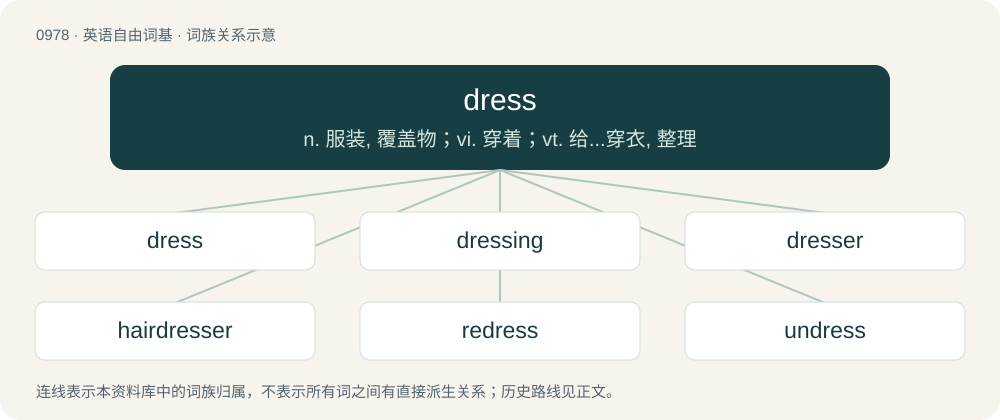

# 1053 · dress — n. 服装, 覆盖物；vi. 穿着；vt. 给...穿衣, 整理

[总目录](../00_总目录_按常用程度.md)

**类型**：英语自由词基　｜　**来源语言**：见词源记录

## 核心含义与来源

- 核心含义：n. 服装, 覆盖物；vi. 穿着；vt. 给...穿衣, 整理
- 英文含义：To put clothes (or, formerly, armour) on (oneself or someone, a doll, a mannequin, etc.); to clothe.
- 词形：dress

## 词族图

## 单词速览（常用到不常用）

| 单词 | 音标 | 释义 |
|---|---|---|
| [dress](#w-1) | 英 /dɹes/；美 /dɹɛs/ | n. 服装, 覆盖物；vi. 穿着；vt. 给...穿衣, 整理 |
| [dressing](#w-2) | /ˈdɹɛsɪŋ/ | n. 调味品, 穿衣, 化妆；\[化\] 追肥 |
| [dresser](#w-3) | 英 /ˈdɹɛsə/ | 【英文】One who dresses in a particular way. |
| [hairdresser](#w-4) | /ˈhєədresə/ | n. 美发师, 理发师 |
| [redress](#w-5) | 英 /ˌɹiːˈdɹɛs/；美 /ɹiˈdɹɛs/ | 【英文】To dress again. |
| [undress](#w-6) | /ʌnˈdɹɛs/ | vt. 使脱衣服, 暴露, 使卸去装饰；vi. 脱衣服 |
| [headdress](#w-7) | 美 /ˈhɛdˌdɹɛs/ | a. 饰头巾, 头式 |
| [dressmaker](#w-8) | 美 /ˈdɹɛsˌmeɪkɚ/ | n. 裁缝 |
| [dressy](#w-9) | /ˈdɹɛsi/ | a. 衣着考究的 |
| [sundress](#w-10) | 美 /ˈsʌnˌdɹɛs/ | n. 太阳裙,背心裙 |
| [dressmaking](#w-11) | /ˈdresmeikiŋ/ | n. 服装缝制 |

## 逐词详解

### 1. dress

**词性**：动词　｜　**音标**：英 /dɹes/；美 /dɹɛs/

**中文释义**：n. 服装, 覆盖物；vi. 穿着；vt. 给...穿衣, 整理

**英文义项**：To put clothes (or, formerly, armour) on (oneself or someone, a doll, a mannequin, etc.); to clothe. / To attire (oneself or someone) for a particular (especially formal) occasion, or in a fashionable manner.

**例句**：

> Due to a left ankle sprain, the basketball player did not dress for the game against Indiana.

该用例对应义项：Of a sportsperson: to put on the uniform and have the equipment needed to play a sport.

### 2. dressing

**词性**：名词　｜　**音标**：/ˈdɹɛsɪŋ/

**中文释义**：n. 调味品, 穿衣, 化妆；\[化\] 追肥

**英文义项**：Material applied to a wound for protection or therapy. / A sauce, especially a cold one for salads.

**构词拆分**：dress + -ing

**词源与演化**：

From Middle English dressing, dressinge, dressynge, equivalent to dress + -ing.

**例句**：

> After you've mixed everything well, add salad dressing and a little pepper!

### 3. dresser

**词性**：名词　｜　**音标**：英 /ˈdɹɛsə/

**英文义项**：One who dresses in a particular way. / A wardrobe assistant (who helps actors put on their costume).

**构词拆分**：dress + -er

**词源与演化**：

From Middle English dresser, equivalent to dress + -er.

**例句**：

> He's a very snappy dresser.

该用例对应义项：One who dresses in a particular way.

### 4. hairdresser

**词性**：名词　｜　**音标**：/ˈhєədresə/

**中文释义**：n. 美发师, 理发师

**英文义项**：A person who cuts or styles hair as an occupation or profession.

**构词拆分**：hair + dress + -er

**词源与演化**：

From hair + dress + -er.

**例句**：

> I used to want to be a hairdresser, or a fashion designer.

### 5. redress

**词性**：动词　｜　**音标**：英 /ˌɹiːˈdɹɛs/；美 /ɹiˈdɹɛs/

**英文义项**：To dress again. / To redecorate a previously existing film set so that it can double for another set.

**构词拆分**：re- + dress

**词源与演化**：

From re- + dress.

### 6. undress

**词性**：动词　｜　**音标**：/ʌnˈdɹɛs/

**中文释义**：vt. 使脱衣服, 暴露, 使卸去装饰；vi. 脱衣服

**英文义项**：To remove one’s clothing. / To remove the clothing of (someone).

**构词拆分**：un- + dress

**词源与演化**：

From Middle English undressen, equivalent to un- + dress. Compare Old English unsċrȳdan (“to undress”, literally “un-shroud”).

**例句**：

> The young men slowly and sensually undressed each other before making passionate love.

该用例对应义项：To remove the clothing of (someone).

### 7. headdress

**词性**：名词　｜　**音标**：美 /ˈhɛdˌdɹɛs/

**中文释义**：a. 饰头巾, 头式

**英文义项**：A decorative covering or ornament worn on the head. / A hairdo.

**构词拆分**：head + dress

**词源与演化**：

From head + dress.

**例句**：

> The week before emancipation day the women love to wear a headdress.

### 8. dressmaker

**词性**：名词　｜　**音标**：美 /ˈdɹɛsˌmeɪkɚ/

**中文释义**：n. 裁缝

**英文义项**：A person who makes tailor-made women's clothes.

**构词拆分**：dress + maker

**词源与演化**：

From dress + maker.

**例句**：

> The dressmaker forgot to sew a pocket on my jeans.

### 9. dressy

**词性**：形容词　｜　**音标**：/ˈdɹɛsi/

**中文释义**：a. 衣着考究的

**英文义项**：Elegant, smart, or stylish. / Fond of dressing up; keen on fashion.

**构词拆分**：dress + -y

**词源与演化**：

From dress + -y.

**例句**：

> If you need something for a dressy party, don't waste your time looking in a department store.

### 10. sundress

**词性**：名词　｜　**音标**：美 /ˈsʌnˌdɹɛs/

**中文释义**：n. 太阳裙,背心裙

**英文义项**：A typically sleeveless dress, usually a minidress, made of light, loose-fitting material for spring and summer wear.

**构词拆分**：sun + dress

**词源与演化**：

From sun + dress.

### 11. dressmaking

**词性**：名词　｜　**音标**：/ˈdresmeikiŋ/

**中文释义**：n. 服装缝制

**英文义项**：The craft of making custom clothing for women, such as dresses, blouses, and evening gowns.

**构词拆分**：dress + making

**词源与演化**：

From dress + making.
