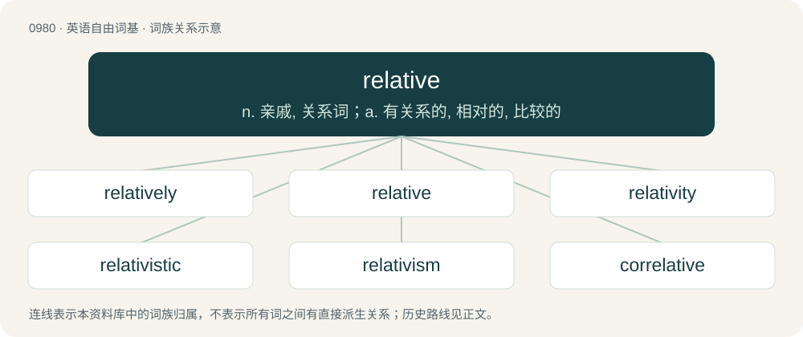

# 1054 · relative — n. 亲戚, 关系词；a. 有关系的, 相对的, 比较的

[总目录](../00_总目录_按常用程度.md)

**类型**：英语自由词基　｜　**来源语言**：见词源记录

## 核心含义与来源

- 核心含义：n. 亲戚, 关系词；a. 有关系的, 相对的, 比较的
- 英文含义：Connected to or depending on something else; comparative.
- 词形：relative

**来源记录 1**（形容词；Connected to or depending on something else; comparative.）

From Middle French relatif, from Late Latin relātīvus, from Latin relātus, perfect passive participle of referō (“to carry back, to ascribe”), from re- (“again”) + ferō (“to bear or carry”). By surface analysis, relate + -ive.

## 词族图

## 单词速览（常用到不常用）

| 单词 | 音标 | 释义 |
|---|---|---|
| [relatively](#w-1) | /ˈɹɛl.ə.tɪv.li/ | adv. 相对地, 比较地, 相当地, 相关地；\[计\] 相对地 |
| [relative](#w-2) | /ˈɹɛl.ə.tɪv/ | n. 亲戚, 关系词；a. 有关系的, 相对的, 比较的 |
| [relativity](#w-3) | /ɹɛl.əˈtɪv.ɪ.ti/ | n. 有关系, 相关性, 相对性；\[化\] 相对性 |
| [relativistic](#w-4) | 英 /ˈɹɛl.ə.təˌvɪst.ɪk/ | a. 相对论的；\[化\] 相对论性(的) |
| [relativism](#w-5) | /ˈrelətivizm/ | n. 相对论, 相对主义 |
| [correlative](#w-6) | /kəˈrelətiv/ | a. 有相互关系的, 相关的；n. 相关物, 相关语, 关联词 |

## 逐词详解

### 1. relatively

**词性**：副词　｜　**音标**：/ˈɹɛl.ə.tɪv.li/

**中文释义**：adv. 相对地, 比较地, 相当地, 相关地；\[计\] 相对地

**英文义项**：In a relative manner; with reference to environment or competition; contextually or comparatively. / Somewhat; fairly.

**构词拆分**：relative + -ly

**词源与演化**：

From relative + -ly.

**例句**：

> The situation is relatively calm now.

该用例对应义项：in a relative manner; by comparison to something else

### 2. relative

**词性**：形容词　｜　**音标**：/ˈɹɛl.ə.tɪv/

**中文释义**：n. 亲戚, 关系词；a. 有关系的, 相对的, 比较的

**英文义项**：Connected to or depending on something else; comparative. / Expressed in relation to another item, rather than in complete form.

**词源与演化**：

From Middle French relatif, from Late Latin relātīvus, from Latin relātus, perfect passive participle of referō (“to carry back, to ascribe”), from re- (“again”) + ferō (“to bear or carry”). By surface analysis, relate + -ive.

**例句**：

> We've been discussing the relative merits of various methods of transportation.

该用例对应义项：Connected to or depending on something else; comparative.

### 3. relativity

**词性**：名词　｜　**音标**：/ɹɛl.əˈtɪv.ɪ.ti/

**中文释义**：n. 有关系, 相关性, 相对性；\[化\] 相对性

**英文义项**：The state of being relative to something else; the absence of universally applicable rules or standards; relativism; (countable) an instance of this. / Also Einsteinian relativity: the reliance of the nature of physical phenomena (such as gravity, light, mass, and time) on the relative motion between an observer and the thing observed, as developed by Albert Einstein in two theories, special relativity and general relativity.

**构词拆分**：relative (“connected to or depending on something else”) + -ity (suffix forming nouns from adjectives where the nouns refer to the properties, qualities, or states described by the adjectives)；relative + -ity

**词源与演化**：

From relative (“connected to or depending on something else”) + -ity (suffix forming nouns from adjectives where the nouns refer to the properties, qualities, or states described by the adjectives). Sense 2.1 (“reliance of the nature of physical phenomena on the relative motion between an observer and the thing observed”) is a translation of German Relativität (“relativity”) used in the works of the German-American theoretical physicist Albert Einstein (1879–1955). Morphologically relative + -ity.

**例句**：

> The results are perfectly in line with the theory of general relativity.

### 4. relativistic

**词性**：形容词　｜　**音标**：英 /ˈɹɛl.ə.təˌvɪst.ɪk/

**中文释义**：a. 相对论的；\[化\] 相对论性(的)

**英文义项**：Of or relating to relativity. / At or near the speed of light.

**构词拆分**：relativist + -ic；relative + -istic

**词源与演化**：

From relativist + -ic or relative + -istic.

**例句**：

> Relativistic increase in mass.

该用例对应义项：relating or subject to the special or the general theory of relativity

### 5. relativism

**词性**：名词　｜　**音标**：/ˈrelətivizm/

**中文释义**：n. 相对论, 相对主义

**英文义项**：The theory, especially in ethics or aesthetics, that conceptions of truth and moral values are not absolute but are relative to the persons or groups holding them. / A specific such theory, advocated by a particular philosopher or school of thought.

**构词拆分**：relative + -ism

**词源与演化**：

From relative + -ism.

**例句**：

> It's important to take cultural relativism into account before judging another culture.

### 6. correlative

**词性**：形容词　｜　**音标**：/kəˈrelətiv/

**中文释义**：a. 有相互关系的, 相关的；n. 相关物, 相关语, 关联词

**英文义项**：Mutually related; corresponding.

**构词拆分**：correlate + -ive；cor- + relative

**词源与演化**：

From correlate + -ive or cor- + relative.

**例句**：

> How are rights and duties correlative?
