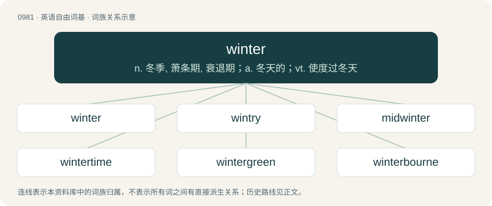

# 1055 · winter — n. 冬季, 萧条期, 衰退期；a. 冬天的；vt. 使度过冬天

[总目录](../00_总目录_按常用程度.md)

**类型**：英语自由词基　｜　**来源语言**：见词源记录

## 核心含义与来源

- 核心含义：n. 冬季, 萧条期, 衰退期；a. 冬天的；vt. 使度过冬天
- 英文含义：Traditionally the fourth of the four seasons, typically regarded as spanning either the period between the winter solstice to the spring equinox, or the months of December, January, and February in temperate and polar regions of the Northern Hemisphere and the months of June, July, and August in the Southern Hemisphere. It is the time when the sun is lowest in the sky, resulting in short days, and the time of year with the lowest atmospheric temperatures for the region.
- 词形：winter

**来源记录 1**（名词；Traditionally the fourth of the four seasons, typically regarded as spanning either the period between the winter solstice to the spring equinox, or the months of December, January, and February in temperate and polar regions of the Northern Hemisphere and the months of June, July, and August in the Southern Hemisphere. It is the time when the sun is lowest in the sky, resulting in short days, and the time of year with the lowest atmospheric temperatures for the region.）

From Middle English winter, from Old English winter, from Proto-West Germanic \*wintru, from Proto-Germanic \*wintruz (“winter”). Cognate with West Frisian winter (“winter”), Dutch winter (“winter”), German Winter (“winter”), Danish, Norwegian Bokmål, Norwegian Nynorsk, and Swedish vinter (“winter”), Faroese and Icelandic vetur (“winter”).

## 词族图

## 单词速览（常用到不常用）

| 单词 | 音标 | 释义 |
|---|---|---|
| [winter](#w-1) | 英 /ˈwɪntə/；/ˈwɪntɚ/ | n. 冬季, 萧条期, 衰退期；a. 冬天的；vt. 使度过冬天 |
| [wintry](#w-2) | 英 /ˈwɪnt(ə)ɹɪ/；美 /ˈwɪnt(ə)ɹi/ | a. 如冬的, 寒冷的, 冬的, 冷淡的 |
| [midwinter](#w-3) | /ˌmɪdˈwɪntə(ɹ)/ | n. 仲冬, 冬至 |
| [wintertime](#w-4) | /ˈwintətaim/ | n. 冬季, 冬天 |
| [wintergreen](#w-5) | /ˈwɪntə(ɹ)ˌɡɹiːn/ | \[医\] 冬绿\[树\] |
| [winterbourne](#w-6) | 英 /ˈwɪntəbɔːn/；美 /ˈwɪntɚˌboɹn/ | n. 间歇河(指冬季多雨时节才有水流而夏季干涸的河) |

## 逐词详解

### 1. winter

**词性**：名词　｜　**音标**：英 /ˈwɪntə/；/ˈwɪntɚ/

**中文释义**：n. 冬季, 萧条期, 衰退期；a. 冬天的；vt. 使度过冬天

**英文义项**：Traditionally the fourth of the four seasons, typically regarded as spanning either the period between the winter solstice to the spring equinox, or the months of December, January, and February in temperate and polar regions of the Northern Hemisphere and the months of June, July, and August in the Southern Hemisphere. It is the time when the sun is lowest in the sky, resulting in short days, and the time of year with the lowest atmospheric temperatures for the region. / The period of decay, old age, death, or the like.

**词源与演化**：

From Middle English winter, from Old English winter, from Proto-West Germanic \*wintru, from Proto-Germanic \*wintruz (“winter”). Cognate with West Frisian winter (“winter”), Dutch winter (“winter”), German Winter (“winter”), Danish, Norwegian Bokmål, Norwegian Nynorsk, and Swedish vinter (“winter”), Faroese and Icelandic vetur (“winter”).

**例句**：

> There has been a lot of sickness in my family this winter.

### 2. wintry

**词性**：形容词　｜　**音标**：英 /ˈwɪnt(ə)ɹɪ/；美 /ˈwɪnt(ə)ɹi/

**中文释义**：a. 如冬的, 寒冷的, 冬的, 冷淡的

**英文义项**：Suggestive or characteristic of winter; cold, stormy. / Containing sleet or snow.

**构词拆分**：winter + -y

**词源与演化**：

From winter + -y; compare Old English wintriġ (a parallel formation).

**例句**：

> It will be cloudy overnight, with outbreaks of heavy rain at times. The rain may turn wintry over higher ground.

该用例对应义项：Containing sleet or snow.

### 3. midwinter

**词性**：名词　｜　**音标**：/ˌmɪdˈwɪntə(ɹ)/

**中文释义**：n. 仲冬, 冬至

**英文义项**：The middle of winter. / The winter solstice; about December 21st or 22nd.

**构词拆分**：mid- + winter

**词源与演化**：

From Middle English midwinter, mydwinter, mydwynter, from Old English midwinter, from Proto-West Germanic \*midiwintru, from Proto-Germanic \*midjawintruz (“midwinter”), equivalent to mid- + winter. Cognate with West Frisian midwinter (“midwinter”), Dutch midwinter (“midwinter”), German Mittwinter (“midwinter”), Danish midvinter (“midwinter”), Swedish midvinter (“midwinter”).

**例句**：

> In the deep midwinter, frosty wind made moan.

### 4. wintertime

**词性**：名词　｜　**音标**：/ˈwintətaim/

**中文释义**：n. 冬季, 冬天

**英文义项**：The season of winter, between autumn and spring.

**构词拆分**：winter + time

**词源与演化**：

From winter + time.

**例句**：

> Recurrent wintertime outbreaks of SARS-CoV-2 could occur after the initial pandemic wave.

### 5. wintergreen

**词性**：名词　｜　**音标**：/ˈwɪntə(ɹ)ˌɡɹiːn/

**中文释义**：\[医\] 冬绿\[树\]

**英文义项**：Gaultheria procumbens, native to North America, having solitary white flowers and aromatic leaves (checkerberry or teaberry) / Gaultheria humifusa – alpine wintergreen

**构词拆分**：winter + green

**词源与演化**：

From winter + green.

**例句**：

> He used flavorings from trees and plants like sassafras and sarsaparilla, wintergreen, birch bark, herbs and juniper berries.

### 6. winterbourne

**词性**：名词　｜　**音标**：英 /ˈwɪntəbɔːn/；美 /ˈwɪntɚˌboɹn/

**中文释义**：n. 间歇河(指冬季多雨时节才有水流而夏季干涸的河)

**英文义项**：A stream that only flows in winter or after wet weather, particularly in an area rich in limestone.

**构词拆分**：winter + bourne (“seasonal brook or stream”)

**词源与演化**：

From winter + bourne (“seasonal brook or stream”), partly also from the placenames Winterborne, Winterbourne, which are derived from Old English winterburna (“stream that is full in winter”), from winter (from Proto-Germanic \*wintruz, further etymology uncertain) + burna (“stream”) (ultimately from Proto-Indo-European \*bʰrewh₁- (“to boil; to brew”)). The Old English word appears to have survived only in placenames.
