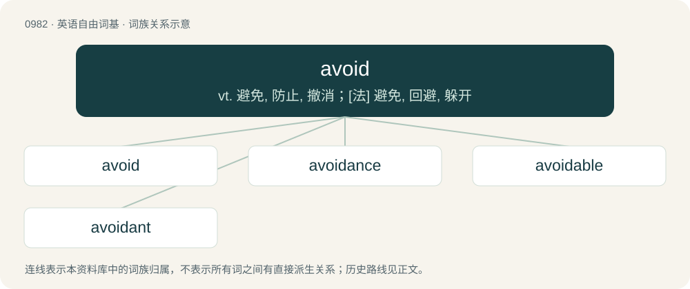

# 1057 · avoid — vt. 避免, 防止, 撤消；\[法\] 避免, 回避, 躲开

[总目录](../00_总目录_按常用程度.md)

**类型**：英语自由词基　｜　**来源语言**：见词源记录

## 核心含义与来源

- 核心含义：vt. 避免, 防止, 撤消；\[法\] 避免, 回避, 躲开
- 英文含义：To try not to meet or communicate with (a person); to shun.
- 词形：avoid

**来源记录 1**（动词；To try not to meet or communicate with (a person); to shun.）

From Middle English avoiden, from Anglo-Norman avoider, Old French esvuidier (“to empty out”), from es- + vuidier, from Vulgar Latin \*vocitāre &lt; Vulgar Latin \*vocitum, ultimately related to Latin vacuus. Displaced native Old English forbūgan (literally “to bend away from”).

## 词族图

## 单词速览（常用到不常用）

| 单词 | 音标 | 释义 |
|---|---|---|
| [avoid](#w-1) | /əˈvɔɪd/ | vt. 避免, 防止, 撤消；\[法\] 避免, 回避, 躲开 |
| [avoidance](#w-2) | /əˈvɔɪdəns/ | n. 避免, 避开, 逃避；\[经\] 回避, 废止, 宣告无效 |
| [avoidable](#w-3) | /əˈvɔɪdəbl̩/ | a. 可避免的；\[法\] 可作为无效的, 可回避的, 可避免的 |
| [avoidant](#w-4) | /əˈvɔɪdənt/ | a. \[心\]回避反应的 |

## 逐词详解

### 1. avoid

**词性**：动词　｜　**音标**：/əˈvɔɪd/

**中文释义**：vt. 避免, 防止, 撤消；\[法\] 避免, 回避, 躲开

**英文义项**：To try not to meet or communicate with (a person); to shun. / To stay out of the way of (something harmful).

**词源与演化**：

From Middle English avoiden, from Anglo-Norman avoider, Old French esvuidier (“to empty out”), from es- + vuidier, from Vulgar Latin \*vocitāre &lt; Vulgar Latin \*vocitum, ultimately related to Latin vacuus. Displaced native Old English forbūgan (literally “to bend away from”).

**例句**：

> One town was flooded from the storm, while the other town avoided the storm.

该用例对应义项：To stay out of the way of (something harmful).

### 2. avoidance

**词性**：名词　｜　**音标**：/əˈvɔɪdəns/

**中文释义**：n. 避免, 避开, 逃避；\[经\] 回避, 废止, 宣告无效

**英文义项**：The act of avoiding or shunning; keeping clear of.

**构词拆分**：avoid + -ance

**词源与演化**：

From Middle English avoidaunce, from avoid + -ance.

**例句**：

> Will the media really continue to gloss over corporate tax avoidance?

### 3. avoidable

**词性**：形容词　｜　**音标**：/əˈvɔɪdəbl̩/

**中文释义**：a. 可避免的；\[法\] 可作为无效的, 可回避的, 可避免的

**英文义项**：Capable of being vacated; liable to be annulled or made invalid; voidable. / Capable of being avoided, shunned, or escaped.

**构词拆分**：avoid + -able

**词源与演化**：

From avoid + -able.

**例句**：

> The minister confessed that many of the deaths were avoidable.

该用例对应义项：Capable of being avoided, shunned, or escaped.

### 4. avoidant

**词性**：形容词　｜　**音标**：/əˈvɔɪdənt/

**中文释义**：a. \[心\]回避反应的

**英文义项**：Exhibiting avoidance; avoiding something.

**构词拆分**：avoid + -ant

**词源与演化**：

From avoid + -ant.

**例句**：

> His avoidant tendencies led him to isolate himself.
