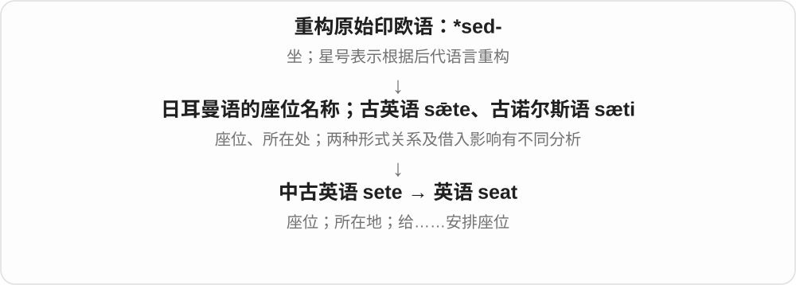

# 1057 · seat — 可坐位置、席位和地位；容量与移除

[逐词精讲目录](../00_逐词精讲目录.md) · [总目录](../00_总目录_按常用程度.md)

## 核心词根与来源

seat 近源与 sit 旧同族但不是现代随意变元音。seater 容量组合按搭配认识；un- 在 unseat 里形成移除动作。

**SEAT：有地方坐，也借座位表示位置、职位**

seat → seater；backseat 原有；unseat → unseated 保持相邻，由动作到结果。

- **座位、容量和后座**：seat · seater · backseat
- **失位动作及结果**：unseat · unseated
- **sit／seat → seats：坐的位置与安排入座**：seat · seats
- **seat → seated：座位到安排坐下**：seat · seated

## 词形与演化规律

seat + -er；back + seat；un- + seat → unseat；unseat + -ed。

北欧、较早英语座位词族相互联系，现代 seat 也有给人安排座位的动词。

古英语、北欧座位材料的关系有不同分析；现代动词 ed 读 id。

## 单词速览（按词族由简到繁）

同一基础词的相关扩展放在一起，先读基础形式，再读扩展；各组之间优先读常用的。具体词源关系见各词讲解。

| 单词 | 音标 | 核心意思 |
|---|---|---|
| [seat](#w-1) | /siːt/ | 座位；席位；所在地；给……安排座位 |
| [seats](#w-6) | /siːts/ | 座位；席位；给……安排座位、可容纳〔第三人称单数〕 |
| [seated](#w-7) | /ˈsiːtɪd/ | 坐着的、就座的；安排坐下了〔过去式、过去分词〕 |
| [seater](#w-3) | 英 /ˈsiːtə/；美 /ˈsiːtər/ | 有若干座的交通工具、座椅等〔通常带数量〕；安排座位者 |
| [backseat](#w-2) | /ˈbæksiːt/ | 后座；次要地位；后座的 |
| [unseat](#w-4) | /ʌnˈsiːt/ | 使离座、掀下座位；使失去席位、职位 |
| [unseated](#w-5) | /ʌnˈsiːtɪd/ | 被掀离座位的；被挤下职位、冠军位置的 |

## 逐词讲解

### 1. seat — 座位；席位；所在地；给……安排座位

**音标**：/siːt/

**先抓住这个画面**

seat 从可以坐下的位置开始：会议里的一把椅子能代表一个席位，一座城市也能成为权力落脚的中心。

**怎么拆**

经中古英语 sete，联系古英语 sǣte 与古诺尔斯语 sæti；具体借入、同源影响有不同分析。远源与 sit、sedēre 同属 *sed-。

**怎么变成今天的意思**

take a seat 是请坐；win a seat 是赢得议会等席位；seat six people 是能坐六人。the seat of government 是政府所在地。

**常见搭配与例句**

take a seat；a window seat；win a seat；be seated。

> The table can seat six people comfortably.

这张桌子能让六个人舒适地围坐。

> She won a seat on the local council.

她赢得了地方议会的一个席位。

> The city became the seat of government.

这座城市成为政府所在地。

**别混淆**

chair 常是可移动的椅子；seat 更广，长凳上的位置、车座和议会席位都可以是 seat。

### 2. seats — 座位；席位；给……安排座位、可容纳〔第三人称单数〕

**音标**：/siːts/

**先抓住这个画面**

能坐下的位置是 seats；组织、议会中的一个正式名额也像席位。动词 seats 则说安排别人坐下，或一个场所有多少座位。

**怎么拆**

seat + -s，/t/ 后读 /s/。seat 的较早词形涉及古英语 sǣte、古诺尔斯语 sæti 及中古英语 sete，都是坐的位置词族，借入、同源影响细节有不同分析。

**怎么变成今天的意思**

**较早英语、北欧座位词族 → 中古英语 sete → seat**  
坐的位置、所在处

↓

**seat + -s → seats**  
多个座位、席位；单数主语安排入座、容纳

empty seats 空座位；front seats 前排座位；seats on the committee 委员会席位；seats fifty people 可坐五十人。

**常见搭配与例句**

reserve seats；take your seats。

> We reserved two seats near the front.

我们预订了两个靠前的座位。

> The small hall seats about fifty people.

这间小礼堂能坐大约五十人。

**别混淆**

seat 侧重可坐的位置，chair 侧重椅子这一家具；一排长椅可以有多个 seats。The hall seats fifty 中 seats 是动词，说明容纳人数。

### 3. seated — 坐着的、就座的；安排坐下了〔过去式、过去分词〕

**音标**：/ˈsiːtɪd/

**先抓住这个画面**

人已经在一个位置上坐好，是 seated；工作人员把客人引到座位坐下，也可以说 seated them。

**怎么拆**

seat 经中古英语 sete，接古英语 sæte、古诺尔斯语 sæti 等座位材料，借入和同族影响有不同分析；远源与 sit、拉丁 sedere 相连。现代 seat 动词加完整 -ed，/t/ 后读 /ɪd/。

**怎么变成今天的意思**

**日耳曼座位名称 → 中古英语 sete → seat**  
座位 → 安排某人坐下

↓

**seat + -ed → seated**  
已经安排坐下；人处于就座状态

be seated 坐下、就座；remain seated 保持坐着；seated at the table 坐在桌旁。

**常见搭配与例句**

seated beside someone 坐在某人旁边；seated the guests 给客人安排了座位。

> The guests remained seated until the music ended.

宾客们一直坐着，直到音乐结束。

> The host seated us near the window.

主人安排我们坐在窗边。

**别混淆**

be seated 常描述坐好的状态；sit down 着重从站着到坐下的动作。seat someone 是安排别人坐下，不是普通地说自己坐。

### 4. seater — 有若干座的交通工具、座椅等〔通常带数量〕；安排座位者

**音标**：英 /ˈsiːtə/；美 /ˈsiːtər/

**先抓住这个画面**

a two-seater 把视线放在能坐几个人，不是在数车轮。也有使人坐下的执行者义，但日常更常碰到容量组合。

**怎么拆**

seat + -er，既可接数量、容量形成有关座数的名词，也可表安排就座的人。本条不另收连字符词头，只在搭配中展示。

**怎么变成今天的意思**

**古诺尔斯语 sæti 等 → 中古英语 sete → seat**  
可坐的位置、座位；与 sit 有旧同族关系

↓

**英语 seat**  
座位、席位；使就座；机构所在处

↓

**seat + -er → seater**  
按座数命名的器物、车辆；安排就座者

a two-seater 两座车、双人座椅，a seven-seater 七座车；单独 seater 通常需要上下文给出容量。

**常见搭配与例句**

a two-seater；a seven-seater；a seater for two。

> They chose a seven-seater for family trips.

他们选了一辆七座车用于家庭出游。

> The small sofa is a two-seater.

这张小沙发是双人座的。

**别混淆**

seater 说座位容量时，-er 不是司机；two-seater car 是两座车，不是有两个司机的车。

### 5. backseat — 后座；次要地位；后座的

**音标**：/ˈbæksiːt/

**先抓住这个画面**

车前面的人掌握方向，后面坐着的人通常不主导；于是后座也能比喻次要位置。

**怎么拆**

back（后）+ seat（座位），具体后排座位引出 take a back seat 等比喻。

**怎么变成今天的意思**

**英语 back；seat**  
组合时并列的两个材料

↓

**back + seat → backseat**  
车辆后座；比喻较不主导的位置

sit in the backseat 是坐后座，take a back seat 是退居次位。backseat driver 是爱对别人指手画脚的人，未必真在车里。

**常见搭配与例句**

in the backseat；take a back seat；a backseat driver。

> The children fell asleep in the backseat.

孩子们在后座睡着了。

> She took a back seat and let the new manager lead.

她退居次位，让新经理主导。

**别混淆**

backseat driver 是惯常比喻，不只说后座乘客；backer 则是支持者，未必总在指挥。

### 6. unseat — 使离座、掀下座位；使失去席位、职位

**音标**：/ʌnˈsiːt/

**先抓住这个画面**

骑手从马鞍上掉下来，是字面离座；议员、冠军失去位置，也能借位子被夺走来理解。

**怎么拆**

un- 移除、逆转 + seat 使就座、给予席位。这里 un- 形成动作，不是简单形容一个东西不是座位。

**怎么变成今天的意思**

**古诺尔斯语 sæti 等 → 中古英语 sete → seat**  
可坐的位置、座位；与 sit 有旧同族关系

↓

**英语 seat**  
座位、席位；使就座；机构所在处

↓

**un- + seat → unseat**  
使离开座位；使失去职位、席位

unseat a rider 把骑手掀下，unseat a champion 击败卫冕者，unseat an incumbent 使在任者失去职位。

**常见搭配与例句**

unseat a rider；unseat the champion；unseat the incumbent。

> The horse’s sudden movement unseated the rider.

马突然一动，把骑手掀了下来。

> The young player unseated the defending champion.

那位年轻选手击败了卫冕冠军。

**别混淆**

unseat 让对方失位，resign 自己辞职；同样结果可能失去职位，施动关系却不同。

### 7. unseated — 被掀离座位的；被挤下职位、冠军位置的

**音标**：/ʌnˈsiːtɪd/

**先抓住这个画面**

原来稳坐那个位置，现在已经被弄下来了。先看动作的结果，再区分马背、选举或比赛。

**怎么拆**

作为 unseat 的过去式、分词，是 unseat + -ed，t 后 -ed 读 /ɪd/。形容词也可按 un- + seat + -ed 理解未安座等结构，常见文本先依句法判断。

**怎么变成今天的意思**

**古诺尔斯语 sæti 等 → 中古英语 sete → seat**  
可坐的位置、座位；与 sit 有旧同族关系

↓

**英语 seat**  
座位、席位；使就座；机构所在处

↓

**unseat + -ed → unseated**  
已经使离座；被夺去席位、地位的

be unseated 被掀下、被击败失位，an unseated champion 失去冠军位置的人。

**常见搭配与例句**

be unseated；an unseated rider；the unseated champion。

> The rider was unseated but landed on soft ground.

骑手被掀了下来，好在落在松软地面上。

> The champion was unseated in the final match.

冠军在最后一场比赛中被击败，失去了头衔。

**别混淆**

unseated 失位或离座，unseating 正在造成失位；并非所有站着的人都惯常叫 unseated。

## 这一组要分清什么

seater 常看数量搭配，不只人物；unseat 与 resign 施动不同；unseated 的 -ed 在 t 后另读 /ɪd/。

## 串起来练习

The horse unseated its rider, who fell beside the fence.

马把骑手掀了下来，骑手摔在篱笆旁。
