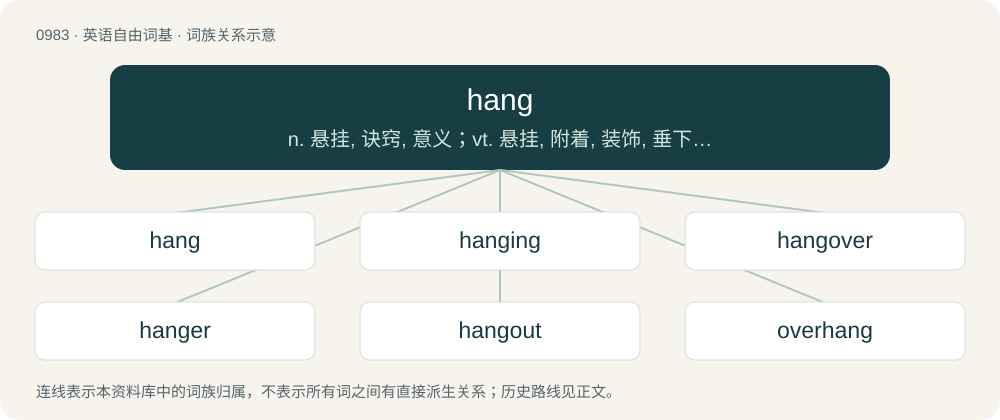

# 1058 · hang — n. 悬挂, 诀窍, 意义；vt. 悬挂, 附着, 装饰, 垂下, 踌躇, 绞死, 使悬而未决；vi. 悬着, 垂下, 被绞死, 悬而不决

[总目录](../00_总目录_按常用程度.md)

**类型**：英语自由词基　｜　**来源语言**：见词源记录

## 核心含义与来源

- 核心含义：n. 悬挂, 诀窍, 意义；vt. 悬挂, 附着, 装饰, 垂下, 踌躇, 绞死, 使悬而未决；vi. 悬着, 垂下, 被绞死, 悬而不决
- 英文含义：To be or remain suspended.
- 词形：hang

**多个词源／构词路径**：同一拼写可能有不同来源；以下按词性和含义分别列出。

**来源记录 1**（动词；To be or remain suspended.）

From Middle English hangen, hongen, from a fusion of Old English hōn (“to hang, be hanging”, transitive verb) and hangian (“to hang, cause to hang”, intransitive verb), respectively from the transitive verb Proto-West Germanic \*hą̄han and the intransitive verb \*hangēn; also probably influenced by Old Norse hengja (“to suspend”) and hanga (“to be suspended”); all from Proto-Germanic \*hanhaną and \*hangāną, from Proto-Indo-European \*ḱenk- (“to waver, be in suspense”). See also Dutch hangen, Low German hangen and hängen, German hängen, Norwegian Bokmål henge, Norwegian Nynorsk henga; also Gothic 𐌷𐌰𐌷𐌰𐌽 (hāhan), Hittite 𒂵𒀀𒀭𒂵 (/⁠kānk-⁠/, “to hang”), Sanskrit शङ्कते (śáṅkate, “is in doubt, hesitates”), Latin cūnctārī (“to delay”).

**来源记录 2**（名词；Cheap processed ham (cured pork), often made specially for sandwiches.）

From hang sangwich, Irish colloquial pronunciation of ham sandwich.

**来源记录 3**（名词；The smallest amount of concern or consideration; a damn.）

Alteration of dang, itself a minced oath of damn.

## 词族图

## 单词速览（常用到不常用）

| 单词 | 音标 | 释义 |
|---|---|---|
| [hang](#w-1) | 英 /hæŋ/；/hæŋ/ | n. 悬挂, 诀窍, 意义；vt. 悬挂, 附着, 装饰, 垂下, 踌躇, 绞死, 使悬而未决；vi. 悬着, 垂下, 被绞死, 悬而不决 |
| [hanging](#w-2) | 英 /ˈhæŋɪŋ/；美 /hæŋɪŋ/ | 縊死 /缢死、絞刑 /绞刑、吊死 |
| [hangover](#w-3) | 英 /ˈhæŋəʊ̯vəː/ ~ /ˈhæŋɵ̞ʊ̯vəː/；美 /ˈhæŋoʊ̯vɚ/ ~ /ˈhæŋɔʊ̯vɚ/ | n. 宿醉, 残留物, 遗物；\[电\] 残存物 |
| [hanger](#w-4) | 英 /ˈhæŋə/；美 /hæŋɚ/ | n. 挂钩, 吊架, 衣架, 挂衣钩；\[经\] (挂在店内的)广告牌 |
| [hangout](#w-5) |  | n. 常去的地方, 聚集处 |
| [overhang](#w-6) | 英 /əʊvəˈhaŋ/；美 /ˈoʊvəɹˌhæŋ/ | n. 突出部份, 悬垂部份；vt. 悬于...之上, (危险等)逼近；vi. 悬垂, 逼近 |
| [hangman](#w-7) | /ˈhæŋˌmæn/ | n. 绞刑吏, 刽子手；\[法\] 执行绞刑者 |

## 逐词详解

### 1. hang

**词性**：动词　｜　**音标**：英 /hæŋ/；/hæŋ/

**中文释义**：n. 悬挂, 诀窍, 意义；vt. 悬挂, 附着, 装饰, 垂下, 踌躇, 绞死, 使悬而未决；vi. 悬着, 垂下, 被绞死, 悬而不决

**英文义项**：To be or remain suspended. / To float, as if suspended.

**词源与演化**：

From Middle English hangen, hongen, from a fusion of Old English hōn (“to hang, be hanging”, transitive verb) and hangian (“to hang, cause to hang”, intransitive verb), respectively from the transitive verb Proto-West Germanic \*hą̄han and the intransitive verb \*hangēn; also probably influenced by Old Norse hengja (“to suspend”) and hanga (“to be suspended”); all from Proto-Germanic \*hanhaną and \*hangāną, from Proto-Indo-European \*ḱenk- (“to waver, be in suspense”). See also Dutch hangen, Low German hangen and hängen, German hängen, Norwegian Bokmål henge, Norwegian Nynorsk henga; also Gothic 𐌷𐌰𐌷𐌰𐌽 (hāhan), Hittite 𒂵𒀀𒀭𒂵 (/⁠kānk-⁠/, “to hang”), Sanskrit शङ्कते (śáṅkate, “is in doubt, hesitates”), Latin cūnctārī (“to delay”).

**例句**：

> In this standard opening position White has to be careful because the pawn on e4 hangs.

该用例对应义项：To be vulnerable to capture.

### 2. hanging

**词性**：名词　｜　**音标**：英 /ˈhæŋɪŋ/；美 /hæŋɪŋ/

**中文释义**：縊死 /缢死、絞刑 /绞刑、吊死

**英文义项**：The act of hanging a person (or oneself) by the neck in order to kill that person (or to commit suicide). / Anything that is hung as a decorative element (such as curtains, gobelins, or posters).

**构词拆分**：hang + -ing

**词源与演化**：

From Middle English hangynge, honginge, equivalent to hang + -ing. Compare Old English hengen (“hanging”) and hōhing (“hanging”).

**例句**：

> I dislike the cramped hanging in the gallery of 18th century painters.

该用例对应义项：The way in which hangings (decorations) are arranged.

### 3. hangover

**词性**：名词　｜　**音标**：英 /ˈhæŋəʊ̯vəː/ ~ /ˈhæŋɵ̞ʊ̯vəː/；美 /ˈhæŋoʊ̯vɚ/ ~ /ˈhæŋɔʊ̯vɚ/

**中文释义**：n. 宿醉, 残留物, 遗物；\[电\] 残存物

**英文义项**：Negative effects, such as headache or nausea, caused by previous drunkenness due to (excessive) consumption of alcohol. / Similar negative effects caused by previous excessive consumption of another substance, such as a drug, coffee, sugar, etc.

**构词拆分**：hang + over

**词源与演化**：

American English; hang + over. First sense was first attested in 1904. Third sense was first attested in 1894.

**例句**：

> I really enjoyed yesterday’s party, but now I have the biggest hangover – I’ll not be doing that again any time soon.

该用例对应义项：Negative effects, such as headache or nausea, caused by previous drunkenness due to (excessive) consumption of alcohol.

### 4. hanger

**词性**：名词　｜　**音标**：英 /ˈhæŋə/；美 /hæŋɚ/

**中文释义**：n. 挂钩, 吊架, 衣架, 挂衣钩；\[经\] (挂在店内的)广告牌

**英文义项**：One who hangs, or causes to be hanged; a hangman, paper hanger, etc. / A person who attempts suicide by hanging.

**构词拆分**：hang + -er

**词源与演化**：

Inherited from Middle English hanger, haunger, hangere, equivalent to hang + -er. Cognate with West Frisian hinger (“hanger”), Dutch hanger (“hanger”), German Hänger (“hanger”), Henker (“hangman”), Danish hænger (“hanger”), Norwegian henger (“hanger”), Swedish hängare (“hanger”).

**例句**：

> He hung his blazer on a hanger because it was really hot.

### 5. hangout

**词性**：名词

**中文释义**：n. 常去的地方, 聚集处

**英文义项**：A place for hanging out; an informal meeting-place. / A casual meeting for informal chat.

**构词拆分**：hang + out

**词源与演化**：

From hang + out, as a deverbal from hang out.

**例句**：

> Every Friday, Geoff and his group of friends all met at their favorite hangout to talk and have a good time.

该用例对应义项：A place for hanging out; an informal meeting-place.

### 6. overhang

**词性**：动词　｜　**音标**：英 /əʊvəˈhaŋ/；美 /ˈoʊvəɹˌhæŋ/

**中文释义**：n. 突出部份, 悬垂部份；vt. 悬于...之上, (危险等)逼近；vi. 悬垂, 逼近

**英文义项**：To hang over (something). / To impend.

**构词拆分**：over- + hang

**词源与演化**：

From Old English oferhangan, corresponding to over- + hang.

**例句**：

> Just as Tom looked up, an icicle fell from overhang of roof.

### 7. hangman

**词性**：名词　｜　**音标**：/ˈhæŋˌmæn/

**中文释义**：n. 绞刑吏, 刽子手；\[法\] 执行绞刑者

**英文义项**：An executioner responsible for hanging criminals. / Someone responsible for hanging pictures and other artworks in a gallery, museum etc.

**构词拆分**：hang + -man

**词源与演化**：

Inherited from Middle English hangman, hongman, hangeman, equivalent to hang + -man.

**例句**：

> I'd rather be hanged than be a hangman.
