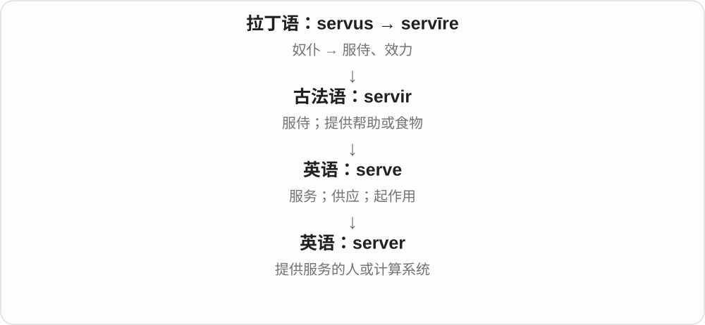

# 1059 · server — 提供服务的服务器，与无需自行管理服务器的模式

[逐词精讲目录](../00_逐词精讲目录.md) · [总目录](../00_总目录_按常用程度.md)

## 核心词根与来源

后缀 -less 在这里不能脱离使用视角。机器仍在运行，只是责任分工变了；这比逐字记无服务器更容易理解。

**SERVERLESS：服务还在，底层机器管理交给提供方**

server 提供服务；serverless 的云语境强调开发者不用自己配置、维护底层服务器。

- **服务提供与管理视角**：server · serverless
- **serve → server → servers：提供服务的人、机器**：serve · server · servers

## 词形与演化规律

serve + -er → server；server + -less → serverless。

serve 去 e 加完整 er，现代服务器从提供计算服务的功能得名。

## 单词速览（按词族由简到繁）

同一基础词的相关扩展放在一起，先读基础形式，再读扩展；各组之间优先读常用的。具体词源关系见各词讲解。

| 单词 | 音标 | 核心意思 |
|---|---|---|
| [serve](#w-3) | 英 /sɜːv/；美 /sɜːrv/ | 服务；端上；供给；起作用；发球 |
| [server](#w-1) | 英 /ˈsɜːvə/；美 /ˈsɜːrvər/ | 服务员；服务器；发球者 |
| [servers](#w-4) | 英 /ˈsɜːvəz/；美 /ˈsɜːrvərz/ | 服务员、服务者；服务器〔复数〕 |
| [serverless](#w-2) | 英 /ˈsɜːvələs/；美 /ˈsɜːrvərləs/ | 无服务器的〔常指开发者无需管理底层服务器的计算模式〕 |

## 逐词讲解

### 1. serve — 服务；端上；供给；起作用；发球

**音标**：英 /sɜːv/；美 /sɜːrv/

**先抓住这个画面**

把自己的行动、食物或功能提供出去，满足别人或某项任务的需要。

**怎么拆**

经古法语 servir 来自拉丁语 servīre“服侍”，与 servus“奴仆”相连。现代服务义不含被奴役的意思。

**怎么变成今天的意思**

服务顾客、端菜、服役都能连到为某人或某事效力。A box serves as a table 是箱子临时起桌子的作用；球类中还指发球。

**常见搭配与例句**

serve customers；serve dinner；serve as；serve a purpose。

> This room serves as both an office and a library.

这个房间既当办公室，也当书房。

> Dinner will be served at seven.

晚饭七点上桌。

**别混淆**

serve someone 是为某人提供服务；serve as something 是充当某种角色。不能把所有 serve 都译成服侍。

### 2. server — 服务员；服务器；发球者

**音标**：英 /ˈsɜːvə/；美 /ˈsɜːrvər/

**先抓住这个画面**

谁把你请求的东西送过来，谁就是这一环节里的 server：餐厅送餐，网络送数据。

**怎么拆**

serve + -er，原指提供服务的人，后来扩展到提供计算服务的程序或机器。

**怎么变成今天的意思**

技术语境中的 server 可以指软件，也可以指运行软件的计算机；不一定是一台巨大的独立机器。

**常见搭配与例句**

a restaurant server；a web server；connect to a server。

> The server brought us a jug of water.

服务员给我们端来一壶水。

> The app sends the request to a server.

应用把请求发送到服务器。

**别混淆**

client 发出请求、使用服务；server 接收请求并提供服务。这是角色区别，不只看设备大小。

### 3. servers — 服务员、服务者；服务器〔复数〕

**音标**：英 /ˈsɜːvəz/；美 /ˈsɜːrvərz/

**先抓住这个画面**

谁负责把需要的东西提供给你，谁就是 server；餐厅送餐的人、网络里提供数据和功能的机器，都符合这个角色。

**怎么拆**

serve 去 e 加完整 -er → server，再加复数 -s。serve 经法语 servir 接拉丁 servire 服侍；计算术语从提供服务的功能发展。

**怎么变成今天的意思**

**法语 servir、拉丁 servire → serve → server**  
服务 → 服务者、提供服务的设备或程序

↓

**server + -s → servers**  
多位服务者；多台服务器

restaurant servers 餐厅服务员；web servers 网站服务器；game servers 游戏服务器。

**常见搭配与例句**

several servers 几台服务器；servers in the café 咖啡馆里的服务员。

> Two servers brought the food to our table.

两位服务员把食物送到我们桌上。

> The website runs on several servers.

这个网站运行在几台服务器上。

**别混淆**

servers 可以指人，也可指程序、机器，先看语境。计算里的 server 与 client 是提供服务与请求服务的角色关系，不只按机器大小区分。

### 4. serverless — 无服务器的〔常指开发者无需管理底层服务器的计算模式〕

**音标**：英 /ˈsɜːvələs/；美 /ˈsɜːrvərləs/

**先抓住这个画面**

像租用已经有人维护的厨房：你提交要做的工作，平台安排机器来跑。叫 serverless，不代表世界上真没有服务器。

**怎么拆**

server 服务器 + -less 无、无需。云计算用法把镜头放在开发者体验：底层服务器管理交给提供方；某些其他场景也可字面说没有中央服务器。

**怎么变成今天的意思**

**serve + -er → server**  
提供服务者 → 计算机服务端

↓

**server + -less → serverless**  
无服务器；云语境常指无需自己管理底层服务器

serverless computing 无服务器计算，a serverless function 无服务器函数，a serverless application 无服务器应用。具体能力、计费和运行限制随服务而异。

**常见搭配与例句**

serverless computing；a serverless function；a serverless application。

> The team used a serverless function to process uploaded images.

团队用无服务器函数处理上传的图片。

> In this serverless setup, the provider manages the underlying servers.

在这套无服务器方案里，提供方管理底层服务器。

**别混淆**

serverless 不等于免费、不用运维任何应用问题；也不等于所有代码都只能是小函数。它说明基础设施责任如何分配，不说明代码功能。

## 这一组要分清什么

serverless 不是没有物理机器，不保证免费，也不免除应用自身的设计和维护工作。

## 串起来练习

A serverless application still runs on servers managed by someone.

无服务器应用仍运行在有人管理的服务器上。
