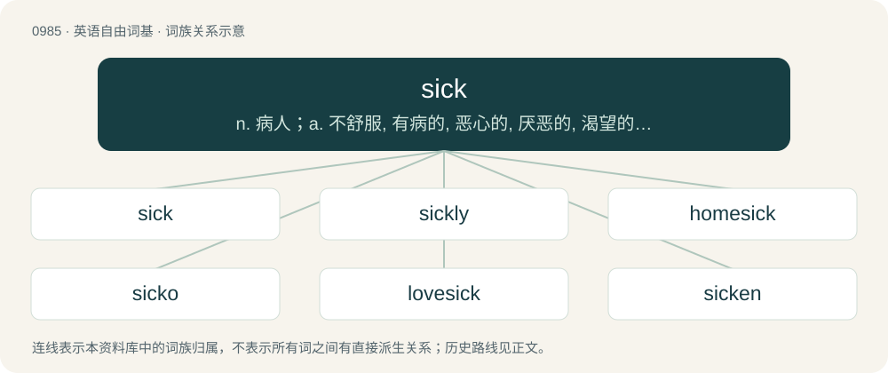

# 1059 · sick — n. 病人；a. 不舒服, 有病的, 恶心的, 厌恶的, 渴望的, 病态的；vt. 呕吐, 追击, 使(狗)去攻击

[总目录](../00_总目录_按常用程度.md)

**类型**：英语自由词基　｜　**来源语言**：见词源记录

## 核心含义与来源

- 核心含义：n. 病人；a. 不舒服, 有病的, 恶心的, 厌恶的, 渴望的, 病态的；vt. 呕吐, 追击, 使(狗)去攻击
- 英文含义：In poor health; ill.
- 词形：sick

**来源记录 1**（形容词；In poor health; ill.）

From Middle English sik, sike, seek, seke, seok, from Old English sēoc (“sick, ill”), from Proto-West Germanic \*seuk, from Proto-Germanic \*seukaz, from Proto-Indo-European \*sewg- (“to be troubled or grieved”). See also West Frisian siik, Dutch ziek, German siech, Norwegian Bokmål syk, Norwegian Nynorsk and Swedish sjuk, Danish syg; also Middle Irish socht (“silence, depression”), Old Armenian հիւծանիմ (hiwcanim, “to be weakening”). The "very good, excellent" sense is an ameliorative semantic shift from the original sense of "in poor health". Compare similar semantic development in terrific and wicked.

## 词族图

## 单词速览（常用到不常用）

| 单词 | 音标 | 释义 |
|---|---|---|
| [sick](#w-1) | /ˈsɪk/ | n. 病人；a. 不舒服, 有病的, 恶心的, 厌恶的, 渴望的, 病态的；vt. 呕吐, 追击, 使(狗)去攻击 |
| [sickly](#w-2) | /ˈsɪkli/ | a. 病弱的, 令人不快的, 无精打采的；adv. 病态地；vt. 使现病容 |
| [homesick](#w-3) | 英 /ˈhəʊ̯m.sɪk/；美 /ˈhoʊ̯m.sɪk/ | a. 思家的, 思乡病的 |
| [sicko](#w-4) | 英 /ˈsɪkəʊ/；美 /ˈsɪkoʊ/ | n. &lt;美俚&gt;有精神病的人,道德败坏的人 |
| [lovesick](#w-5) | /ˈlʌvsɪk/ | a. 害相思病的, 苦恋的 |
| [sicken](#w-6) | /ˈsɪkən/ | vt. 患病, 使厌倦, 使恶心；vi. 生病, 作呕 |
| [seasick](#w-7) | /ˈsiːsɪk/ | a. 晕船的 |

## 逐词详解

### 1. sick

**词性**：形容词　｜　**音标**：/ˈsɪk/

**中文释义**：n. 病人；a. 不舒服, 有病的, 恶心的, 厌恶的, 渴望的, 病态的；vt. 呕吐, 追击, 使(狗)去攻击

**英文义项**：In poor health; ill. / \[with with\] Afflicted by (a specific condition, usually medical).

**词源与演化**：

From Middle English sik, sike, seek, seke, seok, from Old English sēoc (“sick, ill”), from Proto-West Germanic \*seuk, from Proto-Germanic \*seukaz, from Proto-Indo-European \*sewg- (“to be troubled or grieved”). See also West Frisian siik, Dutch ziek, German siech, Norwegian Bokmål syk, Norwegian Nynorsk and Swedish sjuk, Danish syg; also Middle Irish socht (“silence, depression”), Old Armenian հիւծանիմ (hiwcanim, “to be weakening”). The "very good, excellent" sense is an ameliorative semantic shift from the original sense of "in poor health". Compare similar semantic development in terrific and wicked.

**例句**：

> I’ve heard that song on the radio so many times that I’m starting to get sick of it.

该用例对应义项：\[with of\] Tired of or annoyed by (something that has lasted a long time or often recurs).

### 2. sickly

**词性**：形容词　｜　**音标**：/ˈsɪkli/

**中文释义**：a. 病弱的, 令人不快的, 无精打采的；adv. 病态地；vt. 使现病容

**英文义项**：Frequently ill or in poor health; weakly. / Not in good health; (somewhat) sick.

**构词拆分**：sick + -ly

**词源与演化**：

From Middle English seekly, sekely, siklich, sekeliche, equivalent to sick + -ly. Possibly a modification of Old English sīcle (“sickly”) and/or derived from Old Norse sjúkligr (“sickly”). Cognate with Dutch ziekelijk, Middle High German siechlich, Danish sygelig, Swedish sjuklig, Icelandic sjúklegur. The verb is from the adjective.

**用法示例／搭配（非完整句）**：

> a sickly smell; sickly sentimentality

该用例对应义项：Tending to produce nausea.

### 3. homesick

**词性**：形容词　｜　**音标**：英 /ˈhəʊ̯m.sɪk/；美 /ˈhoʊ̯m.sɪk/

**中文释义**：a. 思家的, 思乡病的

**英文义项**：Missing one's home and family very much when away; nostalgic.

**构词拆分**：home + sick

**词源与演化**：

Back-formation from homesickness, equivalent to home + sick.

**例句**：

> The camp counselors tried to comfort the homesick children.

该用例对应义项：Missing one's home and family very much when away; nostalgic.

### 4. sicko

**词性**：名词　｜　**音标**：英 /ˈsɪkəʊ/；美 /ˈsɪkoʊ/

**中文释义**：n. &lt;美俚&gt;有精神病的人,道德败坏的人

**英文义项**：A person with unpleasant tastes, views or habits. / A mentally ill person.

**构词拆分**：sick + -o

**词源与演化**：

From sick + -o (“person with characteristic”).

**例句**：

> What kind of sicko would pay 70,000 euros to kill an elephant?

### 5. lovesick

**词性**：形容词　｜　**音标**：/ˈlʌvsɪk/

**中文释义**：a. 害相思病的, 苦恋的

**英文义项**：Behaving oddly, or as though in distress, due to being overcome by feelings of unrequited or unfulfilled love. / Having an aching desire for one's beloved.

**构词拆分**：love + sick

**词源与演化**：

From love + sick.

**例句**：

> Strong men behaving like lovesick boys.

该用例对应义项：languishing because of love

### 6. sicken

**词性**：动词　｜　**音标**：/ˈsɪkən/

**中文释义**：vt. 患病, 使厌倦, 使恶心；vi. 生病, 作呕

**英文义项**：To make ill. / To become ill.

**构词拆分**：sick + -en

**词源与演化**：

From Middle English sekenen, equivalent to sick + -en. Cognate with Danish sygne (“to pine”), Swedish sjukna (“to fall ill; become sick”), Norwegian sykne, Icelandic sjúkna (“to sicken; become sick”).

**例句**：

> The infection will sicken him until amputation is needed.

该用例对应义项：To make ill.

### 7. seasick

**词性**：形容词　｜　**音标**：/ˈsiːsɪk/

**中文释义**：a. 晕船的

**英文义项**：Suffering from sickness, nausea or dizziness due to the motion of a ship or boat at sea.

**构词拆分**：sea + sick

**词源与演化**：

From Middle English see seke, equivalent to sea + sick.

**例句**：

> People who get seasick easily shouldn't join the navy.

该用例对应义项：Suffering from sickness, nausea or dizziness due to the motion of a ship or boat at sea.
