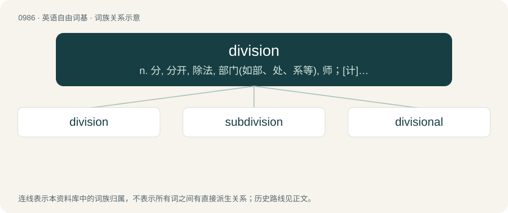

# 1060 · division — n. 分, 分开, 除法, 部门(如部、处、系等), 师；\[计\] 部分

[总目录](../00_总目录_按常用程度.md)

**类型**：英语自由词基　｜　**来源语言**：见词源记录

## 核心含义与来源

- 核心含义：n. 分, 分开, 除法, 部门(如部、处、系等), 师；\[计\] 部分
- 英文含义：The act or process of dividing anything.
- 词形：division

**来源记录 1**（名词；The act or process of dividing anything.）

From Middle English divisioun, from Old French division, from Latin dīvīsiō, dīvīsiōnem, noun of process form from perfect passive participle dīvīsus (“divided”), from dīvidō (“divide”). Doublet of divisio.

## 词族图

## 单词速览（常用到不常用）

| 单词 | 音标 | 释义 |
|---|---|---|
| [division](#w-1) | /dɪˈvɪʒn̩/ | n. 分, 分开, 除法, 部门(如部、处、系等), 师；\[计\] 部分 |
| [subdivision](#w-2) | /ˈsʌbdɪvɪʒən/ | n. 细分, 分部；\[医\] 再分; 亚门 |
| [divisional](#w-3) | /diˈviʒənəl/ | a. 部门的, 部分的, 分开的；\[法\] 分开的, 分割的, 分区的 |

## 逐词详解

### 1. division

**词性**：名词　｜　**音标**：/dɪˈvɪʒn̩/

**中文释义**：n. 分, 分开, 除法, 部门(如部、处、系等), 师；\[计\] 部分

**英文义项**：The act or process of dividing anything. / Each of the separate parts of something resulting from division.

**词源与演化**：

From Middle English divisioun, from Old French division, from Latin dīvīsiō, dīvīsiōnem, noun of process form from perfect passive participle dīvīsus (“divided”), from dīvidō (“divide”). Doublet of divisio.

**例句**：

> Magnolias belong to the division Magnoliophyta.

该用例对应义项：A rank below kingdom and above class, particularly used of plants or fungi, also (particularly of animals) called a phylum; a taxon at that rank.

### 2. subdivision

**词性**：名词　｜　**音标**：/ˈsʌbdɪvɪʒən/

**中文释义**：n. 细分, 分部；\[医\] 再分; 亚门

**英文义项**：A division into smaller pieces of something that has already been divided. / Such a piece that has been divided.

**构词拆分**：sub- + division

**词源与演化**：

From sub- + division.

**例句**：

> They're putting in a new subdivision out past Black Ranch Road.

该用例对应义项：A group of houses created by the same builder or in the same general area.

### 3. divisional

**词性**：形容词　｜　**音标**：/diˈviʒənəl/

**中文释义**：a. 部门的, 部分的, 分开的；\[法\] 分开的, 分割的, 分区的

**英文义项**：Of or pertaining to a division. / Of or pertaining to the process of division.

**构词拆分**：From division + -al.

**词源与演化**：

From division + -al.

**例句**：

> American divisional (fractional) coins include the dime and the nickel.

该用例对应义项：constituting a division or an aliquot part of the basic monetary unit
