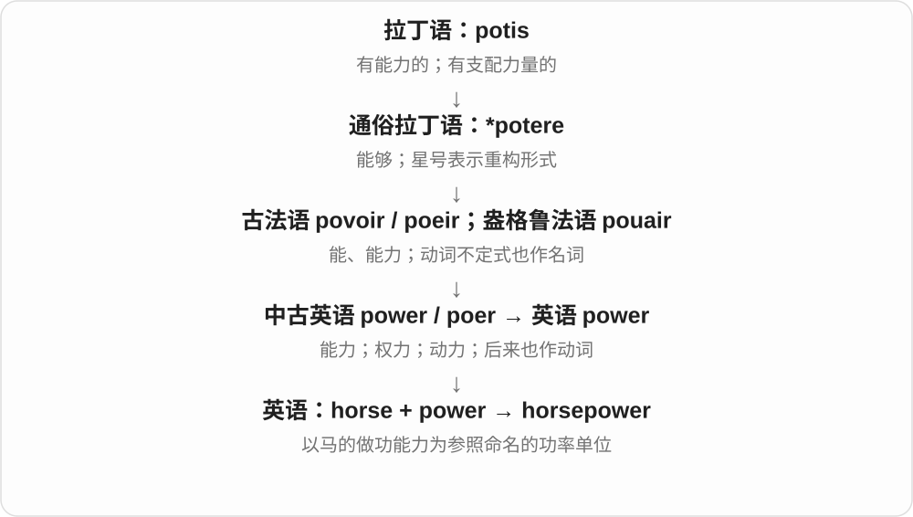

# 1061 · horse — 马及部位、用途；力量、体量与工具比喻

[逐词精讲目录](../00_逐词精讲目录.md) · [总目录](../00_总目录_按常用程度.md)

## 核心词根与来源

已有多数常见合成精讲复用。horseradish 不解释成给马吃的萝卜，冷门与粗俗变体本轮略。

**HORSE：真实的马，也借力量、体量给别物命名**

horse → horsehair、horseback、horseman；horsepower 力量、racehorse 竞赛、workhorse/warhorse 比喻，horseradish 单讲旧加强义。

- **基本动物与相关部位、人物**：horse · horsehair · horseback · horseman
- **力量、用途和比喻**：horsepower · racehorse · workhorse · warhorse
- **旧加强义植物名**：horseradish
- **horse → horses：马；horse around 的胡闹**：horse · horses
- **gallop：马飞快奔驰，到做事飞快**：gallop · gallops · galloped · galloping
- **canter 与 prance：轻快跑步、昂首高抬步**：canter · canters · cantered · cantering · prance · prances · pranced · prancing
- **marshal：管马的职务 → 维持秩序者 → 调配组织**：marshal · marshals · marshaled · marshalled · marshaling · marshalling
- **zebra → zebras：与马比较的斑马名**：zebra · zebras

## 词形与演化规律

horse + hair/back/man/power/radish；race/work/war + horse。

horses 在 /s/ 后增加 /ɪz/；horse 是古英语 hors 的延续，现代动词搭配另按语境理解。

本组与 horse 作步态场景比较，不是由现代英语 horse 派生。gallop 经古法语 galoper、waloper 等，或接法兰克语善跑的重建组合，不把猜测当确定记录。

与 horse 作马步场景比较，不是 horse 的后代。canter 的马步义缩自 Canterbury pace 等；prance 远源未定，马昂首高步与人的炫耀走姿都很早。

较远日耳曼语马 + 仆从组成职务名，经法语 mareschal 进入英语，职务地位与功能扩大；动词由职务名转来，表示排列、组织、调配。美式常见单 l，英式常见双 l 分词。

与 horse 比较外形、动物类别，不认定直接同源。zebra 经欧洲语言传入，意大利语、葡萄牙语形式相关；更远有拉丁野马等不同分析，来源仍不确定。

## 单词速览（按词族由简到繁）

同一基础词的相关扩展放在一起，先读基础形式，再读扩展；各组之间优先读常用的。具体词源关系见各词讲解。

| 单词 | 音标 | 核心意思 |
|---|---|---|
| [horse](#w-1) | 英 /hɔːs/；美 /hɔːrs/ | 马；与马有关的；〔比喻〕强壮、粗大等 |
| [horses](#w-11) | 英 /ˈhɔːsɪz/；美 /ˈhɔːrsɪz/ | 马〔复数〕；horse 的第三人称单数形式〔如 horses around 胡闹〕 |
| [horsepower](#w-2) | 英 /ˈhɔːsˌpaʊə/；美 /ˈhɔːrsˌpaʊər/ | 马力；功率单位 |
| [horseback](#w-3) | 英 /ˈhɔːsbæk/；美 /ˈhɔːrsbæk/ | 马背；骑马地 |
| [horseman](#w-4) | 英 /ˈhɔːsmən/；美 /ˈhɔːrsmən/ | 骑手；善骑马的人 |
| [horseradish](#w-8) | 英 /ˈhɔːsrædɪʃ/；美 /ˈhɔːrsrædɪʃ/ | 辣根；辣根酱〔按语境〕 |
| [horsehair](#w-10) | 英 /ˈhɔːsheə/；美 /ˈhɔːrsher/ | 马毛〔尤鬃、尾长毛〕 |
| [racehorse](#w-5) | 英 /ˈreɪshɔːs/；美 /ˈreɪshɔːrs/ | 赛马 |
| [workhorse](#w-7) | 英 /ˈwɜːkhɔːs/；美 /ˈwɜːrkhɔːrs/ | 役马；可靠耐用、承担大量工作的人或物 |
| [warhorse](#w-9) | 英 /ˈwɔːhɔːs/；美 /ˈwɔːrhɔːrs/ | 战马；久经考验的老将；反复上演的老作品 |
| [marshal](#w-24) | 英 /ˈmɑːʃəl/；美 /ˈmɑrʃəl/ | 组织、调配、整理；维持秩序的工作人员；元帅等官衔 |
| [marshals](#w-25) | 英 /ˈmɑːʃəlz/；美 /ˈmɑrʃəlz/ | 组织、调配〔第三人称单数〕；现场管理人员、元帅等〔复数〕 |
| [marshalling](#w-26) | 英 /ˈmɑːʃəlɪŋ/；美 /ˈmɑrʃəlɪŋ/ | 正在组织、调配、整理〔常见英式拼写〕 |
| [marshalled](#w-27) | 英 /ˈmɑːʃəld/；美 /ˈmɑrʃəld/ | 组织、调配、整理了〔过去式、过去分词；常见英式拼写〕 |
| [marshaling](#w-28) | 英 /ˈmɑːʃəlɪŋ/；美 /ˈmɑrʃəlɪŋ/ | 正在组织、调配、整理〔常见美式拼写〕 |
| [marshaled](#w-29) | 英 /ˈmɑːʃəld/；美 /ˈmɑrʃəld/ | 组织、调配、整理了〔过去式、过去分词；常见美式拼写〕 |
| [zebra](#w-30) | 英 /ˈzebrə/；美 /ˈziːbrə/ | 斑马 |
| [zebras](#w-31) | 英 /ˈzebrəz/；美 /ˈziːbrəz/ | 斑马〔复数〕 |
| [gallop](#w-12) | /ˈɡæləp/ | 马快速奔驰；飞快地推进；一次飞奔 |
| [galloping](#w-13) | /ˈɡæləpɪŋ/ | 正在奔驰；飞速发展的、失控般快速的 |
| [galloped](#w-14) | /ˈɡæləpt/ | 快速奔驰了；飞快地推进、做过了 |
| [gallops](#w-15) | /ˈɡæləps/ | 快速奔驰、飞快推进〔第三人称单数〕；几次飞奔 |
| [canter](#w-16) | 英 /ˈkæntə/；美 /ˈkæntɚ/ | 马轻快跑；马的慢跑步态 |
| [cantering](#w-19) | 英 /ˈkæntərɪŋ/；美 /ˈkæntərɪŋ/ | 马正在轻快跑；以马的慢跑步态前进 |
| [cantered](#w-20) | 英 /ˈkæntəd/；美 /ˈkæntɚd/ | 马轻快跑了；骑马以慢跑步态前进了 |
| [canters](#w-23) | 英 /ˈkæntəz/；美 /ˈkæntɚz/ | 马轻快跑〔第三人称单数〕；几段轻快跑 |
| [prance](#w-18) | 英 /prɑːns/；美 /præns/ | 昂首高抬步；蹦蹦跳跳；得意地走 |
| [prancing](#w-17) | 英 /ˈprɑːnsɪŋ/；美 /ˈprænsɪŋ/ | 正在昂首高步、蹦跳；轻快高步的 |
| [pranced](#w-21) | 英 /prɑːnst/；美 /prænst/ | 昂首高步、蹦跳、得意地走了 |
| [prances](#w-22) | 英 /ˈprɑːnsɪz/；美 /ˈprænsɪz/ | 昂首高步、蹦跳、得意地走〔第三人称单数〕 |

## 逐词讲解

### 1. horse — 马；与马有关的；〔比喻〕强壮、粗大等

**音标**：英 /hɔːs/；美 /hɔːrs/

**先抓住这个画面**

能骑、能拉车的马，是日常画面。合成词有的真说马背、马毛，有的借马的力量、体量，不要求所指都是动物。

**怎么拆**

本族词，接古英语 hors。更远有人联系跑的旧词根，也有借入等不同解释，从可靠旧形讲起。工具、力气和粗大等比喻在具体组合中认。

**怎么变成今天的意思**

**古英语 hors → 中古英语 hors、horse → horse**  
马；更远来源有不同分析

↓

**英语 horse 及比喻、合成**  
骑乘、牵引动物；强壮、粗大；按用途叫工具、人物等

ride a horse 骑马，a horse race 赛马，hold your horses 别急，a dark horse 黑马、实力未明者。horsepower、workhorse 已有精讲，可一起复习。

**常见搭配与例句**

ride a horse；a horse race；hold your horses；a dark horse。

> She learned to ride a horse as a child.

她小时候学会了骑马。

> Hold your horses—we have not checked the date yet.

别急，我们还没核对日期呢。

**别混淆**

horse 马、pony 小型马，不完全按幼年成年区分；foal 驹才直接说幼马。horse 的合成比喻不套用所有动物事实。

### 2. horses — 马〔复数〕；horse 的第三人称单数形式〔如 horses around 胡闹〕

**音标**：英 /ˈhɔːsɪz/；美 /ˈhɔːrsɪz/

**先抓住这个画面**

多匹马是 horses；horse around 是粗野、打闹式地玩，常出现在提醒别人别闹的场景里。

**怎么拆**

horse 已有 e，加 s；原词 /s/ 后增加 /ɪz/ 一个音节。horse 继承古英语 hors，更远来源有不同解释，不强定一个未证实的跑步词根。

**怎么变成今天的意思**

**古英语 hors → horse**  
马；后来有与力量、体型等相关的引申

↓

**horse 名词、动词 + -s → horses**  
多匹马；在特定动词搭配中说胡闹等

ride horses 骑马；wild horses 野马；horses in a stable 马厩里的马；hold your horses 口语说先等等、别着急；horses around 到处打闹。

**常见搭配与例句**

a pair of horses；horses grazing in a field。

> The horses were grazing quietly in the field.

马在田野里安静地吃草。

> The guide asked us to wait while she checked the horses.

向导让我们等一等，她先检查马匹。

**别混淆**

horses 的复数多一个 /ɪz/ 音节，因为单数以 /s/ 收尾；cats、ducks 没有这个音节。hold your horses 常是劝人等一等，不一定真的有人牵马。

### 3. horsepower — 马力；功率单位

**音标**：英 /ˈhɔːsˌpaʊə/；美 /ˈhɔːrsˌpaʊər/

**先抓住这个画面**

horsepower 起初让人用熟悉的马来想象机器有多大本事，现在是衡量功率的单位。

**怎么拆**

horse 马 + power 动力，英语复合词；名称来自用马的工作能力作参照的历史。

**怎么变成今天的意思**

发动机有多少 horsepower，谈的是输出功率，不是能拉几匹马，也不是一段时间里消耗多少能量。马力存在不同单位制，看到精确换算时要确认采用哪一种。

**常见搭配与例句**

engine horsepower；brake horsepower；rated horsepower。

> The brochure lists the engine’s horsepower.

宣传册列出了发动机的马力。

> The newer model produces more horsepower with a smaller engine.

新款车型用更小的发动机输出了更大的功率。

**别混淆**

horsepower 衡量功率；torque 是扭矩，描述使物体转动的力矩，两项指标不能直接当成同一个数。

### 4. horseback — 马背；骑马地

**音标**：英 /ˈhɔːsbæk/；美 /ˈhɔːrsbæk/

**先抓住这个画面**

人不是坐在车里，而是坐在马背上随马前行。

**怎么拆**

horse（马）+ back（背），中古英语已有同族形式；常在 on horseback 这一固定搭配里出现。

**怎么变成今天的意思**

**英语 horse；back**  
组合时并列的两个材料

↓

**horse + back → horseback**  
马的背部；骑乘位置

travel on horseback 是骑马出行，horseback riding 是骑马活动。on horseback 通常不加 a；a horse’s back 则是普通所有格短语。

**常见搭配与例句**

on horseback；ride horseback；horseback riding。

> They explored the valley on horseback.

他们骑马游览了山谷。

> The photograph shows her on horseback beside the river.

照片里她骑在马上，旁边是河。

**别混淆**

horseback 是位置和骑乘方式，horsepower 是功率单位或能力比喻；不能因前半相同就推成同一用途。

### 5. horseman — 骑手；善骑马的人

**音标**：英 /ˈhɔːsmən/；美 /ˈhɔːrsmən/

**先抓住这个画面**

看一个人在马背上能否稳稳控制坐骑，这里关注的是骑乘。

**怎么拆**

horse（马）+ man（人），英语早期已有相应组合。man 在词尾常弱读，不按每次都完整重读 /mæn/。

**怎么变成今天的意思**

**英语 horse；man**  
并列组合的两部分

↓

**horse + man → horseman**  
骑马的人、善骑者

a skilled horseman 是熟练骑手；历史叙事也用来描写骑马出现的人，不自动意味着军人。

**常见搭配与例句**

a skilled horseman；an experienced horseman；a lone horseman。

> He became an accomplished horseman at a young age.

他年纪很轻就成为熟练的骑手。

> A lone horseman appeared on the hill.

山上出现了一名独行骑手。

**别混淆**

horseman 侧重骑马，cavalryman 是骑兵身份，cattleman 从事养牛。会骑马不等于这两个职业之一。

### 6. horseradish — 辣根；辣根酱〔按语境〕

**音标**：英 /ˈhɔːsrædɪʃ/；美 /ˈhɔːrsrædɪʃ/

**先抓住这个画面**

一种味道冲、常用根制成调味品的植物。名字里的 horse 常解释为粗大、强劲这类旧加强义，不是马爱吃的萝卜。

**怎么拆**

horse + radish，horse 在这类旧植物名中可表强、粗大。不要把德语 Meerrettich 被误听成马的流行故事当作可靠唯一词源。

**怎么变成今天的意思**

**古英语 hors → 中古英语 hors、horse → horse**  
马；更远来源有不同分析

↓

**英语 horse 及比喻、合成**  
骑乘、牵引动物；强壮、粗大；按用途叫工具、人物等

↓

**horse〔粗大、强劲的旧用法〕+ radish → horseradish**  
辣根植物及相应调味品

horseradish sauce 辣根酱，grated horseradish 磨碎辣根，a little horseradish 少许辣根调味品。

**常见搭配与例句**

horseradish sauce；grated horseradish；a horseradish root。

> She added a little grated horseradish to the sauce.

她往酱汁里加了一点磨碎的辣根。

> The jar contains horseradish sauce.

罐子里装的是辣根酱。

**别混淆**

horseradish 辣根与 wasabi 山葵是不同植物名；有些调味品的实际配料会混合、替代，不能靠颜色直接判来源。

### 7. horsehair — 马毛〔尤鬃、尾长毛〕

**音标**：英 /ˈhɔːsheə/；美 /ˈhɔːrsher/

**先抓住这个画面**

按材料来源叫名字：从马身上取得、常用于刷子、弓毛或填充等用途的毛。

**怎么拆**

horse + hair，旧时已有相应组合。常作为材料不可数，也可作定语说明相关制品。

**怎么变成今天的意思**

**古英语 hors → 中古英语 hors、horse → horse**  
马；更远来源有不同分析

↓

**英语 horse 及比喻、合成**  
骑乘、牵引动物；强壮、粗大；按用途叫工具、人物等

↓

**horse + hair → horsehair**  
马的毛；相应用途材料

a horsehair brush 马毛刷，horsehair stuffing 马毛填充料，horsehair for violin bows 小提琴弓用马尾毛等。

**常见搭配与例句**

a horsehair brush；horsehair stuffing；natural horsehair。

> He cleaned the shoes with a soft horsehair brush.

他用软马毛刷清理鞋子。

> The restorer found horsehair stuffing inside the old chair.

修复师在旧椅子里发现了马毛填充料。

**别混淆**

horsehair 材料来源，hairstyle 发型；horsehair brush 不是给马梳毛的所有刷子的总称，而常指刷毛材料是马毛。

### 8. racehorse — 赛马

**音标**：英 /ˈreɪshɔːs/；美 /ˈreɪshɔːrs/

**先抓住这个画面**

主要为竞速比赛训练、使用的马，不是马跑起来就临时都成了赛马。

**怎么拆**

race 速度竞赛 + horse 马，按用途形成动物角色名称。

**怎么变成今天的意思**

**race 速度竞赛；horse 马**  
并列构词部分

↓

**racehorse**  
供竞速比赛的马

train a racehorse 训练赛马，a retired racehorse 退役赛马；退役后仍可用这个称谓说明其经历。

**常见搭配与例句**

a racehorse；train a racehorse；a retired racehorse。

> The racehorse was resting in its stable.

赛马正在马厩里休息。

> She helped care for a retired racehorse.

她帮忙照料一匹退役赛马。

**别混淆**

racehorse 是马，racer 既可能是人也可能是马、车；racecourse、racetrack 是竞赛场地。

### 9. workhorse — 役马；可靠耐用、承担大量工作的人或物

**音标**：英 /ˈwɜːkhɔːs/；美 /ˈwɜːrkhɔːrs/

**先抓住这个画面**

不一定最耀眼，却每天都扛得住重活，少了它就转不动。

**怎么拆**

work（劳动）+ horse（马），先说承担劳动的马，再比喻勤劳可靠的人、机器或工具。

**怎么变成今天的意思**

**英语 work；horse**  
并列的两个构词材料

↓

**work + horse → workhorse**  
役马；承担大量日常任务的可靠主力

an office workhorse 可说踏实干活的人；a workhorse printer 可夸打印机能承受大批量日常任务。通常是肯定可靠，并不必然说高端。

**常见搭配与例句**

a reliable workhorse；the workhorse of the fleet；an office workhorse。

> This old laptop is still the workhorse of my home office.

这台旧笔记本仍是我居家办公的主力。

> The small van became the workhorse of the business.

这辆小货车成了公司日常运输的主力。

**别混淆**

workhorse 是可靠主力，workaholic 是难以停止工作的人；工作多与依赖工作不是同一种评价。

### 10. warhorse — 战马；久经考验的老将；反复上演的老作品

**音标**：英 /ˈwɔːhɔːs/；美 /ˈwɔːrhɔːrs/

**先抓住这个画面**

老战马经历许多仗，后来借来称经验老到的人；舞台上总被重新搬出的老作品也像久经阵仗。

**怎么拆**

war + horse，由战马的字面义扩到资深人物、常演曲目和剧目。不是称作品有四条腿。

**怎么变成今天的意思**

**war；horse**  
并列构词成分

↓

**warhorse**  
战马 → 老将；常演老作品

an old political warhorse 政坛老将，a theatrical warhorse 反复上演的老戏。可赞经验丰富，也可嫌作品老套，语气看上下文。

**常见搭配与例句**

an old warhorse；a political warhorse；a theatrical warhorse。

> An old political warhorse returned to lead the campaign.

一位政坛老将回归，领导这次竞选。

> The orchestra chose a familiar warhorse for the final piece.

乐团选了一首常演的经典老曲作压轴。

**别混淆**

warhorse 强调资历、反复历练，workhorse 强调勤恳耐用、承担大量工作；只差一部分，关注点不同。

### 11. marshal — 组织、调配、整理；维持秩序的工作人员；元帅等官衔

**音标**：英 /ˈmɑːʃəl/；美 /ˈmɑrʃəl/

**先抓住这个画面**

把分散的人、资源、论据集合起来，排好、用上，就是 marshal。这个组织动作来自一种负责管理、维持秩序的职务名。

**怎么拆**

日耳曼语马 + 仆从组成旧职务名，经法语 mareschal 进入英语；从管马、家内管理到更高官职。英语名词再转作排列、组织的动词。

**怎么变成今天的意思**

**日耳曼语马 + 仆从 → 法语 mareschal 管马职务、家内及军中官职**  
职务的地位、职责随历史扩大

↓

**英语 marshal：维持秩序者、某些官衔；动词排列、组织**  
把人员、资源或论据有条理地集合到位

marshal resources 是调集资源；marshal evidence 是整理证据；an event marshal 是活动现场维持秩序的工作人员；field marshal 是一种元帅官衔。

**常见搭配与例句**

marshal resources；marshal evidence；an event marshal。

> We need to marshal our resources before the next stage.

进入下一阶段前，我们得把资源组织调配好。

> A marshal directed runners towards the starting line.

一名现场工作人员引导跑者走向起跑线。

**别混淆**

marshal 与 martial 常见读音很接近或相同，但 martial 是接战神名的军事形容词；marshal 是管马职务线及其组织动词。

### 12. marshals — 组织、调配〔第三人称单数〕；现场管理人员、元帅等〔复数〕

**音标**：英 /ˈmɑːʃəlz/；美 /ˈmɑrʃəlz/

**先抓住这个画面**

她把论据一条条排好，是 she marshals the evidence；赛道旁几名工作人员，则是 marshals。行动与职务共享一个名字。

**怎么拆**

marshal + -s → marshals，末尾 /l/ 后接 /z/；动词第三人称单数和职务名复数同形。

**怎么变成今天的意思**

**日耳曼语马 + 仆从 → 法语 mareschal 管马职务、家内及军中官职**  
职务的地位、职责随历史扩大

↓

**英语 marshal：维持秩序者、某些官衔；动词排列、组织**  
把人员、资源或论据有条理地集合到位

↓

**marshal + -s → marshals**  
组织动作的单数形式；或多名现场管理人员等

race marshals 是赛事工作人员；marshals the team 是组织团队；marshals the evidence 是把证据组织起来。

**常见搭配与例句**

race marshals；marshals the evidence；marshals the team。

> Race marshals stood at each junction.

每个路口都站着赛事工作人员。

> She marshals the evidence into a clear argument.

她把证据组织成清晰的论证。

**别混淆**

marshals 只说明某些职务名称的复数，具体职责依场合而不同；赛事工作人员和历史元帅不能只靠中文一词包办。

### 13. marshalling — 正在组织、调配、整理〔常见英式拼写〕

**音标**：英 /ˈmɑːʃəlɪŋ/；美 /ˈmɑrʃəlɪŋ/

**先抓住这个画面**

英式常见 marshalling，仍是把人、资源或信息组织到位的过程。双 l 属拼写习惯，不另添一层调配含义。

**怎么拆**

marshal 双写 l + -ing → marshalling，英式常见；与美式常见 marshaling 相对应。

**怎么变成今天的意思**

**日耳曼语马 + 仆从 → 法语 mareschal 管马职务、家内及军中官职**  
职务的地位、职责随历史扩大

↓

**英语 marshal：维持秩序者、某些官衔；动词排列、组织**  
把人员、资源或论据有条理地集合到位

↓

**marshal 双写 l + -ing → marshalling**  
常见英式现在分词、动名词

marshalling the crowd 是组织引导人群；marshalling arguments 是组织论据。一个现实队伍，一个思路队伍，都能排出次序。

**常见搭配与例句**

marshalling the crowd；marshalling resources；marshalling arguments。

> Staff were marshalling the crowd outside the venue.

工作人员正在场馆外组织引导人群。

> She spent the morning marshalling arguments for her proposal.

她整个上午都在为提案组织论据。

**别混淆**

marshalling 与 marshaling 不需要按不同动作背两份词义；记住同一动词和地区拼写习惯即可。

### 14. marshalled — 组织、调配、整理了〔过去式、过去分词；常见英式拼写〕

**音标**：英 /ˈmɑːʃəld/；美 /ˈmɑrʃəld/

**先抓住这个画面**

同样是把人力或思路组织起来，英式常写 marshalled，双写 l。读音和 marshaled 没有因为多一个字母就多一节。

**怎么拆**

marshal 双写末尾 l + -ed → marshalled；英式在这类词尾常双写 l，-ed 仍读 /d/。

**怎么变成今天的意思**

**日耳曼语马 + 仆从 → 法语 mareschal 管马职务、家内及军中官职**  
职务的地位、职责随历史扩大

↓

**英语 marshal：维持秩序者、某些官衔；动词排列、组织**  
把人员、资源或论据有条理地集合到位

↓

**marshal 双写 l + -ed → marshalled**  
常见英式过去式、过去分词；与单 l 形式同义

marshalled the crowd 是有秩序地引导人群；well-marshalled evidence 是组织得很好的证据。

**常见搭配与例句**

marshalled resources；marshalled the crowd；marshalled the evidence。

> The organisers marshalled the crowd into separate lines.

组织者把人群引导成几条队伍。

> He marshalled all the available information before making a decision.

决定之前，他把现有信息全都整理了一遍。

**别混淆**

双写 l 不代表末尾重读；marshal 的重音仍在第一音节。英式词尾 l 双写不能机械套成只能重读末节才双写。

### 15. marshaling — 正在组织、调配、整理〔常见美式拼写〕

**音标**：英 /ˈmɑːʃəlɪŋ/；美 /ˈmɑrʃəlɪŋ/

**先抓住这个画面**

把志愿者分组，把资料排成论证，这些组织过程是 marshaling。不是只把东西堆到一起，还让它们有次序、能发挥作用。

**怎么拆**

marshal + -ing → marshaling，美式常见单 l；英式常写 marshalling，读音和主要用法相同。

**怎么变成今天的意思**

**日耳曼语马 + 仆从 → 法语 mareschal 管马职务、家内及军中官职**  
职务的地位、职责随历史扩大

↓

**英语 marshal：维持秩序者、某些官衔；动词排列、组织**  
把人员、资源或论据有条理地集合到位

↓

**marshal + -ing → marshaling**  
常见美式现在分词、动名词

marshaling resources 是调集资源；marshaling support 是组织、争取支持；marshaling evidence 是整理证据。

**常见搭配与例句**

marshaling resources；marshaling support；marshaling evidence。

> The team is marshaling its resources for the final stage.

团队正在为最后阶段组织调配资源。

> Marshaling the evidence took longer than writing the summary.

整理证据花的时间比写摘要还长。

**别混淆**

gathering 侧重收拢；marshaling 常进一步强调有条理地组织、安排，以便用来完成目标。

### 16. marshaled — 组织、调配、整理了〔过去式、过去分词；常见美式拼写〕

**音标**：英 /ˈmɑːʃəld/；美 /ˈmɑrʃəld/

**先抓住这个画面**

原来散着的队伍或论据，已经被组织到位，就是 marshaled。美式常见单个 l 的过去形式。

**怎么拆**

marshal + -ed → marshaled，后缀读 /d/；美式通常保留单 l，英式常见 marshalled，含义没有因此分成两套。

**怎么变成今天的意思**

**日耳曼语马 + 仆从 → 法语 mareschal 管马职务、家内及军中官职**  
职务的地位、职责随历史扩大

↓

**英语 marshal：维持秩序者、某些官衔；动词排列、组织**  
把人员、资源或论据有条理地集合到位

↓

**marshal + -ed → marshaled**  
规则过去式、过去分词；常见美式单 l

marshaled the volunteers 是组织了志愿者；carefully marshaled evidence 是仔细整理的证据。

**常见搭配与例句**

marshaled resources；marshaled the volunteers；carefully marshaled evidence。

> The coordinator marshaled the volunteers into small teams.

协调员把志愿者组织成几个小组。

> She marshaled her arguments before the debate.

辩论前，她整理好了论据。

**别混淆**

marshaled 与 marshalled 是拼写变体，过去时间与完成意义相同；不是一个指人、另一个指资源。

### 17. zebra — 斑马

**音标**：英 /ˈzebrə/；美 /ˈziːbrə/

**先抓住这个画面**

马样的身体上布着黑白条纹，是 zebra。先用条纹认动物，再把名字当一个传入英语的整体来记。

**怎么拆**

经意大利语、葡萄牙语等相关名称传入英语，更远来源不定；拉丁 equiferus 野马等只是其中分析，不能当作已证明的唯一祖先。

**怎么变成今天的意思**

**意大利语 zebra、葡萄牙语等相关动物名称 → 英语 zebra**  
更远来源不定，曾有野驴、拉丁野马等不同分析

↓

**英语 zebra 斑马 → zebras**  
现代条纹的画面帮助记动物，不是按英语零碎字母造出的词

a zebra’s stripes 是斑马的条纹；a zebra foal 是斑马幼崽；英式 zebra crossing 借条纹说斑马线。

**常见搭配与例句**

a zebra’s stripes；a zebra foal；a zebra crossing。

> A zebra stood beside the waterhole.

一只斑马站在水坑旁。

> We crossed the road at the zebra crossing.

我们从斑马线过了马路。

**别混淆**

英式常读 /ˈzebrə/，美式常读 /ˈziːbrə/，首元音可不同；两个都指同一种常见动物名称。

### 18. zebras — 斑马〔复数〕

**音标**：英 /ˈzebrəz/；美 /ˈziːbrəz/

**先抓住这个画面**

一群黑白条纹的斑马，可以说 zebras。动物名复数直接加 s。

**怎么拆**

zebra + -s → zebras，末尾 /ə/ 后接 /z/；首元音仍随常见英美读法有所不同。

**怎么变成今天的意思**

**意大利语 zebra、葡萄牙语等相关动物名称 → 英语 zebra**  
更远来源不定，曾有野驴、拉丁野马等不同分析

↓

**英语 zebra 斑马 → zebras**  
现代条纹的画面帮助记动物，不是按英语零碎字母造出的词

↓

**zebra + -s → zebras**  
多只斑马，词尾 /brəz/

a herd of zebras 是一群斑马；zebras grazing 是斑马吃草；zebras and horses 是斑马与马。

**常见搭配与例句**

a herd of zebras；zebras grazing；young zebras。

> A herd of zebras crossed the plain.

一群斑马穿过平原。

> We watched zebras grazing beside the road.

我们看着斑马在路旁吃草。

**别混淆**

zebra crossing 前部通常用单数 zebra 修饰；zebras 是在直接数多只动物，两个语法位置不同。

### 19. gallop — 马快速奔驰；飞快地推进；一次飞奔

**音标**：/ˈɡæləp/

**先抓住这个画面**

马放开步子飞奔，是 gallop。读书、讲解或时间过得飞快，也能借这个画面，像一阵马蹄冲了过去。

**怎么拆**

经古法语 galoper、waloper 等进入英语；更远可能接法兰克语善跑的重建组合。用可能来限定远源，现代把 gallop 作为完整基础词，再认它的常见后缀变化。

**怎么变成今天的意思**

**古法语 galoper、waloper 等 → gallop**  
更远可能接法兰克语善跑的重建组合

↓

**马快速奔驰 → 进程、阅读、时间飞快前进**  
名词可说这种步态、一次飞奔

gallop across the field；at a gallop 飞奔着；gallop through a chapter。

**常见搭配与例句**

a full gallop；go for a gallop；time seems to gallop。

> The horse broke into a gallop.

马开始放开步子奔驰。

> Do not gallop through the explanation; give us time to follow.

解释别讲得那么快，给我们时间跟上。

**别混淆**

gallop 在马的场景比 trot 小跑更快、更放开；比喻里强调快，未必在赞扬读得仔细。

### 20. galloping — 正在奔驰；飞速发展的、失控般快速的

**音标**：/ˈɡæləpɪŋ/

**先抓住这个画面**

一阵密集马蹄声，是 galloping horses。galloping inflation 则像涨价在放开跑，常嫌增长太快、不容易控制。

**怎么拆**

gallop + -ing，结尾音节不重读，不双写 p；分词可写奔驰过程，也能形容发展飞快。

**怎么变成今天的意思**

**古法语 galoper、waloper 等 → gallop**  
更远可能接法兰克语善跑的重建组合

↓

**马快速奔驰 → 进程、阅读、时间飞快前进**  
名词可说这种步态、一次飞奔

↓

**gallop + -ing → galloping**  
奔驰的过程，或飞速发展的性质

galloping horses；galloping inflation；galloping through a speech。

**常见搭配与例句**

a galloping pace；horses galloping across the plain。

> We heard galloping horses on the road.

我们听见路上传来马群奔驰的声音。

> The article described a period of galloping inflation.

文章描述了一段物价飞涨的时期。

**别混淆**

galloping inflation 突出涨价迅猛，stable prices 是价格稳定；这里是形容速度、趋势的比喻，不是具体数值标准。

### 21. galloped — 快速奔驰了；飞快地推进、做过了

**音标**：/ˈɡæləpt/

**先抓住这个画面**

马一阵飞跑冲过草地，是 galloped；赶时间时飞快念完一段说明，也可 galloped through。

**怎么拆**

gallop + 完整 -ed，/p/ 后读 /t/；词尾音节不重读，不双写 p。

**怎么变成今天的意思**

**古法语 galoper、waloper 等 → gallop**  
更远可能接法兰克语善跑的重建组合

↓

**马快速奔驰 → 进程、阅读、时间飞快前进**  
名词可说这种步态、一次飞奔

↓

**gallop + -ed → galloped**  
过去快速奔驰，或飞快处理

galloped across the field；galloped through the chapter；galloped away。

**常见搭配与例句**

galloped towards the village；had galloped all morning。

> The riders galloped across the field.

骑手们策马飞奔过田野。

> He galloped through the final chapter before dinner.

晚饭前，他飞快读完了最后一章。

**别混淆**

galloped through 不保证逐处看懂，studied carefully 才强调仔细研究；快读和细读不是同一过程。

### 22. gallops — 快速奔驰、飞快推进〔第三人称单数〕；几次飞奔

**音标**：/ˈɡæləps/

**先抓住这个画面**

马一过空地就放开跑，是 gallops；几段快速跑马的活动，也可数成 gallops。人说话飞快推进也能借用。

**怎么拆**

gallop + -s，/p/ 后读 /s/；动词三单与名词复数同形。

**怎么变成今天的意思**

**古法语 galoper、waloper 等 → gallop**  
更远可能接法兰克语善跑的重建组合

↓

**马快速奔驰 → 进程、阅读、时间飞快前进**  
名词可说这种步态、一次飞奔

↓

**gallop + -s → gallops**  
他、它飞快推进；多次奔驰

gallops across the field；gallops through the material；short gallops。

**常见搭配与例句**

gallops towards the gate；morning gallops。

> The horse gallops towards the open gate.

马飞快奔向敞开的大门。

> The lecturer gallops through the final slides.

讲师飞快讲过最后几页幻灯片。

**别混淆**

gallops through a topic 可能嫌讲得太快，covers a topic 只说谈到；速度快不保证听者理解。

### 23. canter — 马轻快跑；马的慢跑步态

**音标**：英 /ˈkæntə/；美 /ˈkæntɚ/

**先抓住这个画面**

马已经比快步 trot 更快，却没放到最快奔驰 gallop，是 canter。学习先看轻快、从容的跑，不必把它当成人的普通慢跑。

**怎么拆**

马步义缩自 Canterbury pace、相关较长动词，与前往坎特伯雷的朝圣骑行步调相联。这里不是 cant 加做人称的 -er。

**怎么变成今天的意思**

**Canterbury pace 等短语 → 缩略 canter**  
与前往坎特伯雷朝圣时从容的骑行步调相联

↓

**英语马的轻快跑步 → 动词、相应步态名词**  
此处整个基础词不是 cant 加人称 -er

at a canter 轻快跑着；canter across a field；break into a canter。

**常见搭配与例句**

a gentle canter；canter along the beach。

> The horse moved into a canter.

马开始轻快地跑起来。

> We watched the horses canter across the field.

我们看着马匹轻快地跑过田野。

**别混淆**

马的 trot、canter、gallop 是不同步态；日常先按小跑、轻快跑、放开奔驰区分，不把它们全译成同一跑法。

### 24. cantering — 马正在轻快跑；以马的慢跑步态前进

**音标**：英 /ˈkæntərɪŋ/；美 /ˈkæntərɪŋ/

**先抓住这个画面**

马轻快地带着骑手向前，速度和节奏比快步 trot 更放开，是 cantering。它描述具体步态，不只是笼统说移动。

**怎么拆**

canter + -ing；英式在元音后缀前读出 r，形成动作过程。

**怎么变成今天的意思**

**Canterbury pace 等短语 → 缩略 canter**  
与前往坎特伯雷朝圣时从容的骑行步调相联

↓

**英语马的轻快跑步 → 动词、相应步态名词**  
此处整个基础词不是 cant 加人称 -er

↓

**canter + -ing → cantering**  
马用轻快跑步态前进的过程

cantering across the field；a cantering horse；cantering along the path。

**常见搭配与例句**

riders cantering on the beach；practise cantering。

> A rider was cantering across the field.

一位骑手骑着马，轻快地跑过田野。

> The lesson focused on cantering smoothly.

那节课重点练习平稳地采用轻快跑步态。

**别混淆**

cantering 不等于 galloping 全速奔驰；都比走快，但马的动作节奏不同。

### 25. cantered — 马轻快跑了；骑马以慢跑步态前进了

**音标**：英 /ˈkæntəd/；美 /ˈkæntɚd/

**先抓住这个画面**

沿海滩骑着马轻快跑了一段，可以说 cantered。人作主语时，也可是在说骑马采用这种步态前进。

**怎么拆**

canter + 完整 -ed，读 /d/；不增加 /ɪd/ 音节，英美词尾 r 随口音不同。

**怎么变成今天的意思**

**Canterbury pace 等短语 → 缩略 canter**  
与前往坎特伯雷朝圣时从容的骑行步调相联

↓

**英语马的轻快跑步 → 动词、相应步态名词**  
此处整个基础词不是 cant 加人称 -er

↓

**canter + -ed → cantered**  
过去马轻快跑，或骑马这样前进

cantered along the beach；cantered across the field；cantered away。

**常见搭配与例句**

cantered towards the gate；had cantered for a while。

> We cantered along the beach at sunrise.

日出时，我们骑着马沿海滩轻快跑了一段。

> The horse cantered towards the open gate.

马轻快地跑向敞开的大门。

**别混淆**

we cantered 常是我们骑马轻快跑，we jogged 通常是我们自己慢跑；主语同是人，场景、交通方式仍不同。

### 26. canters — 马轻快跑〔第三人称单数〕；几段轻快跑

**音标**：英 /ˈkæntəz/；美 /ˈkæntɚz/

**先抓住这个画面**

马沿围栏从容跑着，是 canters；几次短程练习这种步态，也可叫 canters。主语、量词帮你认出词性。

**怎么拆**

canter + -s，读 /z/；动词三单与步态名词复数同形，基础马步义缩自 Canterbury pace 等材料。

**怎么变成今天的意思**

**Canterbury pace 等短语 → 缩略 canter**  
与前往坎特伯雷朝圣时从容的骑行步调相联

↓

**英语马的轻快跑步 → 动词、相应步态名词**  
此处整个基础词不是 cant 加人称 -er

↓

**canter + -s → canters**  
马轻快跑，或几次这种跑步

canters around the arena；short canters；canters along the track。

**常见搭配与例句**

gentle canters；canters towards the gate。

> The horse canters smoothly around the arena.

马绕着训练场轻快、平稳地跑着。

> The lesson included several short canters.

那节课包括几段短距离的轻快跑练习。

**别混淆**

canters 是马正在用这种步态跑，walks 可以只是走；有规律地前进不保证速度、步态一样。

### 27. prance — 昂首高抬步；蹦蹦跳跳；得意地走

**音标**：英 /prɑːns/；美 /præns/

**先抓住这个画面**

马精神足，脚抬得高高地走；人穿上新衣服，得意地来回展示，都能 prance。它比普通 walk 多一层显眼、轻快或炫耀的姿态。

**怎么拆**

较早写马高抬步，也很早用于人的得意走姿；远源未定，有日耳曼炫耀词等分析，不能定成现代 prank 和 dance 的简单拼合。

**怎么变成今天的意思**

**较早 prance 写马精神足、昂首高抬步**  
来源未定，有日耳曼炫耀材料、其他语源等分析

↓

**马高步，到人得意、炫耀地走或蹦跳**  
马与人的相关义都很早，不强排简单单线先后

prance around the room；prance across the stage；a horse begins to prance。

**常见搭配与例句**

prance about in a new outfit；prance past the mirror。

> The children began to prance around the room.

孩子们开始在房间里蹦蹦跳跳。

> He liked to prance around in his new coat.

他喜欢穿着新外套，得意地来回走。

**别混淆**

prance 着重高步、蹦跳或炫耀，sneak 是悄悄行动；一个显眼，一个尽量不引人注意。

### 28. prancing — 正在昂首高步、蹦跳；轻快高步的

**音标**：英 /ˈprɑːnsɪŋ/；美 /ˈprænsɪŋ/

**先抓住这个画面**

马头昂着、脚抬得高，或人高兴得带着表演姿态走，是 prancing。它把姿势而不只是方向写出来。

**怎么拆**

prance 去 e 加 -ing；过程分词也能形容马、动作的高步姿态。

**怎么变成今天的意思**

**较早 prance 写马精神足、昂首高抬步**  
来源未定，有日耳曼炫耀材料、其他语源等分析

↓

**马高步，到人得意、炫耀地走或蹦跳**  
马与人的相关义都很早，不强排简单单线先后

↓

**prance + -ing → prancing**  
高抬步、蹦跳的过程或姿态

a prancing horse；prancing around the room；prancing across the stage。

**常见搭配与例句**

prancing in front of a mirror；prancing children。

> A prancing horse is painted on the sign.

牌子上画着一匹昂首高步的马。

> They were prancing around in their new costumes.

他们穿着新服装，得意又兴奋地走来走去。

**别混淆**

prancing 和 dancing 都可能有蹦跳，dancing 是跳舞；走得像表演也不一定真的在跳舞。

### 29. pranced — 昂首高步、蹦跳、得意地走了

**音标**：英 /prɑːnst/；美 /prænst/

**先抓住这个画面**

穿上新衣服，在镜子前得意地走来走去，可以说 pranced。也可轻松写孩子高兴得蹦蹦跳跳。

**怎么拆**

prance 去 e 加完整 -ed；/s/ 后读 /t/，不新增 /ɪd/ 音节。

**怎么变成今天的意思**

**较早 prance 写马精神足、昂首高抬步**  
来源未定，有日耳曼炫耀材料、其他语源等分析

↓

**马高步，到人得意、炫耀地走或蹦跳**  
马与人的相关义都很早，不强排简单单线先后

↓

**prance + -ed → pranced**  
过去显眼、轻快或得意地高步行走

pranced around the room；pranced onto the stage；pranced past the mirror。

**常见搭配与例句**

pranced in her new shoes；the horse pranced。

> The children pranced around the garden after the rain.

雨后，孩子们在花园里高兴地蹦跳。

> He pranced past the mirror in his new jacket.

他穿着新夹克，得意地从镜子前走过。

**别混淆**

pranced 不必带贬义；写孩子高兴蹦跳时可很亲切，写成年人炫耀时才可能有揶揄。

### 30. prances — 昂首高步、蹦跳、得意地走〔第三人称单数〕

**音标**：英 /ˈprɑːnsɪz/；美 /ˈprænsɪz/

**先抓住这个画面**

她一听音乐就高兴地蹦着走，或马昂着头高抬步，是 prances。具体是快乐还是炫耀，要看人物和语气。

**怎么拆**

prance + -s，拼写只添 -s，基础末音 /s/ 后读 /ɪz/。

**怎么变成今天的意思**

**较早 prance 写马精神足、昂首高抬步**  
来源未定，有日耳曼炫耀材料、其他语源等分析

↓

**马高步，到人得意、炫耀地走或蹦跳**  
马与人的相关义都很早，不强排简单单线先后

↓

**prance + -s → prances**  
他、她或它高抬步、得意地走

prances across the stage；prances around the garden；prances in a new dress。

**常见搭配与例句**

the pony prances；prances past the crowd。

> She prances across the stage in bright boots.

她穿着鲜艳的靴子，在舞台上轻快高步地走过。

> The pony prances beside the fence.

小马在围栏旁昂首高步地走着。

**别混淆**

prances 不只是跑得快，sprints 才主要写冲刺；高抬步、展示姿态可能速度并不快。

## 这一组要分清什么

pony 小型马不等于所有幼马；horsehair 按材料命名；horseradish 非马食萝卜，wasabi 另种植物。

## 串起来练习

The horseman brushed the horse before the ride.

骑手出发骑行前给马刷了刷毛。
