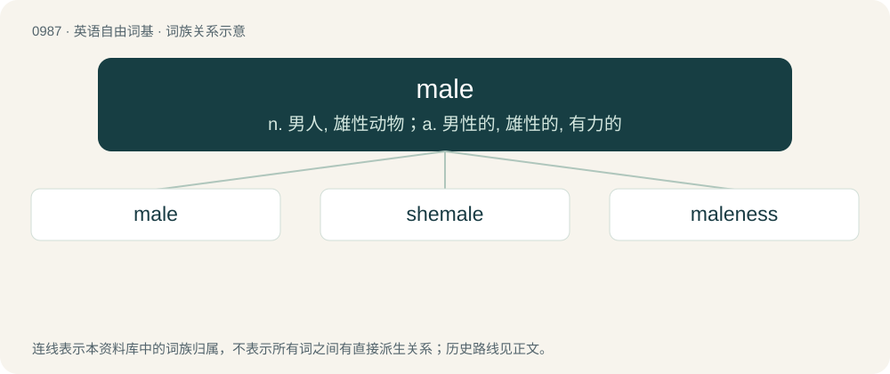

# 1061 · male — n. 男人, 雄性动物；a. 男性的, 雄性的, 有力的

[总目录](../00_总目录_按常用程度.md)

**类型**：英语自由词基　｜　**来源语言**：见词源记录

## 核心含义与来源

- 核心含义：n. 男人, 雄性动物；a. 男性的, 雄性的, 有力的
- 英文含义：Belonging to the sex which typically produces sperm, or to the gender which is typically associated with it.
- 词形：male

**来源记录 1**（形容词；Belonging to the sex which typically produces sperm, or to the gender which is typically associated with it.）

From Middle English male, borrowed from Old French malle, masle (Modern French mâle), from Latin masculus (“masculine, a male”), diminutive of mās (“male, masculine”). Doublet of macho. Displaced native Old English wǣpned (“male”, literally “weaponed”).

## 词族图

## 单词速览（常用到不常用）

| 单词 | 音标 | 释义 |
|---|---|---|
| [male](#w-1) | 英 /meɪl/ | n. 男人, 雄性动物；a. 男性的, 雄性的, 有力的 |
| [shemale](#w-2) | 美 /ˈʃi.meɪl/ | \[美俚\]女人, 女性 |
| [maleness](#w-3) | /meɪlnəs/ | 男性, 雄性 |

## 逐词详解

### 1. male

**词性**：形容词　｜　**音标**：英 /meɪl/

**中文释义**：n. 男人, 雄性动物；a. 男性的, 雄性的, 有力的

**英文义项**：Belonging to the sex which typically produces sperm, or to the gender which is typically associated with it. / Characteristic of this sex/gender. (Compare masculine, manly.)

**词源与演化**：

From Middle English male, borrowed from Old French malle, masle (Modern French mâle), from Latin masculus (“masculine, a male”), diminutive of mās (“male, masculine”). Doublet of macho. Displaced native Old English wǣpned (“male”, literally “weaponed”).

**用法示例／搭配（非完整句）**：

> like testes, ovaries also produce testosterone and some other male hormones

该用例对应义项：Tending to lead to or regulate the development of sexual characteristics typical of this sex.

### 2. shemale

**词性**：名词　｜　**音标**：美 /ˈʃi.meɪl/

**中文释义**：\[美俚\]女人, 女性

**英文义项**：A male-to-female transsexual or transgender person; a trans woman. / A male or non-binary person with feminine characteristics; a femboy.

**构词拆分**：she- + male

**词源与演化**：

From she- + male.

**例句**：

> I didn't know Catherine was a shemale.

### 3. maleness

**词性**：名词　｜　**音标**：/meɪlnəs/

**中文释义**：男性, 雄性

**英文义项**：The characteristic, state or condition of being male.

**构词拆分**：male + -ness

**词源与演化**：

From male + -ness.

**例句**：

> Maleness is by far the biggest risk factor for violence.
