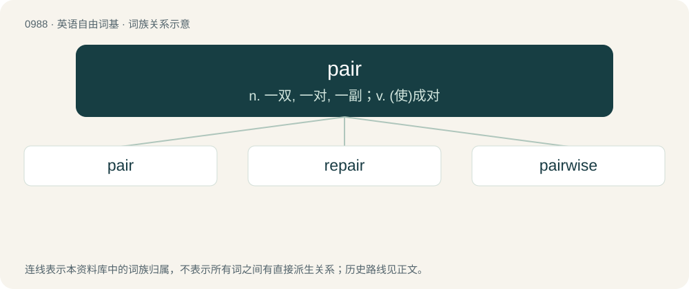

# 1062 · pair — n. 一双, 一对, 一副；v. (使)成对

[总目录](../00_总目录_按常用程度.md)

**类型**：英语自由词基　｜　**来源语言**：见词源记录

## 核心含义与来源

- 核心含义：n. 一双, 一对, 一副；v. (使)成对
- 英文含义：Two alike or identical things taken together; often followed by of.
- 词形：pair

**来源记录 1**（名词；Two alike or identical things taken together; often followed by of.）

From Middle English paire, from Old French paire, from Latin paria (“equals”), neuter plural of par (“pair”). Related to pār (“equal”, adjective). Compare Saterland Frisian Poor (“pair”), West Frisian pear (“pair”), Dutch paar (“pair”), German Paar (“pair”), Italian paio (“pair”)

## 词族图

## 单词速览（常用到不常用）

| 单词 | 音标 | 释义 |
|---|---|---|
| [pair](#w-1) | 英 /pɛə/；美 /pɛɹ/ | n. 一双, 一对, 一副；v. (使)成对 |
| [repair](#w-2) | 英 /ˈɹiːpɛə̯/；美 /ˈɹiːpɛɚ/ | 【英文】To pair again. |
| [pairwise](#w-3) | 英 /ˈpɛə.waɪz/；美 /ˈpɛɹ.waɪz/ | 成对\[双\]地, 两个两个地 |

## 逐词详解

### 1. pair

**词性**：名词　｜　**音标**：英 /pɛə/；美 /pɛɹ/

**中文释义**：n. 一双, 一对, 一副；v. (使)成对

**英文义项**：Two alike or identical things taken together; often followed by of. / One of the constituent items that make up a pair.

**词源与演化**：

From Middle English paire, from Old French paire, from Latin paria (“equals”), neuter plural of par (“pair”). Related to pār (“equal”, adjective). Compare Saterland Frisian Poor (“pair”), West Frisian pear (“pair”), Dutch paar (“pair”), German Paar (“pair”), Italian paio (“pair”)

**例句**：

> I couldn't decide which of the pair of designer shirts I preferred, so I bought the pair.

该用例对应义项：Two alike or identical things taken together; often followed by of.

### 2. repair

**词性**：动词　｜　**音标**：英 /ˈɹiːpɛə̯/；美 /ˈɹiːpɛɚ/

**英文义项**：To pair again.

**构词拆分**：re- + pair

**词源与演化**：

From re- + pair.

**例句**：

> Please try to repair the two earbuds to each other. Place both earbuds back into the charging case, wait for four seconds, then open it and see if they have been repaired with one another.

该用例对应义项：To pair again.

### 3. pairwise

**词性**：形容词　｜　**音标**：英 /ˈpɛə.waɪz/；美 /ˈpɛɹ.waɪz/

**中文释义**：成对\[双\]地, 两个两个地

**英文义项**：Occurring in pairs; two at a time.

**构词拆分**：pair + -wise

**词源与演化**：

From pair + -wise.

**例句**：

> They proceeded to make pairwise comparisons.

该用例对应义项：Occurring in pairs; two at a time.
