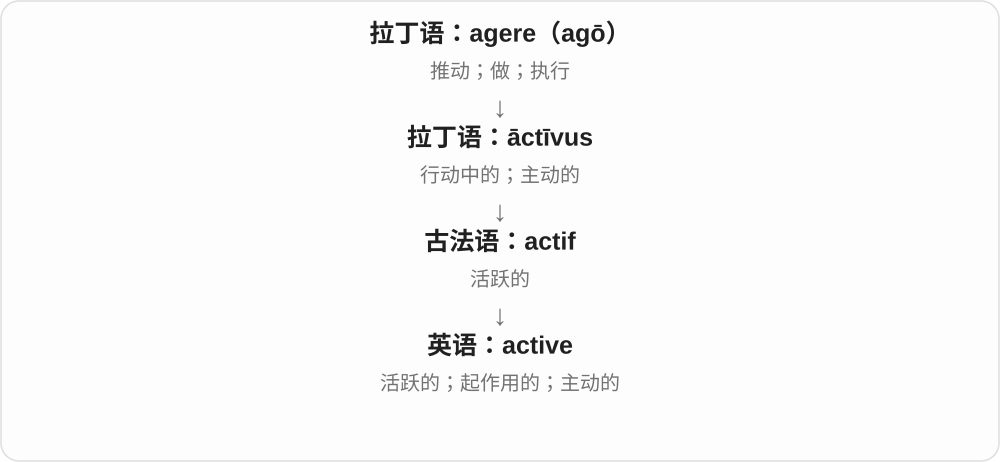
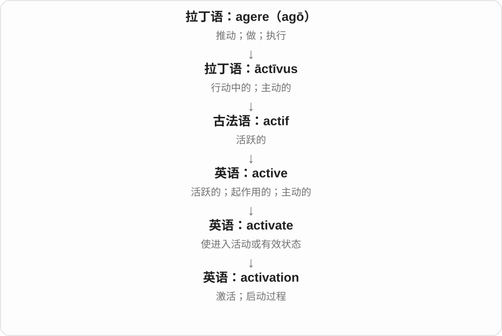
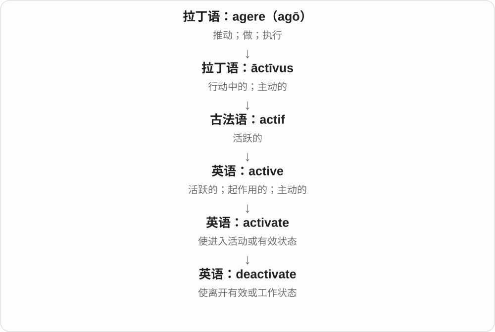

# 1063 · activate — 使起作用、激活，以及使失去活性

[逐词精讲目录](../00_逐词精讲目录.md) · [总目录](../00_总目录_按常用程度.md)

## 核心词根与来源

先看起作用，再把过程、促成者和反向操作接起来。失去活性不一定是物体消失，重新激活则是恢复其作用。

**ACTIVATE：让原本没运转的能力开始起作用**

activate → activation、activator；deactivate、inactivate 停用或失活；reactivate 再次激活。

- **激活、过程与促成者**：activate · activation · activator
- **停用、失活与恢复**：deactivate · inactivate · reactivate
- **activate → activated：让它开始起作用**：active · activate · activated

## 词形与演化规律

active → activate；-ation 过程，-or 促成者；de-、in- 在本组关联停用、无活性，re- 表再次。

英语 activ 词干加动词后缀 ate；active 早经法语接拉丁 activus。

## 单词速览（按词族由简到繁）

同一基础词的相关扩展放在一起，先读基础形式，再读扩展；各组之间优先读常用的。具体词源关系见各词讲解。

| 单词 | 音标 | 核心意思 |
|---|---|---|
| [active](#w-7) | /ˈæktɪv/ | 活跃的；正在起作用的；主动的 |
| [activate](#w-2) | /ˈæktɪveɪt/ | 激活；启动；使起作用 |
| [activated](#w-8) | /ˈæktɪveɪtɪd/ | 启动、激活了；已起作用的〔过去式、过去分词〕 |
| [activation](#w-1) | /ˌæktɪˈveɪʃən/ | 激活；启动；使生效 |
| [activator](#w-4) | 英 /ˈæktɪveɪtə/；美 /ˈæktɪveɪtər/ | 激活物、活化剂；起激活作用的人或装置 |
| [deactivate](#w-3) | /diːˈæktɪveɪt/ | 停用；使失效；关闭作用 |
| [reactivate](#w-5) | /ˌriːˈæktɪveɪt/ | 重新激活；恢复启用 |
| [inactivate](#w-6) | /ɪˈnæktɪveɪt/ | 使失去活性；使不起作用 |

## 逐词讲解

### 1. active — 活跃的；正在起作用的；主动的

**音标**：/ˈæktɪv/

**先抓住这个画面**

active 像一个已经进入工作状态的按钮，也像一个愿意参与、经常活动的人。

**怎么拆**

现代对应 act + -ive；历史来自拉丁语 āctīvus，经法语传入。

**怎么变成今天的意思**

随对象变化：active member 积极参与，active account 账号有效，active ingredient 是实际发挥作用的成分。

**常见搭配与例句**

an active member；remain active；an active role；the active voice。

> She plays an active role in the club.

她积极参与俱乐部事务。

> Your account is now active.

你的账号现在已可使用。

**别混淆**

active 是参与或起作用；busy 是忙，忙碌并不保证在某件事上积极参与。

### 2. activate — 激活；启动；使起作用

**音标**：/ˈæktɪveɪt/

**先抓住这个画面**

东西已经在那里，现在让它从待着、未启用变成能工作。

**怎么拆**

active 的词干 activ- + 动词后缀 -ate，表示使变得活跃、起作用。不是再往 act 后随意加一个 vate 词根。

**怎么变成今天的意思**

**拉丁语 agere → āctus、āctīvus → 法语 actif**  
做、行动 → 行动、积极活动的

↓

**英语 active 及其后续构词**  
活跃、起作用；使启动；相应方式、人物与活动

↓

**active + -ate → activate**  
活跃、起作用 → 使启动、使起作用

activate a device 启动设备，activate an account 激活账号。具体方式与条件看对象，单词本身只说明从未启用转到起作用。

**常见搭配与例句**

activate a device；activate a feature；activate an account。

> Pressing the button activates the recorder.

按下按钮会启动录音机。

> She received an email asking her to activate the new account.

她收到一封要求激活新账号的邮件。

**别混淆**

activate 让功能起作用，create 创建出东西；账号可能先被创建，之后才激活。

### 3. activated — 启动、激活了；已起作用的〔过去式、过去分词〕

**音标**：/ˈæktɪveɪtɪd/

**先抓住这个画面**

东西原本关着、休眠着或还没发挥作用，现在被打开、唤醒，就是 activated。

**怎么拆**

activate 去 e 加完整 -ed，末尾 /t/ 后读 /ɪd/。activate 对应 active 的 activ- 词干与动词 -ate，使活跃、使起作用。

**怎么变成今天的意思**

**active 的 activ- + -ate → activate**  
活跃、起作用 → 使启动

↓

**activate 去 e + -ed → activated**  
已被启动、激活

activated the alarm 启动警报；activated an account 激活账号；automatically activated 自动启动的。

**常见搭配与例句**

activated by movement 由运动触发；newly activated 刚激活的。

> The movement activated the light.

这个动作触发了灯。

> The account was activated yesterday.

账号昨天已激活。

**别混淆**

activated 强调从未起作用到开始起作用的变化。active 是状态形容词；activated 则带有某种条件或动作使它开始的意味。

### 4. activation — 激活；启动；使生效

**音标**：/ˌæktɪˈveɪʃən/

**先抓住这个画面**

activation 像把准备好的设备从待命切到工作，关键是开始发挥作用。

**怎么拆**

activate + -ion，也可对应 active + -ation；现代英语构词。

**怎么变成今天的意思**

可说账号启用、设备触发或某个过程开始起作用。具体学科中的 activation 有自己的判据，不一定真有一个开关。

**常见搭配与例句**

account activation；activation energy；automatic activation。

> Account activation takes only a few minutes.

账号激活只需几分钟。

> The sensor controls the activation of the alarm.

传感器控制警报的触发。

**别混淆**

activity 是活动状态或活动量；activation 是进入这种有效状态的过程。

### 5. activator — 激活物、活化剂；起激活作用的人或装置

**音标**：英 /ˈæktɪveɪtə/；美 /ˈæktɪveɪtər/

**先抓住这个画面**

原本没有充分起作用的系统，被某个东西带动起来；这个起激活作用的东西就是 activator。具体是什么，要由所在领域来定。

**怎么拆**

activate 去末尾 e 加 -or，形成执行或促成动作的名词；底层 active 表处于活动、起作用的状态。

**怎么变成今天的意思**

**拉丁 actīvus → active**  
能行动、起作用的

↓

**active → activate**  
使进入活动、有效状态

↓

**activate + -or → activator**  
促使某物起作用的人、物质或装置

a chemical activator 化学活化剂，an enzyme activator 酶激活剂。名称说明它促成激活，具体作用机理需看上下文。

**常见搭配与例句**

an enzyme activator；add an activator。

> The researchers compared two different activators.

研究人员比较了两种不同的活化剂。

> The reaction began after an activator was added.

加入活化剂后，反应开始了。

**别混淆**

activator 说起激活作用的东西，activation 说激活过程；它与 catalyst 催化剂有联系，但两种名称不能在所有领域直接互换。

### 6. deactivate — 停用；使失效；关闭作用

**音标**：/diːˈæktɪveɪt/

**先抓住这个画面**

deactivate 像把原本在工作的功能关掉，使它暂时不再发挥作用。

**怎么拆**

de-（解除、撤去）+ activate。

**怎么变成今天的意思**

账号、警报、设备功能都能被 deactivate。并不总等于删除，停用后的内容可能仍然保留。

**常见搭配与例句**

deactivate an account；deactivate the alarm；deactivate a feature。

> I deactivated the old account after moving to a new service.

改用新服务后，我停用了旧账号。

> Press this button to deactivate the automatic timer.

按这个按钮可以停用自动计时器。

**别混淆**

deactivate 停止作用；delete 删除对象或记录；是否能恢复取决于系统。

### 7. reactivate — 重新激活；恢复启用

**音标**：/ˌriːˈæktɪveɪt/

**先抓住这个画面**

以前动过、后来停了，现在再让它起作用。

**怎么拆**

re- 再、重新 + activate 启动；不是所有修理都叫 reactivate，核心是恢复活动或启用状态。

**怎么变成今天的意思**

**拉丁语 agere → āctus、āctīvus → 法语 actif**  
做、行动 → 行动、积极活动的

↓

**英语 active 及其后续构词**  
活跃、起作用；使启动；相应方式、人物与活动

↓

**activate → re- + activate → reactivate**  
启动 → 再次使起作用

reactivate an account 重新启用账号，reactivate a plan 重新启动计划；具体恢复了什么，要看对象。

**常见搭配与例句**

reactivate an account；reactivate a project；reactivate an old network。

> The library reactivated my old membership.

图书馆重新启用了我的旧会员资格。

> The group plans to reactivate a project that was paused last year.

团队打算重新启动去年暂停的项目。

**别混淆**

reactivate 重新启用，repair 修理；没有坏只是停用的东西，也能被 reactivate。

### 8. inactivate — 使失去活性；使不起作用

**音标**：/ɪˈnæktɪveɪt/

**先抓住这个画面**

东西可能还在那里，却不再发挥原来的作用。inactivate 突出把它变成无活性、无效的状态。

**怎么拆**

可分析为 inactive + -ate，或否定前缀 in- + activate；两种分析都指向使不活跃、使失去作用。

**怎么变成今天的意思**

**拉丁 actīvus → active**  
能行动、起作用的

↓

**inactive + -ate／in- + activate**  
使成为不活动、无活性的状态

inactivate an enzyme 使酶失活，inactivate a protein 使蛋白质失去活性。常见于技术、生物化学描述。

**常见搭配与例句**

inactivate an enzyme；be inactivated。

> The treatment inactivated the enzyme.

这种处理使酶失去了活性。

> The report explains how the protein becomes inactivated.

报告解释了这种蛋白质如何失去活性。

**别混淆**

inactivate 与 deactivate 有重叠；前者很常突出活性丧失，后者也常说停用设备、账号。不要把它们规定成绝对不能重叠的两类。

## 这一组要分清什么

activation 是过程，activator 是促成者；inactivate、deactivate 的范围有重叠，按语境选。

## 串起来练习

The team studied activation and compared the effects of two activators.

团队研究了激活过程，并比较两种活化剂的作用。
