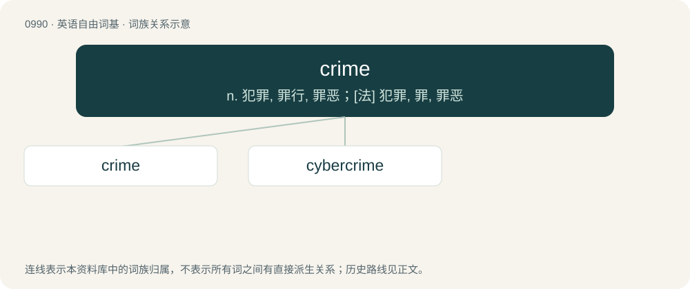

# 1064 · crime — n. 犯罪, 罪行, 罪恶；\[法\] 犯罪, 罪, 罪恶

[总目录](../00_总目录_按常用程度.md)

**类型**：英语自由词基　｜　**来源语言**：见词源记录

## 核心含义与来源

- 核心含义：n. 犯罪, 罪行, 罪恶；\[法\] 犯罪, 罪, 罪恶
- 英文含义：A specific act committed in violation of the law, especially criminal law.
- 词形：crime

**来源记录 1**（名词；A specific act committed in violation of the law, especially criminal law.）

From Middle English cryme, crime, from Old French crime, crimne, from Latin crīmen. Displaced native Old English firen.

## 词族图

## 单词速览（常用到不常用）

| 单词 | 音标 | 释义 |
|---|---|---|
| [crime](#w-1) | 英 /kɹaɪm/ | n. 犯罪, 罪行, 罪恶；\[法\] 犯罪, 罪, 罪恶 |
| [cybercrime](#w-2) |  | n. 网络犯罪 |

## 逐词详解

### 1. crime

**词性**：名词　｜　**音标**：英 /kɹaɪm/

**中文释义**：n. 犯罪, 罪行, 罪恶；\[法\] 犯罪, 罪, 罪恶

**英文义项**：A specific act committed in violation of the law, especially criminal law. / Any great sin or wickedness; iniquity.

**词源与演化**：

From Middle English cryme, crime, from Old French crime, crimne, from Latin crīmen. Displaced native Old English firen.

**例句**：

> Those methods of saving money should be a crime.

该用例对应义项：Any great sin or wickedness; iniquity.

### 2. cybercrime

**词性**：名词

**中文释义**：n. 网络犯罪

**英文义项**：Crime committed using computer networks. / An individual crime of this kind.

**构词拆分**：cyber- + crime

**词源与演化**：

From cyber- + crime.

**例句**：

> I don't know if you realise this, but you're committing a cybercrime.
