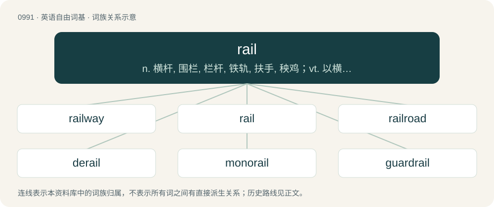

# 1066 · rail — n. 横杆, 围栏, 栏杆, 铁轨, 扶手, 秧鸡；vt. 以横木围栏, 给...铺铁轨；vi. 责骂, 抱怨

[总目录](../00_总目录_按常用程度.md)

**类型**：英语自由词基　｜　**来源语言**：见词源记录

## 核心含义与来源

- 核心含义：n. 横杆, 围栏, 栏杆, 铁轨, 扶手, 秧鸡；vt. 以横木围栏, 给...铺铁轨；vi. 责骂, 抱怨
- 英文含义：A horizontal bar extending between supports and used for support or as a barrier; a railing.
- 词形：rail

**多个词源／构词路径**：同一拼写可能有不同来源；以下按词性和含义分别列出。

**来源记录 1**（名词；A horizontal bar extending between supports and used for support or as a barrier; a railing.）

From Middle English rail, rayl, \*reȝel, \*reȝol (found in reȝolsticke (“a ruler”)), partly from Old English regol (“a ruler, straight bar”) and partly from Old French reille; both from Latin regula (“rule, bar”), from regō (“to rule, to guide, to govern”); see regular. Doublet of regal, regula, rigol, and rule.

**来源记录 2**（名词；Any of several birds in the family Rallidae.）

From French râle, rale, from Middle French raalle, from Old French rasle. Compare Medieval Latin rallus. Named from its harsh cry, Vulgar Latin \*rasculum, from Latin rādere (“to scrape”).

**来源记录 3**（动词；To complain violently (against, about).）

From Middle French railler.

## 词族图

## 单词速览（常用到不常用）

| 单词 | 音标 | 释义 |
|---|---|---|
| [railway](#w-1) | 英 /ˈɹeɪlˌweɪ/ | n. 铁路, 轨道；\[经\] 铁路 |
| [rail](#w-2) | /ɹeɪ(ə)l/ | n. 横杆, 围栏, 栏杆, 铁轨, 扶手, 秧鸡；vt. 以横木围栏, 给...铺铁轨；vi. 责骂, 抱怨 |
| [railroad](#w-3) | 英 /ˈɹeɪlɹəʊd/；美 /ˈɹeɪlɹoʊd/ | n. 铁路, 铁路公司；vt. 铺设铁路, 用铁路运输；vi. 在铁路工作 |
| [derail](#w-4) | 英 /ˌdiːˈɹeɪl/；美 /ˌdiˈɹeɪl/ | vt. 使出轨；n. 脱轨器；\[计\] 转移指令 |
| [monorail](#w-5) | 英 /ˈmɒnəɹeɪl/；美 /ˈmɑnəɹeɪl/ | n. 单轨铁路；\[化\] 单轨梁 |
| [guardrail](#w-6) | 美 /ˈɡɑɹdˌɹeɪl/ | n. 护栏, 护轨 |
| [handrail](#w-7) | 美 /ˈhændˌɹeɪl/ | n. 栏杆, 扶手 |
| [crossrail](#w-8) | /ˈkrɔsreil/ | n. 横木 |
| [railcar](#w-9) | 美 /ˈɹeɪlˌkɑɹ/ | n. 有轨机动车 |
| [railgun](#w-10) | /ˈɹeɪl.ɡʌn/ | 磁轨炮 |

## 逐词详解

### 1. railway

**词性**：名词　｜　**音标**：英 /ˈɹeɪlˌweɪ/

**中文释义**：n. 铁路, 轨道；\[经\] 铁路

**英文义项**：A transport system using rails used to move passengers or goods. / A track, consisting of parallel rails, over which wheeled vehicles such as trains may travel.

**构词拆分**：rail + way

**词源与演化**：

From rail + way.

**例句**：

> It often happens that railway traffic is suspended by a heavy snowfall.

### 2. rail

**词性**：名词　｜　**音标**：/ɹeɪ(ə)l/

**中文释义**：n. 横杆, 围栏, 栏杆, 铁轨, 扶手, 秧鸡；vt. 以横木围栏, 给...铺铁轨；vi. 责骂, 抱怨

**英文义项**：A horizontal bar extending between supports and used for support or as a barrier; a railing. / The metal bar forming part of the track for a railroad.

**词源与演化**：

From Middle English rail, rayl, \*reȝel, \*reȝol (found in reȝolsticke (“a ruler”)), partly from Old English regol (“a ruler, straight bar”) and partly from Old French reille; both from Latin regula (“rule, bar”), from regō (“to rule, to guide, to govern”); see regular. Doublet of regal, regula, rigol, and rule.

**例句**：

> ISA devices draw power from the +5 V, −5 V, +12 V, and −12 V rails of the power supply unit.

该用例对应义项：A conductor maintained at a fixed electrical potential relative to ground, to which other circuit components are connected.

### 3. railroad

**词性**：名词　｜　**音标**：英 /ˈɹeɪlɹəʊd/；美 /ˈɹeɪlɹoʊd/

**中文释义**：n. 铁路, 铁路公司；vt. 铺设铁路, 用铁路运输；vi. 在铁路工作

**英文义项**：A permanent track consisting of fixed metal rails to drive trains or similar motorized vehicles on. / The transportation system comprising such tracks and vehicles fitted to travel on the rails, usually with several vehicles connected together in a train.

**构词拆分**：rail + road

**词源与演化**：

From rail + road.

**例句**：

> The lawyers made the procedure a railroad to get the signatures they needed.

该用例对应义项：A procedure conducted in haste without due consideration.

### 4. derail

**词性**：名词　｜　**音标**：英 /ˌdiːˈɹeɪl/；美 /ˌdiˈɹeɪl/

**中文释义**：vt. 使出轨；n. 脱轨器；\[计\] 转移指令

**英文义项**：Synonym of derailer: A device placed on railway tracks in order to cause a train to derail. / An instance of diverting a conversation or debate from its original topic.

**构词拆分**：de- + rail

**词源与演化**：

From French dérailler (“to go off the rails”). Analyzable as de- + rail.

**例句**：

> The derail was placed deliberately so that the train would fall into the river.

该用例对应义项：Synonym of derailer: A device placed on railway tracks in order to cause a train to derail.

### 5. monorail

**词性**：名词　｜　**音标**：英 /ˈmɒnəɹeɪl/；美 /ˈmɑnəɹeɪl/

**中文释义**：n. 单轨铁路；\[化\] 单轨梁

**英文义项**：a railroad system where the trains run on one rail / a train running on a single rail

**构词拆分**：mono- + rail

**词源与演化**：

Borrowed from French monorail, equivalent to mono- + rail.

**例句**：

> Benedito will ride the monorail at the theme park.

### 6. guardrail

**词性**：名词　｜　**音标**：美 /ˈɡɑɹdˌɹeɪl/

**中文释义**：n. 护栏, 护轨

**英文义项**：A rail set alongside a dangerous place as a barrier, to improve safety. / A strengthened barrier installed on the sides of a (usually major) road to keep vehicles on the highway and reduce the risk and/or impact of crashes.

**构词拆分**：guard + rail

**词源与演化**：

From guard + rail.

**例句**：

> Tom lost control of his vehicle and hit the guardrail.

### 7. handrail

**词性**：名词　｜　**音标**：美 /ˈhændˌɹeɪl/

**中文释义**：n. 栏杆, 扶手

**英文义项**：A rail which can be held, such as on the side of a staircase, ramp, or other walkway, and serving as a support or guard. / A moving continuous belt-like rail on either side of an escalator which users can hold on to for support.

**构词拆分**：hand + rail

**词源与演化**：

From hand + rail.

**例句**：

> The staircase to the loft doesn't have a handrail. It's not safe.

### 8. crossrail

**词性**：名词　｜　**音标**：/ˈkrɔsreil/

**中文释义**：n. 横木

**英文义项**：A rail that goes across something. / A commuter rail line that crosses a major city through a tunnel and which continues for a significant distance into the surrounding areas, generally with relatively high speeds and widely spaced stations compared to an underground or metro.

**构词拆分**：cross- + rail

**词源与演化**：

From cross- + rail.

**例句**：

> Crossrail is one of Europe's largest infrastructure construction projects.

### 9. railcar

**词性**：名词　｜　**音标**：美 /ˈɹeɪlˌkɑɹ/

**中文释义**：n. 有轨机动车

**英文义项**：A self-propelled railway vehicle for passengers, similar to a bus. / A powered single railway vehicle designed for passenger transport, with a driver's cab in both ends; Not to be confused with motor coach/motorcar, which is a powered railway vehicle capable to haul a train.

**构词拆分**：rail + car

**词源与演化**：

From rail + car.

### 10. railgun

**词性**：名词　｜　**音标**：/ˈɹeɪl.ɡʌn/

**中文释义**：磁轨炮

**英文义项**：An electromagnetic gun that uses a large electrical current to propel a projectile down a track of two parallel conductive rails. / A railway gun.

**构词拆分**：rail + gun

**词源与演化**：

From rail + gun. \* (railway gun): From being a gun mounted on a rail car, and being railroad-mobile. \* (EM gun): From being a projectile ejecting device with a pair of electric conducting rails that a launch sled runs along, which shoots the projectile.
