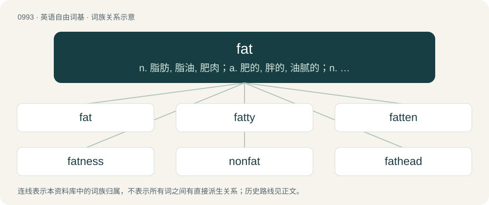

# 1068 · fat — n. 脂肪, 脂油, 肥肉；a. 肥的, 胖的, 油腻的；n. 文件分配表

[总目录](../00_总目录_按常用程度.md)

**类型**：英语自由词基　｜　**来源语言**：见词源记录

## 核心含义与来源

- 核心含义：n. 脂肪, 脂油, 肥肉；a. 肥的, 胖的, 油腻的；n. 文件分配表
- 英文含义：Carrying more fat than usual on one's body; plump; not lean or thin.
- 词形：fat

**多个词源／构词路径**：同一拼写可能有不同来源；以下按词性和含义分别列出。

**来源记录 1**（形容词；Carrying more fat than usual on one's body; plump; not lean or thin.）

From Middle English fat, from Old English fǣtt (“fatted, fat”), from Proto-West Germanic \*faitid (“fatted”), originally the past participle of the verb \*faitijan (“to make fat”), from \*fait (“fat”).

**来源记录 2**（名词；A specialized animal tissue with high lipid content, used for long-term storage of energy: fat tissue.）

From Middle English fat, fatt, fatte, from the adjective above, and possibly from Old English fǣt (“fat”, recorded once), from Proto-West Germanic \*fait, from Proto-Germanic \*faitą, \*faitaz (“fat”).

**来源记录 3**（名词；A fop or dandy.）

From French fat (“conceited person”).

## 词族图

## 单词速览（常用到不常用）

| 单词 | 音标 | 释义 |
|---|---|---|
| [fat](#w-1) | /ˈfæt/ | n. 脂肪, 脂油, 肥肉；a. 肥的, 胖的, 油腻的；n. 文件分配表 |
| [fatty](#w-2) | 英 /ˈfæt.i/；美 /ˈfæt.i/ | a. 肥胖的, 脂肪的, 含脂肪的；\[医\] 脂肪的 |
| [fatten](#w-3) | /ˈfætən/ | vi. 养肥；vt. 使肥胖 |
| [fatness](#w-4) | 美 /ˈfætnəs/ | n. 肥胖, 油腻；\[医\] 肥胖\[症\] |
| [nonfat](#w-5) | 英 /nɒnˈfæt/；美 /nɑnˈfæt/ | a. 脱脂的 |
| [fathead](#w-6) | /ˈfæt.hɛd/ | n. 笨蛋, 呆子 |

## 逐词详解

### 1. fat

**词性**：形容词　｜　**音标**：/ˈfæt/

**中文释义**：n. 脂肪, 脂油, 肥肉；a. 肥的, 胖的, 油腻的；n. 文件分配表

**英文义项**：Carrying more fat than usual on one's body; plump; not lean or thin. / Thick; large.

**词源与演化**：

From Middle English fat, from Old English fǣtt (“fatted, fat”), from Proto-West Germanic \*faitid (“fatted”), originally the past participle of the verb \*faitijan (“to make fat”), from \*fait (“fat”).

**例句**：

> It's a fat contract for a fat part in the film, so he’ll grown fat on the profits.

该用例对应义项：Rich; producing a large income; desirable.

### 2. fatty

**词性**：形容词　｜　**音标**：英 /ˈfæt.i/；美 /ˈfæt.i/

**中文释义**：a. 肥胖的, 脂肪的, 含脂肪的；\[医\] 脂肪的

**英文义项**：Containing, composed of, or consisting of fat. / Sometimes, especially, containing excess fat.

**构词拆分**：fat + -y

**词源与演化**：

From Middle English fatty, equivalent to fat + -y. Cognate with Saterland Frisian fattig (“fatty”), Dutch vettig (“fatty, greasy”), German Low German fettig (“fatty”), German fettig (“fatty”).

**用法示例／搭配（非完整句）**：

> fatty alcohol

该用例对应义项：Of or related to fat.

### 3. fatten

**词性**：动词　｜　**音标**：/ˈfætən/

**中文释义**：vi. 养肥；vt. 使肥胖

**英文义项**：To cause (a person or animal) to be fat or fatter. / To become fat or fatter.

**构词拆分**：From fat + -en.

**词源与演化**：

From fat + -en.

**例句**：

> He gradually fattened in the five years after getting married.

该用例对应义项：To become fat or fatter.

### 4. fatness

**词性**：名词　｜　**音标**：美 /ˈfætnəs/

**中文释义**：n. 肥胖, 油腻；\[医\] 肥胖\[症\]

**英文义项**：The state, quality, or condition of being fat.

**构词拆分**：fat + -ness

**词源与演化**：

From Middle English fatnesse, fattenesse, from Old English fǣtnes (“fatness, the richest part of anything”), equivalent to fat + -ness.

**例句**：

> Fatness isn't contagious, or is it?

### 5. nonfat

**词性**：形容词　｜　**音标**：英 /nɒnˈfæt/；美 /nɑnˈfæt/

**中文释义**：a. 脱脂的

**英文义项**：Containing no fat; fat-free.

**构词拆分**：From non- + fat.

**词源与演化**：

From non- + fat.

**例句**：

> Nonfat or fat-free milk.

该用例对应义项：without fat or fat solids

### 6. fathead

**词性**：名词　｜　**音标**：/ˈfæt.hɛd/

**中文释义**：n. 笨蛋, 呆子

**英文义项**：An idiot; a fool. / A cyprinid fish of the Mississippi valley, Pimephales promelas, the black-headed minnow.

**构词拆分**：fat + head

**词源与演化**：

From fat + head.

**例句**：

> You fathead! You forgot to put the milk in the fridge and now it's spoiled!

该用例对应义项：An idiot; a fool.
