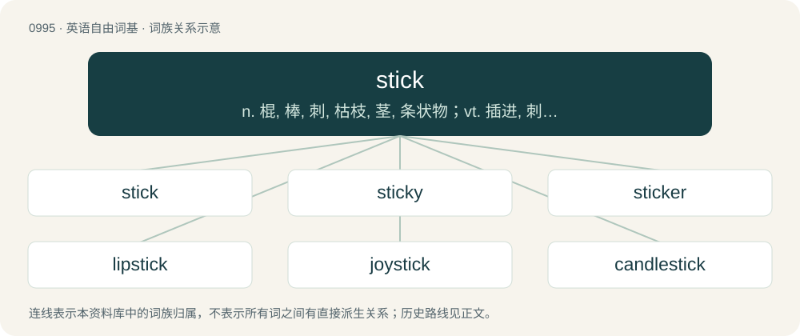

# 1069 · stick — n. 棍, 棒, 刺, 枯枝, 茎, 条状物；vt. 插进, 刺入, 钉住, 伸出, 粘贴, 停止；vi. 粘住, 停留, 坚持, 陷住, 伸出

[总目录](../00_总目录_按常用程度.md)

**类型**：英语自由词基　｜　**来源语言**：见词源记录

## 核心含义与来源

- 核心含义：n. 棍, 棒, 刺, 枯枝, 茎, 条状物；vt. 插进, 刺入, 钉住, 伸出, 粘贴, 停止；vi. 粘住, 停留, 坚持, 陷住, 伸出
- 英文含义：A small, thin branch from a tree or bush; a twig; a branch.
- 词形：stick

**多个词源／构词路径**：同一拼写可能有不同来源；以下按词性和含义分别列出。

**来源记录 1**（名词；A small, thin branch from a tree or bush; a twig; a branch.）

From Middle English sticke, stik, stikke (“branch, twig; kindling; mast; pale; stick, stylus”), from Old English sticca (“stick; peg; beam, rod”), from Proto-West Germanic \*stikkō, from Proto-Germanic \*stikkô (“pole, stick”), from \*stikkōną (“to fix, stick”), from \*stikaną (“to stick; to stab”), from Proto-Indo-European \*(s)teyg- (“to be sharp; to sting”). Cognates Cognate with Dutch stek (“home, spot; cutting, a leaf, stem, branch, or root removed from a plant and cultivated to grow a new plant”), German Stecken (“stick”), Vilamovian śtakia (“stick”); also Cornish wosa (“after”), Welsh wedi (“past (time); after”), Latin instigo (“to stimulate”), Ancient Greek στῐ́ζω (stĭ́zō, “to tattoo; to mark; to punctuate”), Central Kurdish تێژ (têj), تیژ (tîj, “sharp; hot, spicy”), Northern Kurdish tîj, tûj (“sharp; hot, spicy; severe”), Ossetian цыхт (cyxt, “cheese”), Persian تیز (tēz / tiz, “sharp; pungent; shrill; piercing; penetrating; nimble, swift; smart”), Sanskrit तेज॑ते (téjate, “to be or become sharp; to activate, energize”). Related to stigma.

**来源记录 2**（名词；A thrust with a pointed instrument; a stab; an instance of sticking (pricking or piercing).）

From Middle English stiken (“to stick, pierce, stab, remain embedded, be fastened”), from Old English stician (“to pierce, stab, remain embedded, be fastened”), from Proto-West Germanic \*stikkōn, from Proto-Germanic \*stikkōną (“to pierce, prick, be sharp”), from Proto-Indo-European \*(s)tig-, \*(s)teyg- (“to pierce, prick, be sharp”). See also the related Proto-Germanic \*stikaną, whence West Frisian stekke, Low German steken, Dutch steken, German stechen; compare also Danish stikke, Swedish sticka. Cognate with the first etymology (same PIE root, different paths through Germanic and Old English), to stitch, and to etiquette, via French étiquette – see there for further discussion.

## 词族图

## 单词速览（常用到不常用）

| 单词 | 音标 | 释义 |
|---|---|---|
| [stick](#w-1) | 英 /stɪk/ | n. 棍, 棒, 刺, 枯枝, 茎, 条状物；vt. 插进, 刺入, 钉住, 伸出, 粘贴, 停止；vi. 粘住, 停留, 坚持, 陷住, 伸出 |
| [sticky](#w-2) | /ˈstɪki/ | a. 粘的, 有粘性的, 顽固的 |
| [sticker](#w-3) | 英 /ˈstɪkə/；美 /ˈstɪkɚ/ | n. 屠夫, 尖刀, 刺, 芒, 尖物, 携带尖刀者, 张贴物, 滞销品, (非正式)难题；\[经\] 呆滞商品 |
| [lipstick](#w-4) | 英 /ˈlɪpstɪk/；美 /ˈlɪpˌstɪk/ | n. 口红, 唇膏；\[机\] 口红 |
| [joystick](#w-5) | 英 /ˈd͡ʒɔɪ.stɪk/ | n. (飞机的)操纵杆；\[计\] 控制杆, 操纵杆 |
| [candlestick](#w-6) | /ˈkændəlˌstɪk/ | n. 蜡杆, 蜡烛架 |
| [slapstick](#w-7) | /ˈslæpstik/ | n. 闹剧, 趣剧 |
| [yardstick](#w-8) | 英 /ˈjɑːdˌstɪk/；美 /ˈjɑɹdˌstɪk/ | n. 码尺, 计算标准, 准绳；\[法\] 尺度, 衡量标准, 任何评判或比较的标准 |
| [broomstick](#w-9) | /ˈbɹum.stɪk/ | n. 扫帚柄 |
| [chapstick](#w-10) | 美 /ˈt͡ʃæpˌstɪk/ | n. 无色唇膏 |
| [drumstick](#w-11) | /ˈdɹʌmˌstɪk/ | n. 鼓槌, 鸡腿下段 |
| [nonstick](#w-12) |  | a. 锅底不粘的 |
| [dipstick](#w-13) | /ˈdɪpstɪk/ | n. 量油尺 |
| [matchstick](#w-14) | 美 /ˈmætʃstɪk/ | n. 火柴 |
| [stickman](#w-15) | /sˈtɪkmæn/ | n. &lt;俚&gt;赌场筹码管理人, 曲棍球手 |

## 逐词详解

### 1. stick

**词性**：名词　｜　**音标**：英 /stɪk/

**中文释义**：n. 棍, 棒, 刺, 枯枝, 茎, 条状物；vt. 插进, 刺入, 钉住, 伸出, 粘贴, 停止；vi. 粘住, 停留, 坚持, 陷住, 伸出

**英文义项**：A small, thin branch from a tree or bush; a twig; a branch. / A relatively long, thin piece of wood, of any size.

**词源与演化**：

From Middle English sticke, stik, stikke (“branch, twig; kindling; mast; pale; stick, stylus”), from Old English sticca (“stick; peg; beam, rod”), from Proto-West Germanic \*stikkō, from Proto-Germanic \*stikkô (“pole, stick”), from \*stikkōną (“to fix, stick”), from \*stikaną (“to stick; to stab”), from Proto-Indo-European \*(s)teyg- (“to be sharp; to sting”). Cognates Cognate with Dutch stek (“home, spot; cutting, a leaf, stem, branch, or root removed from a plant and cultivated to grow a new plant”), German Stecken (“stick”), Vilamovian śtakia (“stick”); also Cornish wosa (“after”), Welsh wedi (“past (time); after”), Latin instigo (“to stimulate”), Ancient Greek στῐ́ζω (stĭ́zō, “to tattoo; to mark; to punctuate”), Central Kurdish تێژ (têj), تیژ (tîj, “sharp; hot, spicy”), Northern Kurdish tîj, tûj (“sharp; hot, spicy; severe”), Ossetian цыхт (cyxt, “cheese”), Persian تیز (tēz / tiz, “sharp; pungent; shrill; piercing; penetrating; nimble, swift; smart”), Sanskrit तेज॑ते (téjate, “to be or become sharp; to activate, energize”). Related to stigma.

**例句**：

> I found enough sticks in dumpsters at construction sites to build my shed.

该用例对应义项：A timber board, especially a two by four (inches).

### 2. sticky

**词性**：形容词　｜　**音标**：/ˈstɪki/

**中文释义**：a. 粘的, 有粘性的, 顽固的

**英文义项**：Tending to stick; able to adhere via the drying of a viscous substance. / Difficult, awkward.

**构词拆分**：From stick + -y.

**词源与演化**：

From stick + -y.

**例句**：

> We should make the printing direction sticky so the user doesn't have to keep setting it.

该用例对应义项：Persistent.

### 3. sticker

**词性**：名词　｜　**音标**：英 /ˈstɪkə/；美 /ˈstɪkɚ/

**中文释义**：n. 屠夫, 尖刀, 刺, 芒, 尖物, 携带尖刀者, 张贴物, 滞销品, (非正式)难题；\[经\] 呆滞商品

**英文义项**：Something or someone that sticks (pierces, or adheres). / One who sticks to something, or does not give up; a stayer.

**构词拆分**：From stick (“to pierce, to be fastened, to adhere”) + -er (“agent”).

**词源与演化**：

From stick (“to pierce, to be fastened, to adhere”) + -er (“agent”).

**例句**：

> When buying a car, know the sticker and the invoice price.

该用例对应义项：The listed price (also sticker price).

### 4. lipstick

**词性**：名词　｜　**音标**：英 /ˈlɪpstɪk/；美 /ˈlɪpˌstɪk/

**中文释义**：n. 口红, 唇膏；\[机\] 口红

**英文义项**：Makeup for the lips. / A stick of this makeup.

**构词拆分**：lip + stick

**词源与演化**：

From lip + stick.

**例句**：

> I'd like three lipsticks in this shade.

该用例对应义项：A stick of this makeup.

### 5. joystick

**词性**：名词　｜　**音标**：英 /ˈd͡ʒɔɪ.stɪk/

**中文释义**：n. (飞机的)操纵杆；\[计\] 控制杆, 操纵杆

**英文义项**：A mechanical control device consisting of a handgrip mounted on a base or pedestal and typically having one or more buttons, used to control an aircraft, computer, or other equipment. / A penis.

**构词拆分**：joy + stick

**词源与演化**：

From joy + stick. First attested around 1910 (as joy-stick) as the control stick on an airplane. Its relation to the word joy is unclear.

**例句**：

> It's no use trying to find people to play Street Fighter with when you can't explain double quarter-circle joystick motions.

### 6. candlestick

**词性**：名词　｜　**音标**：/ˈkændəlˌstɪk/

**中文释义**：n. 蜡杆, 蜡烛架

**英文义项**：A holder with a socket or spike for a candle. / A gymnastics move in which the legs are pointed vertically upward.

**构词拆分**：candle + stick

**词源与演化**：

From Middle English candelstik, candelstikke, from Old English candelsticca (“candlestick”), equivalent to candle + stick. Cognate with Scots candilsteke, candilstik (“candlestick”). Compare Old Norse kertastika, kertistika (“candlestick”).

**例句**：

> Miss Scarlett was killed with a candlestick in the ballroom.

### 7. slapstick

**词性**：名词　｜　**音标**：/ˈslæpstik/

**中文释义**：n. 闹剧, 趣剧

**英文义项**：A style of humor focusing on physical comedy, such as slipping on a banana peel, and with foolish characters who get into humiliating situations. / A pair of sticks attached at one end and used to create a slapping sound effect, used especially in slapstick comedy; a type of clapper.

**构词拆分**：slap + stick

**词源与演化**：

From slap + stick, calque of Italian batacchio. The pair of sticks was used by the comic character Harlequin in the commedia dell'arte.

**例句**：

> Shimura attracted fans of all generations with his slapstick comedy and funny faces.

### 8. yardstick

**词性**：名词　｜　**音标**：英 /ˈjɑːdˌstɪk/；美 /ˈjɑɹdˌstɪk/

**中文释义**：n. 码尺, 计算标准, 准绳；\[法\] 尺度, 衡量标准, 任何评判或比较的标准

**英文义项**：A measuring rod thirty-six inches (one yard) long. / A standard to which other measurements or comparisons are judged.

**构词拆分**：yard + stick

**词源与演化**：

From yard + stick.

**例句**：

> On what kind of yardstick is he basing his judgment?

该用例对应义项：a measure or standard used for comparison

### 9. broomstick

**词性**：名词　｜　**音标**：/ˈbɹum.stɪk/

**中文释义**：n. 扫帚柄

**英文义项**：The handle of a broom (sweeping tool); (sometimes) the entire broom. / A broom imbued with magic, enabling one to fly astride the handle.

**构词拆分**：broom + stick

**词源与演化**：

From broom + stick.

**例句**：

> It's hard to do ballet if you're as rigid as a broomstick.

### 10. chapstick

**词性**：名词　｜　**音标**：美 /ˈt͡ʃæpˌstɪk/

**中文释义**：n. 无色唇膏

**英文义项**：Synonym of lip balm.

**构词拆分**：chap + stick

**词源与演化**：

Genericized trademark from ChapStick, a brand name, from chap + stick, since it is a stick that relieves chapped lips.

### 11. drumstick

**词性**：名词　｜　**音标**：/ˈdɹʌmˌstɪk/

**中文释义**：n. 鼓槌, 鸡腿下段

**英文义项**：A stick used to play drums. / The second joint of the legbone of a chicken or other fowl, especially as an item of food.

**构词拆分**：drum + stick

**词源与演化**：

From drum + stick.

**例句**：

> Tom put down his fork and picked up the drumstick with his fingers.

### 12. nonstick

**词性**：形容词

**中文释义**：a. 锅底不粘的

**英文义项**：Resistant to sticking.

**构词拆分**：From non- + stick.

**词源与演化**：

From non- + stick.

**例句**：

> This nonstick cookware is easy to clean.

该用例对应义项：Resistant to sticking.

### 13. dipstick

**词性**：名词　｜　**音标**：/ˈdɪpstɪk/

**中文释义**：n. 量油尺

**英文义项**：A stick or rod used to measure the depth of a liquid. Often used to check the level at which a liquid in an opaque or inaccessible tank or reservoir stands; gauge. / The penis.

**构词拆分**：dip + stick

**词源与演化**：

From dip + stick.

**例句**：

> I haven't checked the oil level of my car's motor since I lost the dipstick three months ago.

该用例对应义项：A stick or rod used to measure the depth of a liquid. Often used to check the level at which a liquid in an opaque or inaccessible tank or reservoir stands; gauge.

### 14. matchstick

**词性**：名词　｜　**音标**：美 /ˈmætʃstɪk/

**中文释义**：n. 火柴

**英文义项**：A small, slender piece of wood or cardboard serving as a component of a match. / Any similarly small and thin piece.

**构词拆分**：match + stick

**词源与演化**：

From match + stick.

**例句**：

> The explosion blew the powder shed to matchsticks.

该用例对应义项：Any similarly small and thin piece.

### 15. stickman

**词性**：名词　｜　**音标**：/sˈtɪkmæn/

**中文释义**：n. &lt;俚&gt;赌场筹码管理人, 曲棍球手

**英文义项**：A simple drawing of a man with lines to represent limbs and torso. / A dealer in gambling who gathers the dice with a stick.

**构词拆分**：stick + -man

**词源与演化**：

From stick + -man.
