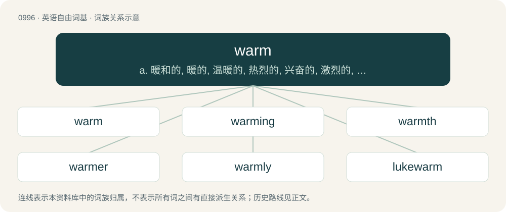

# 1070 · warm — a. 暖和的, 暖的, 温暖的, 热烈的, 兴奋的, 激烈的, 多情的, 色情的；vt. 使温暖, 弄热, 使兴奋, 使充满仇恨；vi. 变暖和, 变温暖, 取暖, 激动, 同情, 爱好

[总目录](../00_总目录_按常用程度.md)

**类型**：英语自由词基　｜　**来源语言**：见词源记录

## 核心含义与来源

- 核心含义：a. 暖和的, 暖的, 温暖的, 热烈的, 兴奋的, 激烈的, 多情的, 色情的；vt. 使温暖, 弄热, 使兴奋, 使充满仇恨；vi. 变暖和, 变温暖, 取暖, 激动, 同情, 爱好
- 英文含义：Of a somewhat high temperature, often but not always connoting that the high temperature is pleasant rather than uncomfortable.
- 词形：warm

**多个词源／构词路径**：同一拼写可能有不同来源；以下按词性和含义分别列出。

**来源记录 1**（形容词；Of a somewhat high temperature, often but not always connoting that the high temperature is pleasant rather than uncomfortable.）

From Middle English warm, werm, from Old English wearm, from Proto-West Germanic \*warm, from Proto-Germanic \*warmaz, from one of: \* Proto-Indo-European \*wór-mo-s, from \*wer- (“to burn”), which is related to Hittite 𒉿𒊏𒀀𒉌 (warāni, “to burn”), Armenian վառել (vaṙel, “to burn, heat, warm”), Old Church Slavonic варити (variti, “to cook, boil”). \* Proto-Indo-European \*gʷʰor-mo-s, from the root \*gʷʰer- (“warm, hot”), in which case cognate with Ancient Greek θερμός (thermós) (making perhaps a distant doublet of thermos), Latin formus, Sanskrit घर्म (gharmá). In any case cognate within Germanic to West Frisian waarm, Saterland Frisian woorm, Dutch warm, German warm, Swedish varm, Icelandic varmur.

**来源记录 2**（动词；To make or keep warm.）

From Middle English warmen, wermen, wyrmen, from Old English wierman (“to make warm”) and wearmian (“to become warm”), from Proto-West Germanic \*warmijan and \*warmōn. Cognate with Dutch warmen, German wärmen, Swedish värma.

## 词族图

## 单词速览（常用到不常用）

| 单词 | 音标 | 释义 |
|---|---|---|
| [warm](#w-1) | 英 /wɔːm/；美 /wɔɹm/ | a. 暖和的, 暖的, 温暖的, 热烈的, 兴奋的, 激烈的, 多情的, 色情的；vt. 使温暖, 弄热, 使兴奋, 使充满仇恨；vi. 变暖和, 变温暖, 取暖, 激动, 同情, 爱好 |
| [warming](#w-2) | 英 /ˈwɔːmɪŋ/；美 /ˈwoɹmɪŋ/ | n. 暖和, 加温, 暖热, 温暖, (非正式)打, 鞭打 |
| [warmth](#w-3) | 英 /wɔːmθ/；美 /wɔɹmθ/ | n. 温暖, 温情, 暖和, 激动, 生气 |
| [warmer](#w-4) | 英 /ˈwɔːmə/；美 /ˈwɔɹmɚ/ | n. 进行加热的人, 取暖器；\[化\] 热炼机 |
| [warmly](#w-5) | 英 /ˈwɔːmli/；美 /ˈwɔɹmli/ | adv. 亲切地, 温暖地, 热心地 |
| [lukewarm](#w-6) | 英 /ˌl(j)uːk.ˈwɔːm/；美 /ˌl(j)uk.ˈwɔɹm/ | a. 微温的, 不热的, 不热情的；\[医\] 微温的 |

## 逐词详解

### 1. warm

**词性**：形容词　｜　**音标**：英 /wɔːm/；美 /wɔɹm/

**中文释义**：a. 暖和的, 暖的, 温暖的, 热烈的, 兴奋的, 激烈的, 多情的, 色情的；vt. 使温暖, 弄热, 使兴奋, 使充满仇恨；vi. 变暖和, 变温暖, 取暖, 激动, 同情, 爱好

**英文义项**：Of a somewhat high temperature, often but not always connoting that the high temperature is pleasant rather than uncomfortable. / Friendly and with affection.

**词源与演化**：

From Middle English warm, werm, from Old English wearm, from Proto-West Germanic \*warm, from Proto-Germanic \*warmaz, from one of: \* Proto-Indo-European \*wór-mo-s, from \*wer- (“to burn”), which is related to Hittite 𒉿𒊏𒀀𒉌 (warāni, “to burn”), Armenian վառել (vaṙel, “to burn, heat, warm”), Old Church Slavonic варити (variti, “to cook, boil”). \* Proto-Indo-European \*gʷʰor-mo-s, from the root \*gʷʰer- (“warm, hot”), in which case cognate with Ancient Greek θερμός (thermós) (making perhaps a distant doublet of thermos), Latin formus, Sanskrit घर्म (gharmá). In any case cognate within Germanic to West Frisian waarm, Saterland Frisian woorm, Dutch warm, German warm, Swedish varm, Icelandic varmur.

**例句**：

> We have a warm friendship.

该用例对应义项：Friendly and with affection.

### 2. warming

**词性**：名词　｜　**音标**：英 /ˈwɔːmɪŋ/；美 /ˈwoɹmɪŋ/

**中文释义**：n. 暖和, 加温, 暖热, 温暖, (非正式)打, 鞭打

**英文义项**：A small rise in temperature. / A beating; a thrashing.

**构词拆分**：warm + -ing

**词源与演化**：

From Middle English warmyng, warmynge, from Old English wærming, wirming, equivalent to warm + -ing.

**例句**：

> Red sky in morning; global warming. Red sky at night, reactor's alight.

### 3. warmth

**词性**：名词　｜　**音标**：英 /wɔːmθ/；美 /wɔɹmθ/

**中文释义**：n. 温暖, 温情, 暖和, 激动, 生气

**英文义项**：A moderate degree of heat; the sensation of being warm. / Friendliness, kindness or affection.

**构词拆分**：warm + -th (abstract nominal suffix)

**词源与演化**：

From Middle English warmth, warmeth, wermþe, from Old English \*wiermþu (“warmth”), from Proto-West Germanic \*warmiþu (“warmness; warmth”), corresponding to warm + -th (abstract nominal suffix). Cognate with Saterland Frisian Waarmte (“warmth”), West Frisian waarmte (“warmth”), Dutch warmte (“warmth”), German Low German Warmte, Warmt (“warmth”).

**例句**：

> An agreeable warmth in the house.

该用例对应义项：the quality of having a moderate degree of heat

### 4. warmer

**词性**：名词　｜　**音标**：英 /ˈwɔːmə/；美 /ˈwɔɹmɚ/

**中文释义**：n. 进行加热的人, 取暖器；\[化\] 热炼机

**英文义项**：Something that warms (something else) by providing some small amount of heat, such as a hot water bottle or a soup. / A piece of clothing for warmth via insulation of body heat.

**构词拆分**：warm + -er

**词源与演化**：

From warm + -er.

**例句**：

> I'll put off my visit to England till the weather is warmer.

### 5. warmly

**词性**：副词　｜　**音标**：英 /ˈwɔːmli/；美 /ˈwɔɹmli/

**中文释义**：adv. 亲切地, 温暖地, 热心地

**英文义项**：In a manner that maintains warm temperature. / In a warm, friendly manner.

**构词拆分**：warm + -ly

**词源与演化**：

From warm + -ly.

**例句**：

> Be sure to dress warmly today!

该用例对应义项：In a manner that maintains warm temperature.

### 6. lukewarm

**词性**：形容词　｜　**音标**：英 /ˌl(j)uːk.ˈwɔːm/；美 /ˌl(j)uk.ˈwɔɹm/

**中文释义**：a. 微温的, 不热的, 不热情的；\[医\] 微温的

**英文义项**：Between warm and cool. / Unenthusiastic (about a proposal or an idea).

**构词拆分**：luke (“lukewarm”) + warm

**词源与演化**：

From Middle English leukwarm, lukewarm (“lukewarm, tepid”), equivalent to luke (“lukewarm”) + warm. Compare Saterland Frisian luukwoarm (“lukewarm”), German Low German luukwarm (“lukewarm”); first element is related to Dutch leuk (“lukewarm”), as in leukwater (“lukewarm water”). Compare also West Frisian lijwarm (“lukewarm”), Afrikaans louwarm (“lukewarm”), German Low German lowarm, luwarm (“lukewarm”), German lauwarm (“lukewarm”). First element believed to be an alteration of Middle English lew (“tepid”) (&gt; English dialectal lew), from Old English \*hlēowe (“warm, sunny”), from Proto-Germanic \*hliwjaz, \*hlēwaz, \*hlūmaz, \*hleumaz (“warm”), from Proto-Indo-European \*ḱal(w)e-, \*ḱel(w)e-, \*k(')lēw- (“warm, hot”). Cognate with Dutch lauw (“tepid”), German lau (“lukewarm”), Faroese lýggjur (“warm”), Swedish ljum (“lukewarm”), ljummen (“lukewarm”) and ly (“warm”), Danish lummer (“muggy”), Danish and Norwegian lunken (“tepid”), dialectal Swedish ljummen (“lukewarm”).

**例句**：

> The suggestion met with only a lukewarm response.

该用例对应义项：Unenthusiastic (about a proposal or an idea).
