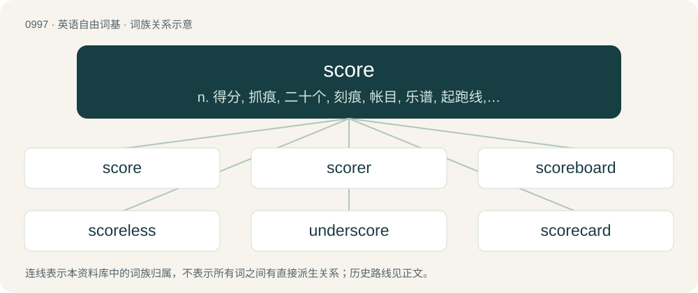

# 1072 · score — n. 得分, 抓痕, 二十个, 刻痕, 帐目, 乐谱, 起跑线, 终点线, 大量；vt. 刻划, 划线, 获得, 评价, 把...记下；vi. 刻痕, 记分, 得分

[总目录](../00_总目录_按常用程度.md)

**类型**：英语自由词基　｜　**来源语言**：见词源记录

## 核心含义与来源

- 核心含义：n. 得分, 抓痕, 二十个, 刻痕, 帐目, 乐谱, 起跑线, 终点线, 大量；vt. 刻划, 划线, 获得, 评价, 把...记下；vi. 刻痕, 记分, 得分
- 英文含义：The total number of goals, points, runs, etc. earned by a participant in a game.
- 词形：score

**来源记录 1**（名词；The total number of goals, points, runs, etc. earned by a participant in a game.）

From Middle English score, skore, schore, from Old English scoru (“notch; tally; score”), from Old Norse skor, from Proto-Germanic \*skurō (“incision; tear; rift”), which is related to \*skeraną (“to cut”), ultimately from Proto-Indo-European \*(s)ker- (“cut”). Cognate with Icelandic skora, Swedish skåra, Danish skår. Related to shear. For the sense “twenty”: The mark on a tally made by drovers for every twenty beasts passing through a tollgate.

## 词族图

## 单词速览（常用到不常用）

| 单词 | 音标 | 释义 |
|---|---|---|
| [score](#w-1) | 英 /skɔː/；美 /skoɹ/ | n. 得分, 抓痕, 二十个, 刻痕, 帐目, 乐谱, 起跑线, 终点线, 大量；vt. 刻划, 划线, 获得, 评价, 把...记下；vi. 刻痕, 记分, 得分 |
| [scorer](#w-2) | /ˈskɒːrə/ | n. 记录员, 刻痕者 |
| [scoreboard](#w-3) | /ˈskɒːbɒːd/ | n. 记分板 |
| [scoreless](#w-4) | /ˈskɒːlis/ | a. 没得分的 |
| [underscore](#w-5) | 英 /ˈʌn.dəˌskɔː(ɹ)/；美 /ˈʌn.dɚˌskoɹ/ | vt. 划线于...下；n. (表强调的)下划线；\[计\] 底线 |
| [scorecard](#w-6) | /ˈskɒːkɑːd/ | n. 记分卡 |
| [scoreline](#w-7) | /ˈskɔːlain/ | n. (报刊上报道体育比赛结果的)分数栏 |
| [scoresheet](#w-8) | /ˈskɔːʃiːt/ | n. \[体\]记分单 |
| [outscore](#w-9) | /autˈskɔː/ | vt.得分超过 |

## 逐词详解

### 1. score

**词性**：名词　｜　**音标**：英 /skɔː/；美 /skoɹ/

**中文释义**：n. 得分, 抓痕, 二十个, 刻痕, 帐目, 乐谱, 起跑线, 终点线, 大量；vt. 刻划, 划线, 获得, 评价, 把...记下；vi. 刻痕, 记分, 得分

**英文义项**：The total number of goals, points, runs, etc. earned by a participant in a game. / The number of points accrued by each of the participants in a game, expressed as a ratio or a series of numbers.

**词源与演化**：

From Middle English score, skore, schore, from Old English scoru (“notch; tally; score”), from Old Norse skor, from Proto-Germanic \*skurō (“incision; tear; rift”), which is related to \*skeraną (“to cut”), ultimately from Proto-Indo-European \*(s)ker- (“cut”). Cognate with Icelandic skora, Swedish skåra, Danish skår. Related to shear. For the sense “twenty”: The mark on a tally made by drovers for every twenty beasts passing through a tollgate.

**例句**：

> The score is 8-1 even though it's not even half-time!

该用例对应义项：The number of points accrued by each of the participants in a game, expressed as a ratio or a series of numbers.

### 2. scorer

**词性**：名词　｜　**音标**：/ˈskɒːrə/

**中文释义**：n. 记录员, 刻痕者

**英文义项**：One who scores. / One who keeps track of scores in a game; a scorekeeper.

**构词拆分**：score + -er

**词源与演化**：

From score + -er.

**例句**：

> The team was making goals so fast the scorer could barely keep up.

该用例对应义项：One who keeps track of scores in a game; a scorekeeper.

### 3. scoreboard

**词性**：名词　｜　**音标**：/ˈskɒːbɒːd/

**中文释义**：n. 记分板

**英文义项**：A large board that displays the score in a game or contest. / A similar board that also displays each batsman's score, and many statistics and pieces of information.

**构词拆分**：score + board

**词源与演化**：

From score + board.

**例句**：

> The player made a bad move, and now the scoreboard is once more against him.

### 4. scoreless

**词性**：形容词　｜　**音标**：/ˈskɒːlis/

**中文释义**：a. 没得分的

**英文义项**：With no points or goals etc having been scored.

**构词拆分**：score + -less

**词源与演化**：

From score + -less.

### 5. underscore

**词性**：动词　｜　**音标**：英 /ˈʌn.dəˌskɔː(ɹ)/；美 /ˈʌn.dɚˌskoɹ/

**中文释义**：vt. 划线于...下；n. (表强调的)下划线；\[计\] 底线

**英文义项**：To underline; to mark a line beneath text. / To emphasize or draw attention to.

**构词拆分**：under- + score

**词源与演化**：

From under- + score.

**例句**：

> I wish to underscore the importance of proper formatting.

该用例对应义项：To emphasize or draw attention to.

### 6. scorecard

**词性**：名词　｜　**音标**：/ˈskɒːkɑːd/

**中文释义**：n. 记分卡

**英文义项**：A printed card allowing spectators of a game to identify players and record progress. / A tabular representation of the most important statistics of an innings or match.

**构词拆分**：score + card

**词源与演化**：

From score + card.

**例句**：

> What we need is some kind of scorecard by which we can make objective comparisons between these products.

该用例对应义项：A system of ratings.

### 7. scoreline

**词性**：名词　｜　**音标**：/ˈskɔːlain/

**中文释义**：n. (报刊上报道体育比赛结果的)分数栏

**英文义项**：A line in a newspaper or other publication giving the score in a sports match / The score at the end of, of during, a match or game.

**构词拆分**：score + line

**词源与演化**：

From score + line.

### 8. scoresheet

**词性**：名词　｜　**音标**：/ˈskɔːʃiːt/

**中文释义**：n. \[体\]记分单

**英文义项**：A sheet of paper (or similar) on which score is kept. / A list of people who have scored.

**构词拆分**：score + sheet

**词源与演化**：

From score + sheet.

### 9. outscore

**词性**：动词　｜　**音标**：/autˈskɔː/

**中文释义**：vt.得分超过

**英文义项**：To score more than.

**构词拆分**：out- + score

**词源与演化**：

From out- + score.
