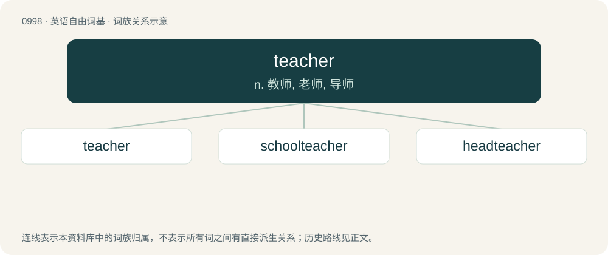

# 1074 · teacher — n. 教师, 老师, 导师

[总目录](../00_总目录_按常用程度.md)

**类型**：英语自由词基　｜　**来源语言**：见词源记录

## 核心含义与来源

- 核心含义：n. 教师, 老师, 导师
- 英文含义：A person who teaches, especially one employed in a school; preceptor.
- 词形：teacher

**来源记录 1**（名词；A person who teaches, especially one employed in a school; preceptor.）

From Middle English techere, equivalent to teach + -er. More at teach.

## 词族图

## 单词速览（常用到不常用）

| 单词 | 音标 | 释义 |
|---|---|---|
| [teacher](#w-1) | 英 /ˈtiː.t͡ʃəː/；美 /ˈti.t͡ʃɚ/ | n. 教师, 老师, 导师 |
| [schoolteacher](#w-2) | /ˈskuːltiːtʃə/ | n. 教师 |
| [headteacher](#w-3) | /hedˈtiːtʃər/ | n. 中小学的校长 |

## 逐词详解

### 1. teacher

**词性**：名词　｜　**音标**：英 /ˈtiː.t͡ʃəː/；美 /ˈti.t͡ʃɚ/

**中文释义**：n. 教师, 老师, 导师

**英文义项**：A person who teaches, especially one employed in a school; preceptor. / The index finger; the forefinger.

**构词拆分**：teach + -er

**词源与演化**：

From Middle English techere, equivalent to teach + -er. More at teach.

**例句**：

> Experience is a demanding teacher.

该用例对应义项：a personified abstraction that teaches

### 2. schoolteacher

**词性**：名词　｜　**音标**：/ˈskuːltiːtʃə/

**中文释义**：n. 教师

**英文义项**：A teacher working in a school.

**构词拆分**：school + teacher

**词源与演化**：

From school + teacher.

**例句**：

> Tom's dream is to be a schoolteacher.

### 3. headteacher

**词性**：名词　｜　**音标**：/hedˈtiːtʃər/

**中文释义**：n. 中小学的校长

**英文义项**：The most senior teacher in a school who is responsible for its management and administration.

**构词拆分**：head + teacher

**词源与演化**：

From head + teacher.

**例句**：

> I had to go and see the headteacher about my attitude.

该用例对应义项：The most senior teacher in a school who is responsible for its management and administration.
