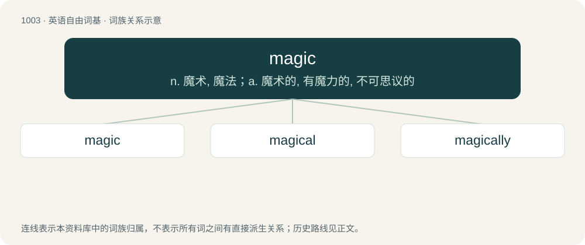

# 1080 · magic — n. 魔术, 魔法；a. 魔术的, 有魔力的, 不可思议的

[总目录](../00_总目录_按常用程度.md)

**类型**：英语自由词基　｜　**来源语言**：见词源记录

## 核心含义与来源

- 核心含义：n. 魔术, 魔法；a. 魔术的, 有魔力的, 不可思议的
- 英文含义：The application of rituals or actions, especially those based on occult knowledge, to subdue or manipulate natural or supernatural beings and forces in order to have some benefit from them.
- 词形：magic

**来源记录 1**（名词；The application of rituals or actions, especially those based on occult knowledge, to subdue or manipulate natural or supernatural beings and forces in order to have some benefit from them.）

From Middle English magik, magyk, from Old French magique (noun and adjective), from Latin magicus (adjective), magica (noun use of feminine form of magicus), from Ancient Greek μαγικός (magikós, “magical”), from μάγος (mágos, “magus”). Ultimately from Old Iranian, probably derived from Proto-Indo-European \*meh₂gʰ- (“to be able to, to help; power, sorcerer”). Displaced Old English ġealdor (whence Middle English galder) and dwimmer.

## 词族图

## 单词速览（常用到不常用）

| 单词 | 音标 | 释义 |
|---|---|---|
| [magic](#w-1) | 英 /ˈmad͡ʒɪk/；美 /ˈmæd͡ʒɪk/ | n. 魔术, 魔法；a. 魔术的, 有魔力的, 不可思议的 |
| [magical](#w-2) | /ˈmæd͡ʒ.ɪ.kəl/ | a. 魔术的, 有魔力的, 不可思议的 |
| [magically](#w-3) | /ˈmæd͡ʒ.ɪ.kli/ | adv. 用魔法地；如魔法般地 |

## 逐词详解

### 1. magic

**词性**：名词　｜　**音标**：英 /ˈmad͡ʒɪk/；美 /ˈmæd͡ʒɪk/

**中文释义**：n. 魔术, 魔法；a. 魔术的, 有魔力的, 不可思议的

**英文义项**：The application of rituals or actions, especially those based on occult knowledge, to subdue or manipulate natural or supernatural beings and forces in order to have some benefit from them. / The supernatural forces which are drawn on in such a ritual.

**词源与演化**：

From Middle English magik, magyk, from Old French magique (noun and adjective), from Latin magicus (adjective), magica (noun use of feminine form of magicus), from Ancient Greek μαγικός (magikós, “magical”), from μάγος (mágos, “magus”). Ultimately from Old Iranian, probably derived from Proto-Indo-European \*meh₂gʰ- (“to be able to, to help; power, sorcerer”). Displaced Old English ġealdor (whence Middle English galder) and dwimmer.

**例句**：

> “My magic will help you find true love,” said the witch as she looked for the right herbs in her collection.

该用例对应义项：The application of rituals or actions, especially those based on occult knowledge, to subdue or manipulate natural or supernatural beings and forces in order to have some benefit from them.

### 2. magical

**词性**：形容词　｜　**音标**：/ˈmæd͡ʒ.ɪ.kəl/

**中文释义**：a. 魔术的, 有魔力的, 不可思议的

**英文义项**：Of, relating to, or by means of magic. / Enchanting.

**构词拆分**：magic + -al

**词源与演化**：

From magic + -al.

**例句**：

> The fireworks created a magical atmosphere in that beautiful summer night.

该用例对应义项：Enchanting.

### 3. magically

**词性**：副词　｜　**音标**：/ˈmæd͡ʒ.ɪ.kli/

**中文释义**：adv. 用魔法地；如魔法般地

**英文义项**：In a magical manner; by magic, or as if by magic.

**构词拆分**：magic + -ally；magical + -ly

**词源与演化**：

From magic + -ally or magical + -ly.

**例句**：

> He wished that a bowl of peanut soup would magically appear before him.
