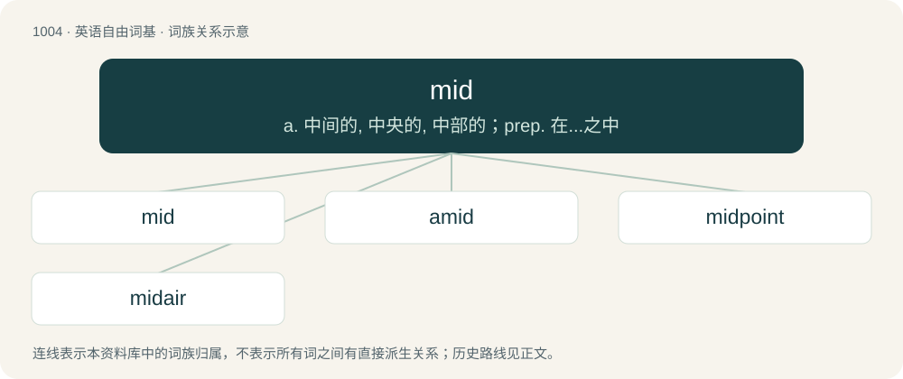

# 1082 · mid — a. 中间的, 中央的, 中部的；prep. 在...之中

[总目录](../00_总目录_按常用程度.md)

**类型**：英语自由词基　｜　**来源语言**：见词源记录

## 核心含义与来源

- 核心含义：a. 中间的, 中央的, 中部的；prep. 在...之中
- 英文含义：Occupying a middle position; middle.
- 词形：mid

**多个词源／构词路径**：同一拼写可能有不同来源；以下按词性和含义分别列出。

**来源记录 1**（形容词；Occupying a middle position; middle.）

Inherited from Middle English mid, midde, from Old English midd (“mid, middle, midway”), from Proto-West Germanic \*midi, from Proto-Germanic \*midjaz (“mid, middle”, adjective), from Proto-Indo-European \*médʰyos (“between, in the middle, middle”). Cognate with Dutch midden (“in the middle”), German Mitte (“center, middle, mean”), Icelandic miður (“middle”, adjective), Latin medius (“middle”, noun and adjective). See also middle. The slang sense may be influenced by terms such as middling and midwit.

**来源记录 2**（名词；A mid-range.）

Clipping of mid-range.

**来源记录 3**（介词；With.）

From or representing German mit, and/or perhaps German Low German mid. Although Middle English had a native preposition mid with this same meaning ("with"), it had fallen out of general use by the mid 1400s and survived into the modern English period only in sporadic use and the compounds midwife and theremid.

## 词族图

## 单词速览（常用到不常用）

| 单词 | 音标 | 释义 |
|---|---|---|
| [mid](#w-1) | /mɪd/ | a. 中间的, 中央的, 中部的；prep. 在...之中 |
| [amid](#w-2) | 英 /əˈmɪd/ | prep. 在其间, 在其中；\[经\] 在...中 |
| [midpoint](#w-3) | 英 /ˈmɪd.pɔɪnt/ | n. 中点, 一半 |
| [midair](#w-4) | 美 /(ˈ)mɪdˈɛɹ/ | n. 半空中 |

## 逐词详解

### 1. mid

**词性**：名词　｜　**音标**：/mɪd/

**中文释义**：a. 中间的, 中央的, 中部的；prep. 在...之中

**英文义项**：The middle of the battlefield.

**词源与演化**：

Inherited from Middle English mid, midde, from Old English midd (“mid, middle, midway”), from Proto-West Germanic \*midi, from Proto-Germanic \*midjaz (“mid, middle”, adjective), from Proto-Indo-European \*médʰyos (“between, in the middle, middle”). Cognate with Dutch midden (“in the middle”), German Mitte (“center, middle, mean”), Icelandic miður (“middle”, adjective), Latin medius (“middle”, noun and adjective). See also middle. The slang sense may be influenced by terms such as middling and midwit.

**例句**：

> We need to retake mid.

该用例对应义项：The middle of the battlefield.

### 2. amid

**词性**：介词　｜　**音标**：英 /əˈmɪd/

**中文释义**：prep. 在其间, 在其中；\[经\] 在...中

**英文义项**：In the middle of; in the center of; surrounded by.

**构词拆分**：a- + mid

**词源与演化**：

From Middle English amidde, Old English on middan, a- + mid.

**例句**：

> I sat down amid roars of laughter.

该用例对应义项：In the middle of; in the center of; surrounded by.

### 3. midpoint

**词性**：名词　｜　**音标**：英 /ˈmɪd.pɔɪnt/

**中文释义**：n. 中点, 一半

**英文义项**：A point equidistant between two extremes. / A point which divides a line segment into two lines of equal length.

**构词拆分**：mid + point

**词源与演化**：

From mid + point.

### 4. midair

**词性**：名词　｜　**音标**：美 /(ˈ)mɪdˈɛɹ/

**中文释义**：n. 半空中

**英文义项**：The condition of being airborne. / A collision between two or more aerospace vehicles in flight.

**构词拆分**：mid (adjetive) + air (noun)

**词源与演化**：

From mid (adjetive) + air (noun).

**例句**：

> The leaping dog spun around in midair.

该用例对应义项：The condition of being airborne.
