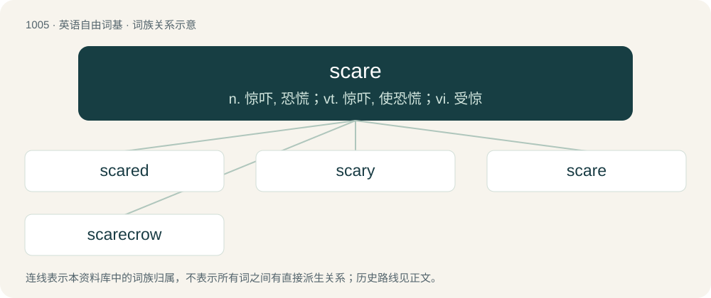

# 1083 · scare — n. 惊吓, 恐慌；vt. 惊吓, 使恐慌；vi. 受惊

[总目录](../00_总目录_按常用程度.md)

**类型**：英语自由词基　｜　**来源语言**：见词源记录

## 核心含义与来源

- 核心含义：n. 惊吓, 恐慌；vt. 惊吓, 使恐慌；vi. 受惊
- 英文含义：A minor fright.
- 词形：scare

**多个词源／构词路径**：同一拼写可能有不同来源；以下按词性和含义分别列出。

**来源记录 1**（名词；A minor fright.）

From Middle English sker, skere (“terror, fright”), from the verb Middle English skerren (“to frighten”) (see below).

**来源记录 2**（动词；To frighten, terrify, startle, especially in a minor way.）

From Middle English scaren, skaren, scarren, skeren, skerren, from Old Norse skirra (“to frighten; to shrink away from, shun; to prevent, avert”), from Proto-Germanic \*skirzijaną (“to shoo, scare off”), from Proto-Indo-European \*(s)ker- (“to swing, jump, move”). Related to Old Norse skjarr (“timid, shy, afraid of”). Cognate with Scots skar (“wild, timid, shy”), dialectal Norwegian Nynorsk skjerra, dialectal Swedish skjarra and possibly Old Armenian ցիռ (cʻiṙ, “wild ass”).

## 词族图

## 单词速览（常用到不常用）

| 单词 | 音标 | 释义 |
|---|---|---|
| [scared](#w-1) | 英 /skɛəd/；美 /skɛ(ə)ɹd/ | a. 害怕的, 担惊受怕的, 惊慌的, 吓坏了的 |
| [scary](#w-2) | 英 /ˈskɛə.ɹi/；美 /ˈskɛə.ɹi/ | a. 容易受惊的, 胆小的, 提心吊胆的 |
| [scare](#w-3) | 英 /skɛə/；美 /skɛɚ/ | n. 惊吓, 恐慌；vt. 惊吓, 使恐慌；vi. 受惊 |
| [scarecrow](#w-4) | 英 /ˈskɛəkɹəʊ/；美 /ˈskɛɚˌkɹoʊ/ | n. 稻草人, 衣衫褴褛的人 |

## 逐词详解

### 1. scared

**词性**：形容词　｜　**音标**：英 /skɛəd/；美 /skɛ(ə)ɹd/

**中文释义**：a. 害怕的, 担惊受怕的, 惊慌的, 吓坏了的

**英文义项**：Feeling fear; afraid, frightened.

**构词拆分**：From scare + -ed.

**词源与演化**：

From scare + -ed.

**例句**：

> The child was really scared of the dark.

该用例对应义项：Feeling fear; afraid, frightened.

### 2. scary

**词性**：形容词　｜　**音标**：英 /ˈskɛə.ɹi/；美 /ˈskɛə.ɹi/

**中文释义**：a. 容易受惊的, 胆小的, 提心吊胆的

**英文义项**：Causing fear or anxiety / Uncannily striking or surprising.

**构词拆分**：scare + -y

**词源与演化**：

From scare + -y.

**例句**：

> Linda changed her hair, and it’s scary how much she looks like her mother.

该用例对应义项：Uncannily striking or surprising.

### 3. scare

**词性**：名词　｜　**音标**：英 /skɛə/；美 /skɛɚ/

**中文释义**：n. 惊吓, 恐慌；vt. 惊吓, 使恐慌；vi. 受惊

**英文义项**：A minor fright. / A cause of terror or alarm; a panic; something that inspires fear or dread.

**词源与演化**：

From Middle English sker, skere (“terror, fright”), from the verb Middle English skerren (“to frighten”) (see below).

**例句**：

> Johnny had a bad scare last night.

该用例对应义项：A minor fright.

### 4. scarecrow

**词性**：名词　｜　**音标**：英 /ˈskɛəkɹəʊ/；美 /ˈskɛɚˌkɹoʊ/

**中文释义**：n. 稻草人, 衣衫褴褛的人

**英文义项**：An effigy, typically made of straw and dressed in old clothes, fixed to a pole in a field to deter birds from eating crops or seeds planted there. / A person or animal regarded as resembling a scarecrow (sense 1) in some way; especially, a tall, thin, awkward person; or a person wearing ragged and tattered clothes.

**构词拆分**：scare (“to frighten, startle, terrify”) + crow (“bird of the genus Corvus”)

**词源与演化**：

The noun is derived from scare (“to frighten, startle, terrify”) + crow (“bird of the genus Corvus”). The word displaced other terms such as bogle (now dialectal, dated), sewel or shewel, and shoy-hoy (perhaps imitative of the cry of crows). The verb is derived from the noun.

**例句**：

> I cannot scare the birds away. I am not a scarecrow.
