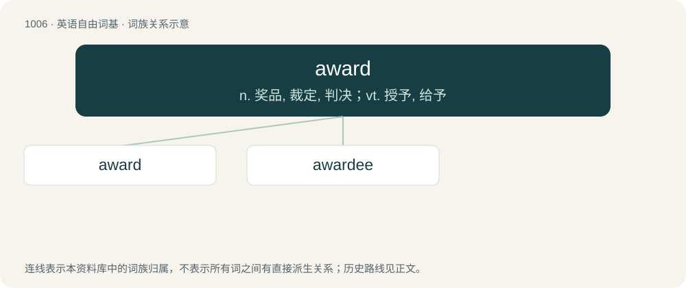

# 1084 · award — n. 奖品, 裁定, 判决；vt. 授予, 给予

[总目录](../00_总目录_按常用程度.md)

**类型**：英语自由词基　｜　**来源语言**：见词源记录

## 核心含义与来源

- 核心含义：n. 奖品, 裁定, 判决；vt. 授予, 给予
- 英文含义：A judgment, sentence, or final decision. Specifically: The decision of arbitrators in a case submitted.
- 词形：award

**来源记录 1**（名词；A judgment, sentence, or final decision. Specifically: The decision of arbitrators in a case submitted.）

From Middle English awarden, from Anglo-Norman awarder, from Medieval Latin \*exwardare, from Latin ex (“out”) + Medieval Latin wardare, guardare (“to observe, regard, guard”); see ward, guard, regard.

## 词族图

## 单词速览（常用到不常用）

| 单词 | 音标 | 释义 |
|---|---|---|
| [award](#w-1) | 英 /əˈwɔːd/；美 /əˈwɔɹd/ | n. 奖品, 裁定, 判决；vt. 授予, 给予 |
| [awardee](#w-2) | /əwɔɹˈdi/ | n. 受奖者；\[法\] 受奖者 |

## 逐词详解

### 1. award

**词性**：动词　｜　**音标**：英 /əˈwɔːd/；美 /əˈwɔɹd/

**中文释义**：n. 奖品, 裁定, 判决；vt. 授予, 给予

**英文义项**：To determine; to make or grant an award. / To give (an award).

**词源与演化**：

From Middle English awarden, from Anglo-Norman awarder, from Medieval Latin \*exwardare, from Latin ex (“out”) + Medieval Latin wardare, guardare (“to observe, regard, guard”); see ward, guard, regard.

**例句**：

> Four or five of these medals are awarded every year.

该用例对应义项：To give (an award).

### 2. awardee

**词性**：名词　｜　**音标**：/əwɔɹˈdi/

**中文释义**：n. 受奖者；\[法\] 受奖者

**英文义项**：The recipient of an award or special honor.

**构词拆分**：From award + -ee.

**词源与演化**：

From award + -ee.
