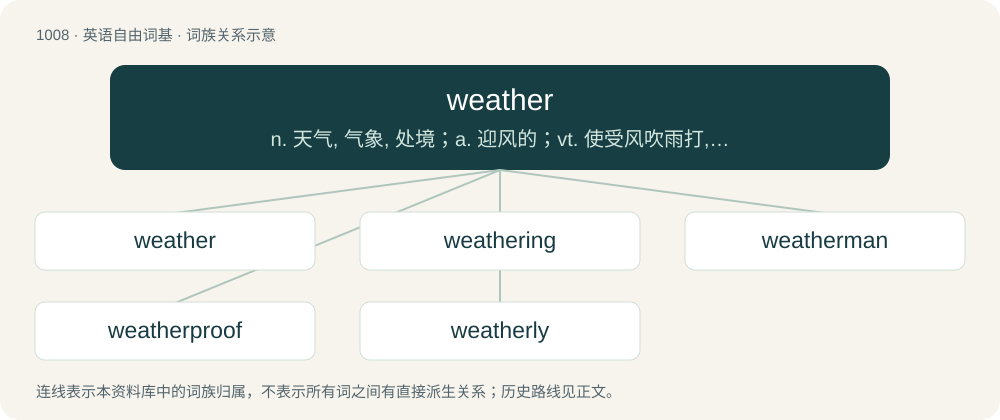

# 1086 · weather — n. 天气, 气象, 处境；a. 迎风的；vt. 使受风吹雨打, 侵蚀, 使风化, 经受住

[总目录](../00_总目录_按常用程度.md)

**类型**：英语自由词基　｜　**来源语言**：见词源记录

## 核心含义与来源

- 核心含义：n. 天气, 气象, 处境；a. 迎风的；vt. 使受风吹雨打, 侵蚀, 使风化, 经受住
- 英文含义：The short-term state of the atmosphere at a specific time and place, including the temperature, relative humidity, cloud cover, precipitation, wind, etc.
- 词形：weather

**来源记录 1**（名词；The short-term state of the atmosphere at a specific time and place, including the temperature, relative humidity, cloud cover, precipitation, wind, etc.）

From Middle English weder, wedir, from Old English weder, from Proto-West Germanic \*wedr, from Proto-Germanic \*wedrą, from Proto-Indo-European \*wedʰrom (=\*we-dʰrom), from \*h₂weh₁- (“to blow”). Cognates Cognate with Scots wather (“weather”), Saterland Frisian Weeder (“weather”), Cimbrian bèttar (“weather”), Dutch weder, weer (“weather”), German Wetter (“weather”), Low German Weder (“weather”), Luxembourgish Wieder (“weather”), Yiddish וועטער (veter, “weather”), Danish vejr (“weather”), Faroese, Icelandic veður (“weather”), Norwegian Bokmål vær (“weather”), Norwegian Nynorsk veder, vêr (“weather”), Swedish väder (“weather”); also more distantly related to Russian вёдро (vjódro, “fair weather”) and perhaps Albanian vrëndë (“light rain”). Other cognates include Sanskrit निर्वाण (nirvāṇa, “blown or put out, extinguished”).

## 词族图

## 单词速览（常用到不常用）

| 单词 | 音标 | 释义 |
|---|---|---|
| [weather](#w-1) | 英 /ˈwɛðə/；美 /ˈwɛðɚ/ | n. 天气, 气象, 处境；a. 迎风的；vt. 使受风吹雨打, 侵蚀, 使风化, 经受住 |
| [weathering](#w-2) | /ˈwɛ.ðə.ɹɪŋ/ | n. 泻水坡, 风化；\[化\] 天然时效 |
| [weatherman](#w-3) | /ˈweðəmæn/ | n. 气象员；天气预报员 |
| [weatherproof](#w-4) | /ˈwɛðəpruːf/ | a. 防风雨的, 不受天气影响的；vt. 使防风雨 |
| [weatherly](#w-5) | /ˈweðəli/ | a. \[海\](帆船)能驶向上风的, 能抢风航行的 |

## 逐词详解

### 1. weather

**词性**：名词　｜　**音标**：英 /ˈwɛðə/；美 /ˈwɛðɚ/

**中文释义**：n. 天气, 气象, 处境；a. 迎风的；vt. 使受风吹雨打, 侵蚀, 使风化, 经受住

**英文义项**：The short-term state of the atmosphere at a specific time and place, including the temperature, relative humidity, cloud cover, precipitation, wind, etc. / Unpleasant or destructive atmospheric conditions, and their effects.

**词源与演化**：

From Middle English weder, wedir, from Old English weder, from Proto-West Germanic \*wedr, from Proto-Germanic \*wedrą, from Proto-Indo-European \*wedʰrom (=\*we-dʰrom), from \*h₂weh₁- (“to blow”). Cognates Cognate with Scots wather (“weather”), Saterland Frisian Weeder (“weather”), Cimbrian bèttar (“weather”), Dutch weder, weer (“weather”), German Wetter (“weather”), Low German Weder (“weather”), Luxembourgish Wieder (“weather”), Yiddish וועטער (veter, “weather”), Danish vejr (“weather”), Faroese, Icelandic veður (“weather”), Norwegian Bokmål vær (“weather”), Norwegian Nynorsk veder, vêr (“weather”), Swedish väder (“weather”); also more distantly related to Russian вёдро (vjódro, “fair weather”) and perhaps Albanian vrëndë (“light rain”). Other cognates include Sanskrit निर्वाण (nirvāṇa, “blown or put out, extinguished”).

**例句**：

> Here and there, the weather on the sea allowed two of their friends to hear and see, too.

该用例对应义项：The short-term state of the atmosphere at a specific time and place, including the temperature, relative humidity, cloud cover, precipitation, wind, etc.

### 2. weathering

**词性**：名词　｜　**音标**：/ˈwɛ.ðə.ɹɪŋ/

**中文释义**：n. 泻水坡, 风化；\[化\] 天然时效

**英文义项**：Mechanical or chemical breaking down of rocks in situ by weather or other causes. / A slight inclination given to an approximately horizontal surface to enable it to throw off water.

**构词拆分**：weather + -ing

**词源与演化**：

From Middle English wederyng, equivalent to weather + -ing.

**例句**：

> The birds are weathering the storm underneath the eaves of the house.

### 3. weatherman

**词性**：名词　｜　**音标**：/ˈweðəmæn/

**中文释义**：n. 气象员；天气预报员

**英文义项**：A person, especially a male one, who reports the weather conditions or forecasts.

**构词拆分**：weather + -man

**词源与演化**：

From weather + -man.

**例句**：

> A weatherman is someone with whom the weather does not always agree.

### 4. weatherproof

**词性**：形容词　｜　**音标**：/ˈwɛðəpruːf/

**中文释义**：a. 防风雨的, 不受天气影响的；vt. 使防风雨

**英文义项**：Capable of resisting damage caused by the weather.

**构词拆分**：From weather + -proof.

**词源与演化**：

From weather + -proof.

### 5. weatherly

**词性**：形容词　｜　**音标**：/ˈweðəli/

**中文释义**：a. \[海\](帆船)能驶向上风的, 能抢风航行的

**英文义项**：Able to sail close to the wind with little leeway.

**构词拆分**：weather + -ly

**词源与演化**：

From weather (“direction from which the wind blows”) + -ly (“characteristic of”).
