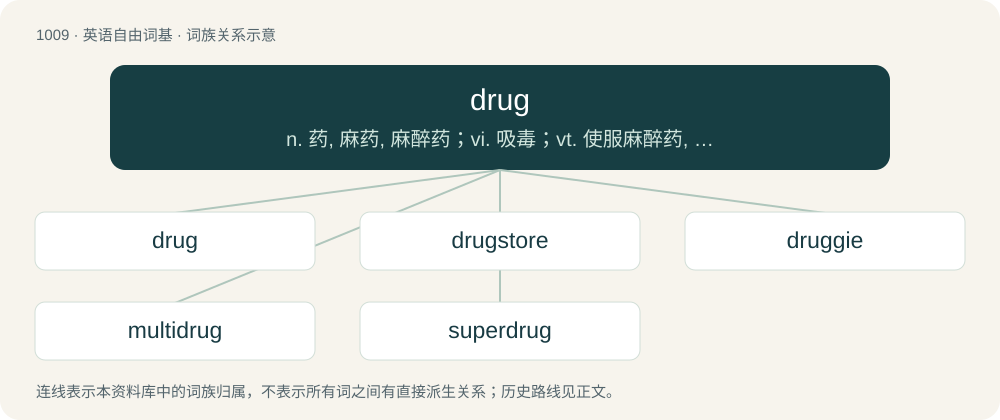

# 1088 · drug — n. 药, 麻药, 麻醉药；vi. 吸毒；vt. 使服麻醉药, 使麻木

[总目录](../00_总目录_按常用程度.md)

**类型**：英语自由词基　｜　**来源语言**：见词源记录

## 核心含义与来源

- 核心含义：n. 药, 麻药, 麻醉药；vi. 吸毒；vt. 使服麻醉药, 使麻木
- 英文含义：A substance used to treat an illness, relieve a symptom, or modify a chemical process in the body for a specific purpose.
- 词形：drug

**来源记录 1**（名词；A substance used to treat an illness, relieve a symptom, or modify a chemical process in the body for a specific purpose.）

From Middle English drogge (“medicine”), from Middle French drogue, drocque (“tincture, pharmaceutical product”) (c. 1462), from Middle Dutch or Middle Low German droge, as in droge vate (“dry vats, dry barrels”), mistaking droge for the contents, which were usually dried herbs, plants or wares. Droge comes from Middle Dutch drōghe (“dry”), from Old Dutch drōgi (“dry”), from Proto-Germanic \*draugiz (“dry, hard”), ultimately from Proto-Indo-European \*dʰerǵʰ- (“to strengthen; become hard or solid”), from \*dʰer- (“to hold, hold fast, support”). Displaced native Old English lybb (“drug, medicine”). Cognate with English dry, Dutch droog (“dry”), German trocken (“dry”).

## 词族图

## 单词速览（常用到不常用）

| 单词 | 音标 | 释义 |
|---|---|---|
| [drug](#w-1) | 英 /ˈdɹʌɡ/ | n. 药, 麻药, 麻醉药；vi. 吸毒；vt. 使服麻醉药, 使麻木 |
| [drugstore](#w-2) | 英 /ˈdɹʌɡ.stɔː(ɹ)/；美 /ˈdɹʌɡ.stoɹ/ | n. 药房, 杂货店 |
| [druggie](#w-3) | /ˈdɹʌɡi/ | n. 吸毒者,瘾君子 |
| [multidrug](#w-4) |  | 多药 |
| [superdrug](#w-5) |  | 【英文】An especially potent or effective drug. |

## 逐词详解

### 1. drug

**词性**：名词　｜　**音标**：英 /ˈdɹʌɡ/

**中文释义**：n. 药, 麻药, 麻醉药；vi. 吸毒；vt. 使服麻醉药, 使麻木

**英文义项**：A substance used to treat an illness, relieve a symptom, or modify a chemical process in the body for a specific purpose. / A psychoactive substance, especially one which is illegal and addictive, ingested for recreational use, such as cocaine.

**词源与演化**：

From Middle English drogge (“medicine”), from Middle French drogue, drocque (“tincture, pharmaceutical product”) (c. 1462), from Middle Dutch or Middle Low German droge, as in droge vate (“dry vats, dry barrels”), mistaking droge for the contents, which were usually dried herbs, plants or wares. Droge comes from Middle Dutch drōghe (“dry”), from Old Dutch drōgi (“dry”), from Proto-Germanic \*draugiz (“dry, hard”), ultimately from Proto-Indo-European \*dʰerǵʰ- (“to strengthen; become hard or solid”), from \*dʰer- (“to hold, hold fast, support”). Displaced native Old English lybb (“drug, medicine”). Cognate with English dry, Dutch droog (“dry”), German trocken (“dry”).

**例句**：

> Aspirin is a drug that reduces pain, acts against inflammation and lowers body temperature.

该用例对应义项：A substance used to treat an illness, relieve a symptom, or modify a chemical process in the body for a specific purpose.

### 2. drugstore

**词性**：名词　｜　**音标**：英 /ˈdɹʌɡ.stɔː(ɹ)/；美 /ˈdɹʌɡ.stoɹ/

**中文释义**：n. 药房, 杂货店

**英文义项**：Synonym of pharmacy, especially a small standalone general store which includes a pharmacy.

**构词拆分**：drug + store

**词源与演化**：

From drug + store.

**例句**：

> Tom lives on the left side of the street, opposite the drugstore.

### 3. druggie

**词性**：名词　｜　**音标**：/ˈdɹʌɡi/

**中文释义**：n. 吸毒者,瘾君子

**英文义项**：A drug addict or abuser.

**构词拆分**：drug + -ie

**词源与演化**：

From drug + -ie.

### 4. multidrug

**词性**：形容词

**中文释义**：多药

**英文义项**：Of or pertaining to multiple drugs.

**构词拆分**：multi- + drug

**词源与演化**：

From multi- + drug.

**用法示例／搭配（非完整句）**：

> multidrug resistance

该用例对应义项：Of or pertaining to multiple drugs.

### 5. superdrug

**词性**：名词

**英文义项**：An especially potent or effective drug.

**构词拆分**：super- + drug

**词源与演化**：

From super- + drug.
