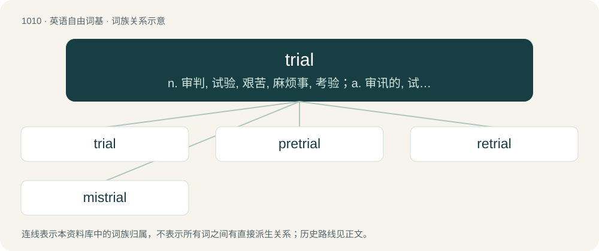

# 1090 · trial — n. 审判, 试验, 艰苦, 麻烦事, 考验；a. 审讯的, 试验性的

[总目录](../00_总目录_按常用程度.md)

**类型**：英语自由词基　｜　**来源语言**：见词源记录

## 核心含义与来源

- 核心含义：n. 审判, 试验, 艰苦, 麻烦事, 考验；a. 审讯的, 试验性的
- 英文含义：An occasion on which a person or thing is tested to find out how well they perform or how suitable they are.
- 词形：trial

**多个词源／构词路径**：同一拼写可能有不同来源；以下按词性和含义分别列出。

**来源记录 1**（名词；An occasion on which a person or thing is tested to find out how well they perform or how suitable they are.）

From Middle English trial, triall, from Anglo-Norman trial, triel, from trier (“to pick out, cull”) + -al. More at English try.

**来源记录 2**（形容词；Characterized by having three (usually equivalent) components.）

From Latin tri- (stem of trēs (“three”)) + -al, on the pattern of dual.

## 词族图

## 单词速览（常用到不常用）

| 单词 | 音标 | 释义 |
|---|---|---|
| [trial](#w-1) | /ˈtɹaɪəl/ | n. 审判, 试验, 艰苦, 麻烦事, 考验；a. 审讯的, 试验性的 |
| [pretrial](#w-2) | /pɹɪˈtɹaɪəl/ | a. 审判前的；n. 审前预备会议 |
| [retrial](#w-3) | /riːˈtraiəl/ | n. 再审, 复试, 再试验；\[法\] 再审, 复审 |
| [mistrial](#w-4) | /.misˈtraiəl/ | n. 无效审判；\[法\] 无效审判, 误审, 审判失误 |

## 逐词详解

### 1. trial

**词性**：名词　｜　**音标**：/ˈtɹaɪəl/

**中文释义**：n. 审判, 试验, 艰苦, 麻烦事, 考验；a. 审讯的, 试验性的

**英文义项**：An occasion on which a person or thing is tested to find out how well they perform or how suitable they are. / The testing of a product or procedure.

**词源与演化**：

From Middle English trial, triall, from Anglo-Norman trial, triel, from trier (“to pick out, cull”) + -al. More at English try.

**例句**：

> He was charged with war crimes and brought to trial before the International Tribunal.

该用例对应义项：A meeting or series of meetings in a court of law at which evidence is presented to a judge (and sometimes a jury) to allow them to decide on a legal matter (especially whether an accused person is guilty of a crime).

### 2. pretrial

**词性**：名词　｜　**音标**：/pɹɪˈtɹaɪəl/

**中文释义**：a. 审判前的；n. 审前预备会议

**英文义项**：A preliminary trial held in advance of a court trial.

**构词拆分**：pre- + trial

**词源与演化**：

From pre- + trial.

**例句**：

> As a result, another pretrial review was to be held on 17 February.

该用例对应义项：A preliminary trial held in advance of a court trial.

### 3. retrial

**词性**：名词　｜　**音标**：/riːˈtraiəl/

**中文释义**：n. 再审, 复试, 再试验；\[法\] 再审, 复审

**英文义项**：A second trial, by the original court, if the original trial was found to be improper, unfair, or no verdict was reached by a jury.

**构词拆分**：re- + trial

**词源与演化**：

From re- + trial.

### 4. mistrial

**词性**：名词　｜　**音标**：/.misˈtraiəl/

**中文释义**：n. 无效审判；\[法\] 无效审判, 误审, 审判失误

**英文义项**：A trial that is prematurely ended upon being declared invalid because of an error in procedure, or because of a hung jury.

**构词拆分**：mis- + trial

**词源与演化**：

From mis- + trial.

**例句**：

> Members of the jury, regretfully I must declare this proceeding a mistrial.
