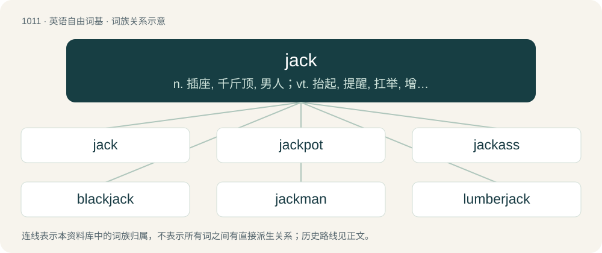

# 1091 · jack — n. 插座, 千斤顶, 男人；vt. 抬起, 提醒, 扛举, 增加, 提高, 放弃；a. 雄的

[总目录](../00_总目录_按常用程度.md)

**类型**：英语自由词基　｜　**来源语言**：见词源记录

## 核心含义与来源

- 核心含义：n. 插座, 千斤顶, 男人；vt. 抬起, 提醒, 扛举, 增加, 提高, 放弃；a. 雄的
- 英文含义：A coarse medieval coat of defence, especially one made of leather.
- 词形：jack

**多个词源／构词路径**：同一拼写可能有不同来源；以下按词性和含义分别列出。

**来源记录 1**（名词；A coarse medieval coat of defence, especially one made of leather.）

Inherited from Middle English jakke, from Anglo-Norman jacke, Middle French jaque, jacque, from jacques (“peasant”), from the proper name Jacques. Compare jacquerie.

**来源记录 2**（名词；A name applied to a hypothetical or typical man.）

Transferred use of the personal name Jack. (cricket: eleventh batsman): An allusion to the jack in playing cards, which follows the 10.

**来源记录 3**（名词；A jackfruit (Artocarpus heterophyllus, syn. Artocarpus integrifolia).）

From Portuguese jaca (“jackfruit”), from Malayalam ചക്ക (cakka).

**来源记录 4**（名词；White mango (Mangifera caesia) of fruit-bearing plants.）

Named after Scottish botanist William Jack, who described the species.

## 词族图

## 单词速览（常用到不常用）

| 单词 | 音标 | 释义 |
|---|---|---|
| [jack](#w-1) | /ˈd͡ʒæk/ | n. 插座, 千斤顶, 男人；vt. 抬起, 提醒, 扛举, 增加, 提高, 放弃；a. 雄的 |
| [jackpot](#w-2) | /ˈd͡ʒækpɒt/ | n. 最大赌注, (彩票的)头奖, 最大成功, 意外的成功/奖赏, 困境 |
| [jackass](#w-3) | 美 /ˈd͡ʒækæs/ | n. 公驴, 愚蠢的人, 傻瓜 |
| [blackjack](#w-4) | /ˈblækd͡ʒæk/ | n. 闪锌矿；扑克牌的二十一点；包革金属棍棒 |
| [jackman](#w-5) |  | 【英文】A member of the pit crew responsible for lifting the car with a jack. |
| [lumberjack](#w-6) | 英 /ˈlʌm.bə.d͡ʒæk/；美 /ˈlʌm.bɚ.d͡ʒæk/ | n. 伐木工人, 板材上垛装置 |
| [applejack](#w-7) | /ˈæpldʒæk/ | n. 苹果白兰地 |
| [jackhammer](#w-8) | 美 /ˈd͡ʒækˌhæmɚ/ | n. 手提钻 |
| [jackdaw](#w-9) | 英 /ˈdʒækˌdɔː/；美 /ˈd͡ʒækˌdɔ/ | n. 寒鸦 |
| [flapjack](#w-10) | /ˈflæpd͡ʒæk/ | n. 烤饼, 煎饼, 小粉盒 |
| [crackerjack](#w-11) | 美 /ˈkɹækɚd͡ʒæk/ | n. &lt;俚&gt;能力极强之人, 极佳之物 |

## 逐词详解

### 1. jack

**词性**：名词　｜　**音标**：/ˈd͡ʒæk/

**中文释义**：n. 插座, 千斤顶, 男人；vt. 抬起, 提醒, 扛举, 增加, 提高, 放弃；a. 雄的

**英文义项**：A coarse medieval coat of defence, especially one made of leather.

**词源与演化**：

Inherited from Middle English jakke, from Anglo-Norman jacke, Middle French jaque, jacque, from jacques (“peasant”), from the proper name Jacques. Compare jacquerie.

**用法示例／搭配（非完整句）**：

> jack of plate

该用例对应义项：A coarse medieval coat of defence, especially one made of leather.

### 2. jackpot

**词性**：名词　｜　**音标**：/ˈd͡ʒækpɒt/

**中文释义**：n. 最大赌注, (彩票的)头奖, 最大成功, 意外的成功/奖赏, 困境

**英文义项**：A money prize pool which accumulates until the conditions are met for it to be won. / A large cash prize or money.

**构词拆分**：jack + pot

**例句**：

> John hit the jackpot. His efforts paid off beyond his wildest dreams.

### 3. jackass

**词性**：名词　｜　**音标**：美 /ˈd͡ʒækæs/

**中文释义**：n. 公驴, 愚蠢的人, 傻瓜

**英文义项**：A male donkey. / A foolish or stupid person.

**构词拆分**：From jack + ass.

**词源与演化**：

From jack + ass.

**例句**：

> We men can silence the vulture within us, but not the jackass.

### 4. blackjack

**词性**：名词　｜　**音标**：/ˈblækd͡ʒæk/

**中文释义**：n. 闪锌矿；扑克牌的二十一点；包革金属棍棒

**英文义项**：A common gambling card game in casinos, where the object is to get as close to 21 without going over. / A hand in the game of blackjack consisting of a face card and an ace.

**构词拆分**：black + jack

**词源与演化**：

From black + jack.

**例句**：

> They played a short round of blackjack before leaving the casino.

### 5. jackman

**词性**：名词

**英文义项**：A member of the pit crew responsible for lifting the car with a jack. / A six-pointed playing piece in the game of jacks; a jackstone.

**构词拆分**：jack + -man

**词源与演化**：

From jack + -man.

### 6. lumberjack

**词性**：名词　｜　**音标**：英 /ˈlʌm.bə.d͡ʒæk/；美 /ˈlʌm.bɚ.d͡ʒæk/

**中文释义**：n. 伐木工人, 板材上垛装置

**英文义项**：A person whose work is to fell trees. / A lumberjacket.

**构词拆分**：lumber + jack

**词源与演化**：

From lumber + jack, of Canadian origin.

**例句**：

> The lumberjack confessed to the IBAMA that he'd chopped down a protected tree.

### 7. applejack

**词性**：名词　｜　**音标**：/ˈæpldʒæk/

**中文释义**：n. 苹果白兰地

**英文义项**：An alcoholic drink similar to apple brandy and calvados, made by freeze-distilling ("jacking") apple cider.

**构词拆分**：apple + jack

**词源与演化**：

From apple + jack, referring to the increase in alcohol concentration due to freeze distillation.

### 8. jackhammer

**词性**：名词　｜　**音标**：美 /ˈd͡ʒækˌhæmɚ/

**中文释义**：n. 手提钻

**英文义项**：A portable percussive power tool that combines a hammer and chisel used to drill or break hard matter, for instance rock or concrete. / Something that is very strong but also very rigid.

**构词拆分**：jack + hammer

**词源与演化**：

From jack + hammer.

**例句**：

> I could hear a jackhammer hammering in the distance.

### 9. jackdaw

**词性**：名词　｜　**音标**：英 /ˈdʒækˌdɔː/；美 /ˈd͡ʒækˌdɔ/

**中文释义**：n. 寒鸦

**英文义项**：A bird of the genus Coloeus, similar in appearance to crows and found within the same family; traditionally associated with church towers and ruins, where it frequently likes to nest.

**构词拆分**：jack + daw

**词源与演化**：

Compound of jack + daw. The first element, also present in Low German (North Saxon) Jöker (“jackdaw”), may refer either to its characteristic call, often represented as tchak-tchak, maybe influenced by association with the name Jack. The second element means “jackdaw” in itself, from Old English \*dāwe, from Proto-West Germanic \*dāhwā. Cognate with Old Prussian doacke (“starling”), Latin faccilāre (“the sound or timbre of the thrush”), and German Dohle (“jackdaw”).

**例句**：

> It's a very intelligent bird, but it's not a magpie at all; it's a jackdaw.

### 10. flapjack

**词性**：名词　｜　**音标**：/ˈflæpd͡ʒæk/

**中文释义**：n. 烤饼, 煎饼, 小粉盒

**英文义项**：A pancake. / A bar made with rolled oats, butter, golden syrup, and brown sugar, baked in a tray.

**构词拆分**：flap (“to toss sharply”) + jack (“generic object”)

**词源与演化**：

From flap (“to toss sharply”) + jack (“generic object”). So called from the process of baking it by flipping and catching it in the griddle when done on one side.

**例句**：

> Sven ordered a stack of flapjacks with maple syrup, two strips of bacon, and an egg, sunny side up.

该用例对应义项：A pancake.

### 11. crackerjack

**词性**：形容词　｜　**音标**：美 /ˈkɹækɚd͡ʒæk/

**中文释义**：n. &lt;俚&gt;能力极强之人, 极佳之物

**英文义项**：Exceptionally fine or excellent; top-notch; high quality. / Expert, top-rated or high-performing.

**构词拆分**：From crack (“highly skilled, excellent”) + -er + jack (“man”).

**词源与演化**：

From crack (“highly skilled, excellent”) + -er + jack (“man”).

**例句**：

> It's going to take crackerjack timing, but if we can work the play, we'll win the game.
