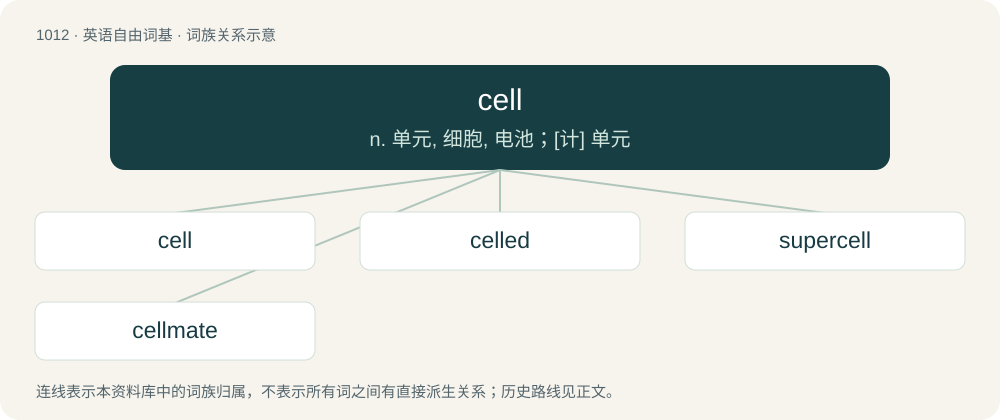

# 1093 · cell — n. 单元, 细胞, 电池；\[计\] 单元

[总目录](../00_总目录_按常用程度.md)

**类型**：英语自由词基　｜　**来源语言**：见词源记录

## 核心含义与来源

- 核心含义：n. 单元, 细胞, 电池；\[计\] 单元
- 英文含义：A single-room dwelling for a hermit.
- 词形：cell

**多个词源／构词路径**：同一拼写可能有不同来源；以下按词性和含义分别列出。

**来源记录 1**（名词；A single-room dwelling for a hermit.）

From Middle English celle, selle, from Old English cell (attested in inflected forms), from Latin cella (“chamber, small room, compartment”), later reinforced by Old French cel, sele, Old French cele. Ultimately from Proto-Italic \*kelnā, from Proto-Indo-European \*ḱelneh₂, from Proto-Indo-European \*ḱel- (“to cover”). Doublet of cella and hall.

**来源记录 2**（名词；A cellular phone.）

Ellipsis of cell phone, itself a clipping of cellular phone, from cellular + phone.

## 词族图

## 单词速览（常用到不常用）

| 单词 | 音标 | 释义 |
|---|---|---|
| [cell](#w-1) | /sɛl/ | n. 单元, 细胞, 电池；\[计\] 单元 |
| [celled](#w-2) | /seld/ | 含有某种或若干小细胞的 |
| [supercell](#w-3) | /suːpərˈsel/ | 超级单体 |
| [cellmate](#w-4) | /ˈselmeɪt/ | n. 狱友；同牢室友 |

## 逐词详解

### 1. cell

**词性**：名词　｜　**音标**：/sɛl/

**中文释义**：n. 单元, 细胞, 电池；\[计\] 单元

**英文义项**：A single-room dwelling for a hermit. / A small room in a monastery or nunnery accommodating one person.

**词源与演化**：

From Middle English celle, selle, from Old English cell (attested in inflected forms), from Latin cella (“chamber, small room, compartment”), later reinforced by Old French cel, sele, Old French cele. Ultimately from Proto-Italic \*kelnā, from Proto-Indo-European \*ḱelneh₂, from Proto-Indo-European \*ḱel- (“to cover”). Doublet of cella and hall.

**例句**：

> Gregor Mendel must have spent a good amount of time outside of his cell.

该用例对应义项：A small room in a monastery or nunnery accommodating one person.

### 2. celled

**词性**：形容词　｜　**音标**：/seld/

**中文释义**：含有某种或若干小细胞的

**英文义项**：Containing cells; cellular. / Containing a specific form or number of cells.

**构词拆分**：From cell + -ed.

**词源与演化**：

From cell + -ed.

### 3. supercell

**词性**：名词　｜　**音标**：/suːpərˈsel/

**中文释义**：超级单体

**英文义项**：A severe thunderstorm with updrafts and downdrafts that are in near balance, allowing the storm to maintain itself for several hours. Supercells often produce large hail, powerful downpours, very strong winds and sometimes tornadoes. / A repeating unit cell of a crystal that contains several primitive cells.

**构词拆分**：super- + cell

**词源与演化**：

From super- + cell.

### 4. cellmate

**词性**：名词　｜　**音标**：/ˈselmeɪt/

**中文释义**：n. 狱友；同牢室友

**英文义项**：A person with whom one shares a prison cell.

**构词拆分**：cell + -mate

**词源与演化**：

From cell + -mate.

**例句**：

> Mennad killed his cellmate because he was told he was a pedo.
