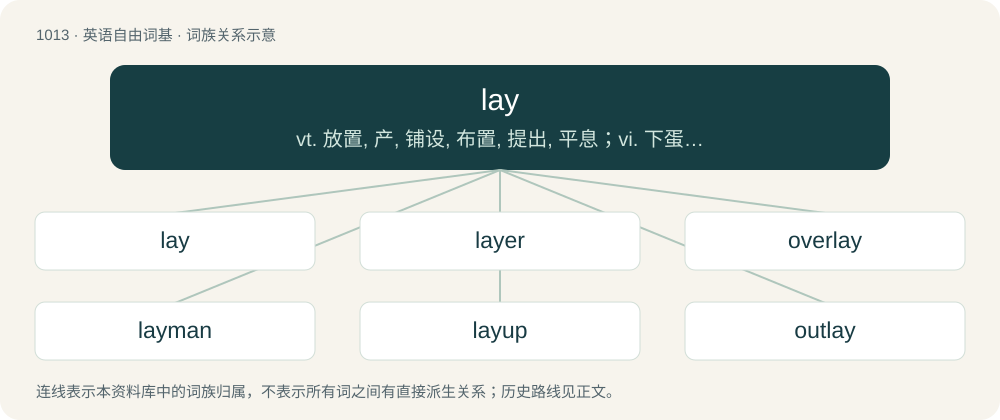

# 1094 · lay — vt. 放置, 产, 铺设, 布置, 提出, 平息；vi. 下蛋, 打赌；n. 位置, 层, 隐藏处

[总目录](../00_总目录_按常用程度.md)

**类型**：英语自由词基　｜　**来源语言**：见词源记录

## 核心含义与来源

- 核心含义：vt. 放置, 产, 铺设, 布置, 提出, 平息；vi. 下蛋, 打赌；n. 位置, 层, 隐藏处
- 英文含义：To place down in a position of rest, or in a horizontal position.
- 词形：lay

**多个词源／构词路径**：同一拼写可能有不同来源；以下按词性和含义分别列出。

**来源记录 1**（动词；To place down in a position of rest, or in a horizontal position.）

Inherited from Middle English leyen, leggen, from Old English leċġan (“to lay”), from Proto-West Germanic \*laggjan, from Proto-Germanic \*lagjaną (“to lay”), causative form of Proto-Germanic \*ligjaną (“to lie, recline”), from Proto-Indo-European \*legʰ- (“to lie, recline”). Cognate with Saterland Frisian lääse (“to lay; to lie”), West Frisian lizze (“to lay, to lie”), Cimbrian leng (“to lay”), Dutch leggen (“to lay”), German legen (“to lay”), Limburgish lègke (“to lay”), Luxembourgish leeën (“to lay”), Yiddish לייגן (leygn, “to lay”), Danish lægge (“to lay”), Faroese, Icelandic leggja (“to lay”), Norwegian Bokmål legge (“to lay”), Norwegian Nynorsk legga, legge, leggja, leggje (“to lay”), Swedish lägga (“to lay”), Gothic 𐌻𐌰𐌲𐌾𐌰𐌽 (lagjan, “to lay”), Old French laier, laiier, laire (“to leave”), Albanian lag (“troop, band, war encampment”).

**来源记录 2**（名词；A lake.）

Inherited from Middle English lay, laye, laie, ley, leye, which may have multiple origins: \* Potentially from \*læġ-, an unattested variant stem of Old English lagu m (“sea, flood, water, ocean”), if transferred to a-stem inflection (compare Old English dæġ-, dag- (“day”) &gt; Middle English day, daw-); compare plural Middle English lawes and lauen. If so, inherited from Proto-West Germanic \*lagu (“water, sea”), from Proto-Germanic \*laguz (“water, sea”), from Proto-Indo-European \*lókus (“water, body of water, lake”). \* Alternatively, borrowed from Old French lai, from Latin lacus (“lake, hollow, hole”), also from Proto-Indo-European \*lókus. \* Alternatively, borrowed from leg-, a stem of Old Norse lǫgr, from Proto-Germanic \*laguz. Compare Icelandic lögur (“liquid, fluid, lake”). All of these theories make it a doublet of loch, Looe, and lough.

**来源记录 3**（形容词；Not belonging to the clergy, but associated with them.）

Inherited from Middle English lay, from Old French lai, from Latin lāicus, from Ancient Greek λαϊκός (laïkós). Doublet of laic.

**来源记录 4**（名词；A ballad or sung poem; a short poem or narrative, usually intended to be sung.）

Inherited from Middle English lay, from Old French lai (“song, lyric, poem”), from Frankish \*laih (“play, melody, song”), from Proto-Germanic \*laikaz, \*laikiz (“jump, play, dance, hymn”), from Proto-Indo-European \*leyg- (“to jump, spring, play”). Akin to Old High German leih (“a play, skit, melody, song”), Middle High German leich (“piece of music, epic song played on a harp”), Old English lācan (“to move quickly, fence, sing”). See lake (“to play”). Contrast German Lied and Lied.

**来源记录 5**（动词；To don or put on (tefillin (phylacteries)).）

Semantic loan from Yiddish לייגן (leygn, “to put, lay”).

## 词族图

## 单词速览（常用到不常用）

| 单词 | 音标 | 释义 |
|---|---|---|
| [lay](#w-1) | /leɪ/ | vt. 放置, 产, 铺设, 布置, 提出, 平息；vi. 下蛋, 打赌；n. 位置, 层, 隐藏处 |
| [layer](#w-2) | 英 /ˈleɪ.ə/；美 /ˈleɪ̯ɚ/ | n. 层, 产卵鸡, 放置者；vt. 分层堆积, 压植；\[计\] 层 |
| [overlay](#w-3) | 英 /ˌəʊ.vəˈleɪ/；美 /ˌoʊvɚˈleɪ/ | n. 覆盖, 覆盖图, 使负担过重；overlie的过去式；\[计\] 覆盖, 覆盖图 |
| [layman](#w-4) | /ˈleɪmən/ | n. 俗人, 门外汉, 凡人；\[医\] 外行, 业外人 |
| [layup](#w-5) | 美 /ˈleɪˌʌp/ | 接头\[合\]处 |
| [outlay](#w-6) | /ˈaʊtleɪ/ | n. 费用, 经费, 支出；vt. 花费 |
| [allay](#w-7) | /əˈleɪ/ | vt. 使平静, 使缓和 |
| [inlay](#w-8) | /ɪnˈleɪ/ | vt. 嵌入, 镶嵌, 装帧；n. 镶嵌物, 镶嵌工艺, 镶补 |
| [layover](#w-9) | /ˈleɪˌəʊvə(ɹ)/ | n. 中途短暂的停留 |
| [belay](#w-10) | 英 /ˈbiːleɪ/；美 /bɪˈleɪ/ | v. 把缆绳拴在系索栓上 |
| [layperson](#w-11) | 美 /ˈleɪ.pɜɹ.sən/ | n. 外行 |
| [underlay](#w-12) | /ʌndəɹˈleɪ/ | vt. 把...置于另一物之下, 垫起, 从下面支撑；vi. (矿脉)倾斜；n. 放在下面的东西, 衬底, 支撑之物, 衬垫物 |

## 逐词详解

### 1. lay

**词性**：动词　｜　**音标**：/leɪ/

**中文释义**：vt. 放置, 产, 铺设, 布置, 提出, 平息；vi. 下蛋, 打赌；n. 位置, 层, 隐藏处

**英文义项**：To place down in a position of rest, or in a horizontal position. / To compel a supernatural entity to cease haunting a place, often by ritual or prayer; to exorcise or banish (a spirit or ghost).

**词源与演化**：

Inherited from Middle English leyen, leggen, from Old English leċġan (“to lay”), from Proto-West Germanic \*laggjan, from Proto-Germanic \*lagjaną (“to lay”), causative form of Proto-Germanic \*ligjaną (“to lie, recline”), from Proto-Indo-European \*legʰ- (“to lie, recline”). Cognate with Saterland Frisian lääse (“to lay; to lie”), West Frisian lizze (“to lay, to lie”), Cimbrian leng (“to lay”), Dutch leggen (“to lay”), German legen (“to lay”), Limburgish lègke (“to lay”), Luxembourgish leeën (“to lay”), Yiddish לייגן (leygn, “to lay”), Danish lægge (“to lay”), Faroese, Icelandic leggja (“to lay”), Norwegian Bokmål legge (“to lay”), Norwegian Nynorsk legga, legge, leggja, leggje (“to lay”), Swedish lägga (“to lay”), Gothic 𐌻𐌰𐌲𐌾𐌰𐌽 (lagjan, “to lay”), Old French laier, laiier, laire (“to leave”), Albanian lag (“troop, band, war encampment”).

**例句**：

> I'll lay that he doesn't turn up on Monday.

该用例对应义项：To bet (that something is or is not the case).

### 2. layer

**词性**：名词　｜　**音标**：英 /ˈleɪ.ə/；美 /ˈleɪ̯ɚ/

**中文释义**：n. 层, 产卵鸡, 放置者；vt. 分层堆积, 压植；\[计\] 层

**英文义项**：A single thickness of some material covering a surface. / An item of clothing worn under or over another.

**构词拆分**：lay + -er

**词源与演化**：

Appears at first glance to be from Middle English leyer, leyare (“a layer of stones or bricks”), equivalent to lay + -er. In which case, ultimately identical to etymology 2 below. For the pronunciation compare prayer. However, this word layer (referring to a thickness of a material covering a surface) has also been argued to be from a respelling of an obsolete sense of the word lair that was once used by farmers, which had to do with soil. The connecting sense between the usual meaning of lair and the specialised farming meaning was: an area where cows typically rest, the ground being fertilised by their waste. Related to lie, ledger.

**例句**：

> It's cold now but it will warm up this afternoon. Make sure you wear layers.

该用例对应义项：An item of clothing worn under or over another.

### 3. overlay

**词性**：动词　｜　**音标**：英 /ˌəʊ.vəˈleɪ/；美 /ˌoʊvɚˈleɪ/

**中文释义**：n. 覆盖, 覆盖图, 使负担过重；overlie的过去式；\[计\] 覆盖, 覆盖图

**英文义项**：To lay, spread, or apply (something) over or across (something else); to overspread. / To overwhelm; to press excessively upon.

**构词拆分**：over- + lay

**词源与演化**：

From Middle English overleyen, from Old English oferleċġan, from Proto-West Germanic \*obarlaggjan, from Proto-Germanic \*uberlagjaną, equivalent to over- + lay. Cognate with Saterland Frisian uurläze, úurlääse, Dutch overleggen, German Low German overleggen, överleggen, German überlegen, Swedish överlägga, Norwegian overlegge. Compare overlie.

**例句**：

> She will now overlay fruit on top of the crust.

该用例对应义项：To lay, spread, or apply (something) over or across (something else); to overspread.

### 4. layman

**词性**：名词　｜　**音标**：/ˈleɪmən/

**中文释义**：n. 俗人, 门外汉, 凡人；\[医\] 外行, 业外人

**英文义项**：Layperson, someone who is not an ordained cleric or member of the clergy. / Someone who is not a professional in a given field.

**构词拆分**：lay (“non-clergy”) + man

**词源与演化**：

From Middle English layman, lay man, equivalent to lay (“non-clergy”) + man. Cognate with Old Frisian lēkmann, lēkmonn (“layman”), obsolete Dutch leekeman (“layman”), Old High German leihman (“layman”), Danish lægmand (“layman”), Swedish lekman (“layman”), Norwegian lekmann (“layman”), Icelandic leikmaður (“layman”).

**例句**：

> Carmen is not a professional anthropologist, but strictly a layman.

该用例对应义项：Someone who is not a professional in a given field.

### 5. layup

**词性**：名词　｜　**音标**：美 /ˈleɪˌʌp/

**中文释义**：接头\[合\]处

**英文义项**：A close-range shot in which the shooter banks the ball off the backboard from a few feet away. / A relatively easy task.

**构词拆分**：lay + up

**词源与演化**：

From lay + up.

**例句**：

> The caboose, long decrepit, rested on a forgotten layup just north of the dry riverbed.

该用例对应义项：A track used to store train cars.

### 6. outlay

**词性**：名词　｜　**音标**：/ˈaʊtleɪ/

**中文释义**：n. 费用, 经费, 支出；vt. 花费

**英文义项**：A laying out or expending; that which is laid out or expended. / The spending of money, or an expenditure.

**构词拆分**：out- + lay

**词源与演化**：

From out- + lay.

**例句**：

> Without too much outlay, you could buy a second-hand car.

该用例对应义项：The spending of money, or an expenditure.

### 7. allay

**词性**：动词　｜　**音标**：/əˈleɪ/

**中文释义**：vt. 使平静, 使缓和

**英文义项**：To make quiet or put at rest; to pacify or appease; to quell; to calm. / To alleviate; to abate; to mitigate.

**构词拆分**：a- + lay

**词源与演化**：

From Middle English alayen, aleyen, aleggen, from Old English āleċġan (“to put, place, lay down, lay aside, throw down, give up, cease from, abandon; put down, allay, suppress, abolish, conquer, destroy, overcome, refute; lay upon, inflict, impose upon; diminish, take away, refuse, lessen, withhold”), from Proto-Germanic \*uzlagjaną (“to lay down”), equivalent to a- + lay. Cognate with German erlegen (“to impose, cause to succumb, kill”), Gothic 𐌿𐍃𐌻𐌰𐌲𐌾𐌰𐌽 (uslagjan, “to lay down”). In Middle English the word was identical to forms of allege and alloy, leading to much overlapping of senses.

**用法示例／搭配（非完整句）**：

> to allay the severity of affliction or the bitterness of adversity

该用例对应义项：To alleviate; to abate; to mitigate.

### 8. inlay

**词性**：动词　｜　**音标**：/ɪnˈleɪ/

**中文释义**：vt. 嵌入, 镶嵌, 装帧；n. 镶嵌物, 镶嵌工艺, 镶补

**英文义项**：To place (pieces of a foreign material) within another material to form a decorative design. / To place an inlay in a tooth.

**构词拆分**：in- + lay

**词源与演化**：

From in- + lay.

**例句**：

> The maple table had a beautiful walnut inlay, forming a floral pattern.

### 9. layover

**词性**：名词　｜　**音标**：/ˈleɪˌəʊvə(ɹ)/

**中文释义**：n. 中途短暂的停留

**英文义项**：A break between stages of a journey.

**构词拆分**：lay + over

**词源与演化**：

From lay + over.

**例句**：

> We had a layover while waiting to change planes, so we stretched our legs.

该用例对应义项：A break between stages of a journey.

### 10. belay

**词性**：动词　｜　**音标**：英 /ˈbiːleɪ/；美 /bɪˈleɪ/

**中文释义**：v. 把缆绳拴在系索栓上

**英文义项**：To make (a rope) fast by turning it around a fastening point such as a cleat. / To handle a climbing rope to prevent (a climber) from falling to the ground.

**构词拆分**：be- (“about, around”) + lay

**词源与演化**：

From Middle English beleggen, bileggen, from Old English beleċġan (“to cover, invest, surround, afflict, attribute to, charge with, accuse”), From Proto-West Germanic \*bilaggjan, equivalent to be- (“about, around”) + lay. Cognate with Dutch beleggen (“to cover, overlay, belay”), German belegen (“to cover, occupy, belay”), Swedish belägga (“to pave”).

**例句**：

> He would need an experienced partner to belay him on the difficult climbs.

该用例对应义项：To handle a climbing rope to prevent (a climber) from falling to the ground.

### 11. layperson

**词性**：名词　｜　**音标**：美 /ˈleɪ.pɜɹ.sən/

**中文释义**：n. 外行

**英文义项**：A person who is not a cleric. / One who is not intimately familiar with a given subject or activity.

**构词拆分**：lay (“non-clergy, nonclergy”) + person

**词源与演化**：

A lay (“non-clergy, nonclergy”) + person, along the lines of layman.

**例句**：

> The book was written for professionals, but an intelligent layperson could understand most of it.

该用例对应义项：One who is not intimately familiar with a given subject or activity.

### 12. underlay

**词性**：动词　｜　**音标**：/ʌndəɹˈleɪ/

**中文释义**：vt. 把...置于另一物之下, 垫起, 从下面支撑；vi. (矿脉)倾斜；n. 放在下面的东西, 衬底, 支撑之物, 衬垫物

**英文义项**：To lay (something) underneath something else; to put under. / To provide a support for something; to raise or support by something laid under.

**构词拆分**：under- + lay

**词源与演化**：

From Middle English underleyen, from Old English underleċġan (“to underlay, prop, support”), equivalent to under- + lay. Cognate with Dutch onderleggen (“to lay or put under”), German unterlegen (“to underlay”), Swedish underlägga (“to underlay”).

**例句**：

> Underlay the boards with joists.

该用例对应义项：provide with a base, support, lining, or backing
