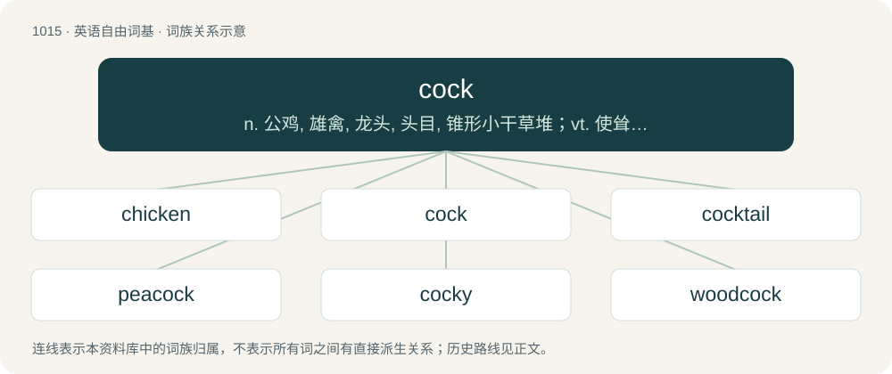

# 1095 · cock — n. 公鸡, 雄禽, 龙头, 头目, 锥形小干草堆；vt. 使耸立, 使竖起, 堆成锥形小干草堆；vi. 大摇大摆地走, 翘起

[总目录](../00_总目录_按常用程度.md)

**类型**：英语自由词基　｜　**来源语言**：见词源记录

## 核心含义与来源

- 核心含义：n. 公鸡, 雄禽, 龙头, 头目, 锥形小干草堆；vt. 使耸立, 使竖起, 堆成锥形小干草堆；vi. 大摇大摆地走, 翘起
- 英文含义：A rooster: a male gallinaceous bird, especially a male domestic chicken (Gallus gallus domesticus).
- 词形：cock

**多个词源／构词路径**：同一拼写可能有不同来源；以下按词性和含义分别列出。

**来源记录 1**（名词；A rooster: a male gallinaceous bird, especially a male domestic chicken (Gallus gallus domesticus).）

From Middle English cok, from Old English coc, cocc (“cock, male bird”), from Proto-West Germanic \*kokk, from Proto-Germanic \*kukkaz (“cock”), probably of onomatopoeic origin. Cognate with Middle Dutch cocke (“cock, male bird”) and Old Norse kokkr ("cock"; whence Danish kok (“cock”), dialectal Swedish kokk (“cock”)). Reinforced by Old French coc, from the same origin. The sense "penis" is attested since at least the 1610s, with the compound pillicock (“penis”) attested since 1325.

**来源记录 2**（名词；A small conical pile of hay or grass.）

From Middle English cokke, cock, cok, from Old English \*cocc (“heap, pile”, attested in place names), from Proto-West Germanic \*kokk, from Proto-Germanic \*kukkaz (“mass, bulge, swelling”), from Proto-Indo-European \*gew- (“to bend, curve, arch”). Cognate with dialectal German Kocke (“heap of hay, dunghill”), Norwegian kok (“heap, lump”), Swedish koka (“a lump of earth”), Norman coque (“small haystack”), Middle Low German kogge (“wide, rounded ship”), Dutch kogel (“ball”), German Kugel (“ball, globe”).

**来源记录 3**（名词；Vulva, vagina.）

Uncertain. Some authors speculate it derives from cockle, a yonic fertility symbol, others suggested it entered Southern US vernacular during the period of French rule (of Louisiana) from Cajun French coquille (“shell”) (itself the source of cockle), which in 18th and 19th century slang meant the vulva.

## 词族图

## 单词速览（常用到不常用）

| 单词 | 音标 | 释义 |
|---|---|---|
| [chicken](#w-1) | 英 /ˈt͡ʃɪkɪn/；美 /ˈt͡ʃɪkən/ | n. 小鸡, 鸡肉 |
| [cock](#w-2) | 英 /kɒk/；美 /kɑk/ | n. 公鸡, 雄禽, 龙头, 头目, 锥形小干草堆；vt. 使耸立, 使竖起, 堆成锥形小干草堆；vi. 大摇大摆地走, 翘起 |
| [cocktail](#w-3) | 英 /ˈkɒk.teɪl/；美 /ˈkɑk.teɪl/ | n. 鸡尾酒, 开味品；a. 鸡尾酒会的 |
| [peacock](#w-4) | 英 /ˈpiːkɒk/；美 /ˈpikɑk/ | n. 孔雀, 好炫耀的人；vi. 炫耀, 神气活现地行走 |
| [cocky](#w-5) | 英 /ˈkɒki/；美 /ˈkɑki/ | a. 骄傲的, 自大的, 太过自信的 |
| [woodcock](#w-6) | /ˈwʊd.kɒk/ | n. 丘鹬 |
| [cocksucker](#w-7) | 美 /ˈkɑkˌsʌ.kɚ/ | 狗杂种, 浑蛋（通常指男人） |
| [cockerel](#w-8) | 英 /ˈkɒkəɹəl/；美 /ˈkɑkəɹəl/ | n. 小公鸡 |
| [coxswain](#w-9) | 英 /ˈkɒk.s(ə)n/；美 /ˈkɑk.s(ə)n/ | n. 艇长, 舵手 |
| [cocksucking](#w-10) |  | 【英文】Fellatio. |
| [cockfighting](#w-11) | /ˈkɒkfaitiŋ/ | n. 斗鸡 |

## 逐词详解

### 1. chicken

**词性**：名词　｜　**音标**：英 /ˈt͡ʃɪkɪn/；美 /ˈt͡ʃɪkən/

**中文释义**：n. 小鸡, 鸡肉

**英文义项**：A domesticated subspecies of red junglefowl (Gallus gallus domesticus). / The meat from this bird eaten as food.

**构词拆分**：cock + -en

**词源与演化**：

From Middle English chiken (also as chike &gt; English chick), from Old English ċicen, ċycen (“chicken”), of uncertain origin. Possibly from Proto-West Germanic \*kiukīn (“chicken”), or alternatively from Proto-West Germanic \*kukkīn, equivalent to cock + -en. Compare North Frisian schückling (“chicken”), Saterland Frisian Sjuuken (“chicken”), Dutch kuiken (“chick, chicken”), German Low German Küken (“chick”), whence German Küken (“chick”), (elevated, obsolete) German Küchlein (“chick”) and Old Norse kjúklingr (“chicken”).

**例句**：

> Don't play chicken with a freight train; you're guaranteed to lose.

该用例对应义项：A confrontational game in which the participants move toward each other at high speed (usually in automobiles); the player who turns first to avoid colliding into the other is the "chicken" (that is, the loser).

### 2. cock

**词性**：名词　｜　**音标**：英 /kɒk/；美 /kɑk/

**中文释义**：n. 公鸡, 雄禽, 龙头, 头目, 锥形小干草堆；vt. 使耸立, 使竖起, 堆成锥形小干草堆；vi. 大摇大摆地走, 翘起

**英文义项**：A rooster: a male gallinaceous bird, especially a male domestic chicken (Gallus gallus domesticus). / A cock pigeon.

**词源与演化**：

From Middle English cok, from Old English coc, cocc (“cock, male bird”), from Proto-West Germanic \*kokk, from Proto-Germanic \*kukkaz (“cock”), probably of onomatopoeic origin. Cognate with Middle Dutch cocke (“cock, male bird”) and Old Norse kokkr ("cock"; whence Danish kok (“cock”), dialectal Swedish kokk (“cock”)). Reinforced by Old French coc, from the same origin. The sense "penis" is attested since at least the 1610s, with the compound pillicock (“penis”) attested since 1325.

**用法示例／搭配（非完整句）**：

> All right, cock?

该用例对应义项：A man; a fellow.

### 3. cocktail

**词性**：名词　｜　**音标**：英 /ˈkɒk.teɪl/；美 /ˈkɑk.teɪl/

**中文释义**：n. 鸡尾酒, 开味品；a. 鸡尾酒会的

**英文义项**：A mixed alcoholic beverage. / A mixture of other substances or things.

**构词拆分**：cock + tail

**词源与演化**：

Early 17th century, from cock (“male bird”) + tail, in the sense “(a horse with its) tail standing up, like a cock’s”. The origin of the extension to “an alcoholic mixed drink” is unknown. One theory is that it refers to a stimulant (gingering), hence a stimulating drink; compare pick-me-up. Another attested use is for non-thoroughbred racehorses: these were considered "cock-tailed" due to their docked tails. This may have led to the term "cocktail" (sense 1) being used for an adulterated spirit.

**例句**：

> Scientists found a cocktail of pollutants in the river downstream from the chemical factory.

该用例对应义项：A mixture of other substances or things.

### 4. peacock

**词性**：名词　｜　**音标**：英 /ˈpiːkɒk/；美 /ˈpikɑk/

**中文释义**：n. 孔雀, 好炫耀的人；vi. 炫耀, 神气活现地行走

**英文义项**：A male peafowl, especially Pavo cristatus, notable for its brilliant iridescently ocellated tail. / A peafowl (of the genus Pavo or Afropavo), either male or female.

**构词拆分**：pea + cock

**词源与演化**：

From Middle English pecok, pekok, pocok, pacok, first component from Old English pēa, pāwa (“peacock, peafowl”), ultimately from Latin pāvō; equivalent to pea + cock. Compare Old Norse páfugl (“peacock”, literally “peafowl”), and English peahen, peachick, etc.

**例句**：

> The peacock (Inachis io) is a beautiful and easily recognizable butterfly.

### 5. cocky

**词性**：形容词　｜　**音标**：英 /ˈkɒki/；美 /ˈkɑki/

**中文释义**：a. 骄傲的, 自大的, 太过自信的

**英文义项**：Overly confident; arrogant and boastful.

**构词拆分**：cock (“male domestic chicken”) + -y (suffix forming adjectives with the sense of ‘having the quality of’)

**词源与演化**：

From cock (“male domestic chicken”) + -y (suffix forming adjectives with the sense of ‘having the quality of’).

**例句**：

> A very cocky young man.

该用例对应义项：overly self-confident or self-assertive

### 6. woodcock

**词性**：名词　｜　**音标**：/ˈwʊd.kɒk/

**中文释义**：n. 丘鹬

**英文义项**：Any of several wading birds in the genus Scolopax, characterised by a long slender bill and cryptic brown and blackish plumage. / A simpleton.

**构词拆分**：wood + cock

**词源与演化**：

From Middle English wodecocke, wode-koc, wodekok, from Old English wudecocc, wuducoc, equivalent to wood + cock.

**例句**：

> The pheasant, the bustard, the deaf wild peacock, the moorhen, the partridge, the woodcock and the thrush are said to be delicacies.

### 7. cocksucker

**词性**：名词　｜　**音标**：美 /ˈkɑkˌsʌ.kɚ/

**中文释义**：狗杂种, 浑蛋（通常指男人）

**英文义项**：A very annoying or objectionable person; any contemptible person. / Someone who performs fellatio.

**构词拆分**：cock + sucker

**词源与演化**：

From cock + sucker.

**例句**：

> I'm extremely happy that I'm not a part of a committee that cocksucker is in.

该用例对应义项：A very annoying or objectionable person; any contemptible person.

### 8. cockerel

**词性**：名词　｜　**音标**：英 /ˈkɒkəɹəl/；美 /ˈkɑkəɹəl/

**中文释义**：n. 小公鸡

**英文义项**：A young male chicken.

**构词拆分**：By surface analysis, cock + -rel

**词源与演化**：

From Middle English kokerel. By surface analysis, cock + -rel.

**例句**：

> The cockerel, herald of the morning, wakes those of us sleeping.

### 9. coxswain

**词性**：名词　｜　**音标**：英 /ˈkɒk.s(ə)n/；美 /ˈkɑk.s(ə)n/

**中文释义**：n. 艇长, 舵手

**英文义项**：In a ship's boat, the helmsman given charge of the boat's crew. / The member of a crew who steers the shell and coordinates the power and rhythm of the rowers.

**构词拆分**：cock (“small boat”) + swain (“boy, servant”)

**词源与演化**：

From Middle English cokswain, equivalent to cock (“small boat”) + swain (“boy, servant”).

**例句**：

> The coxswain egged his crewmen on, and made a winning spurt at the last lap of the regatta.

### 10. cocksucking

**词性**：名词

**英文义项**：Fellatio.

**构词拆分**：cock + sucking

**词源与演化**：

From cock + sucking.

### 11. cockfighting

**词性**：名词　｜　**音标**：/ˈkɒkfaitiŋ/

**中文释义**：n. 斗鸡

**英文义项**：A gambling blood sport (illegal in most countries) in which two roosters have spikes placed on their feet and are made to fight each other, usually to the death.

**构词拆分**：cock + fighting

**词源与演化**：

From Middle English cokfytyng, kokkysfythynge; equivalent to cock + fighting.

**例句**：

> Now illegal in many countries, cockfighting continues in rural areas.
