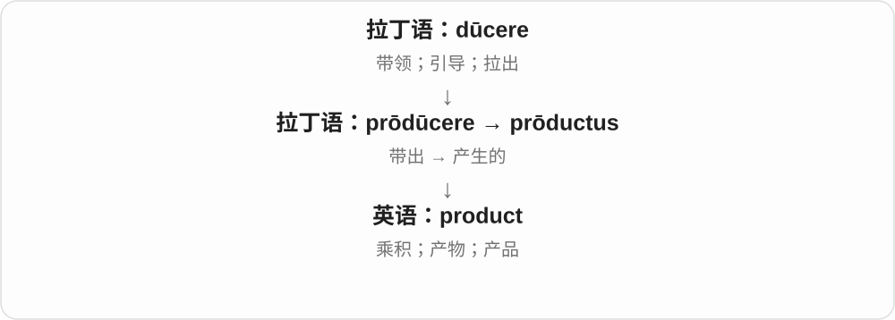
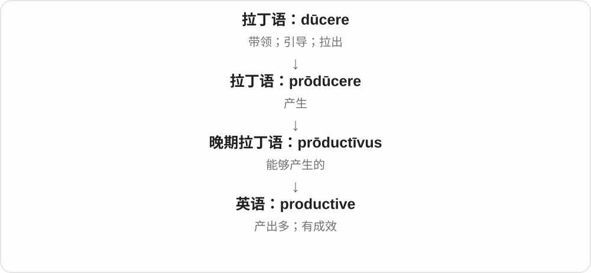

# 1095 · product — 产品；产物；成果

[逐词精讲目录](../00_逐词精讲目录.md) · [总目录](../00_总目录_按常用程度.md)

## 核心词根与来源

product 经法语、拉丁 productum 传来，远接 producere 带出、产生。productive 表示能产出、富有成效，不只表示忙碌。

**PRODUCT：做出来、产生出来的东西**

工厂产出商品，反应产出物质，计算也产出结果。

- **产物**：product
- **产出的能力与效果**：productive

## 词形与演化规律

product 是名词，productive 是形容词；productivity 则是生产率等抽象名词，不在本页词表另列。不要把 productive 理解成所有物品本身。

## 单词速览（按词族由简到繁）

同一基础词的相关扩展放在一起，先读基础形式，再读扩展；各组之间优先读常用的。具体词源关系见各词讲解。

| 单词 | 音标 | 核心意思 |
|---|---|---|
| [product](#w-1) | 英 /ˈprɒdʌkt/；美 /ˈprɑːdʌkt/ | 产品；产物；乘积 |
| [productive](#w-2) | /prəˈdʌktɪv/ | 有成效的；产出多的 |

## 逐词讲解

### 1. product — 产品；产物；乘积

**音标**：英 /ˈprɒdʌkt/；美 /ˈprɑːdʌkt/

**先抓住这个画面**

product 是一个过程最后“带出来”的东西：工厂带出商品，某种环境带出结果，乘法运算带出乘积。

**怎么拆**

来自拉丁语 prōductus，是 prōdūcere“带出、产生”的分词形式。英语早期已有数学用法。

**怎么变成今天的意思**

产品不只是一件能买卖的物品。a product of its time 指某事物由那个时代的条件塑造而成。

**常见搭配与例句**

launch a product（推出产品）；the product of three and four（三与四的乘积）；a product of experience（经验产生的结果）。

> The company is developing a new product.

公司正在开发一种新产品。

> Twelve is the product of three and four.

十二是三与四的乘积。

**别混淆**

product 是产出的东西；production 是生产过程。produce 作名词时常指农产品，别与 products 混用。

### 2. productive — 有成效的；产出多的

**音标**：/prəˈdʌktɪv/

**先抓住这个画面**

productive 关心“忙过以后留下了什么”。讨论解决了问题、工作交出了成果，才叫 productive，不只是一直在动。

**怎么拆**

来自晚期拉丁语 prōductīvus，与 product、produce 同族；-ive 表示具有相关作用或倾向。

**怎么变成今天的意思**

可形容人、土地、会议或一天的工作。重点是实际产出；在语言学中也可说一种构词方式能不断产生新词。

**常见搭配与例句**

a productive meeting（有成效的会议）；a productive day（成果充实的一天）；productive land（高产土地）。

> We had a productive meeting and agreed on the next steps.

会议很有成效，我们确定了下一步安排。

> She is most productive early in the morning.

她清晨工作最有成效。

**别混淆**

busy 是忙；productive 是有产出。efficiency 还涉及花了多少投入，同样多的产出也可能消耗不同时间。

## 这一组要分清什么

product 在数学中可指乘积，不能处处译产品。productive day 说有成果的一天，不只是行程排满。

## 串起来练习

A productive discussion helped the team improve the product.

富有成效的讨论帮助团队改进了产品。
