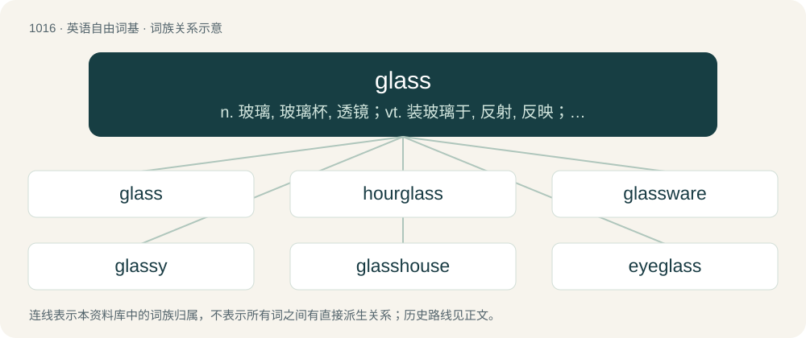

# 1096 · glass — n. 玻璃, 玻璃杯, 透镜；vt. 装玻璃于, 反射, 反映；vi. 成玻璃状

[总目录](../00_总目录_按常用程度.md)

**类型**：英语自由词基　｜　**来源语言**：见词源记录

## 核心含义与来源

- 核心含义：n. 玻璃, 玻璃杯, 透镜；vt. 装玻璃于, 反射, 反映；vi. 成玻璃状
- 英文含义：An amorphous solid, often transparent substance, usually made by melting silica sand with various additives (for most purposes, a mixture of soda, potash and lime is added).
- 词形：glass

**来源记录 1**（名词；An amorphous solid, often transparent substance, usually made by melting silica sand with various additives (for most purposes, a mixture of soda, potash and lime is added).）

From Middle English glas, from Old English glæs, from Proto-West Germanic \*glas, from Proto-Germanic \*glasą, possibly related to Proto-Germanic \*glōaną (“to shine”) (compare glow), and ultimately from the Proto-Indo-European root \*ǵʰleh₁- (“to shine, shimmer, glow”). Cognate with West Frisian glês, Low German and German Glas, Danish, Dutch, Norwegian Nynorsk, and Swedish glas, Norwegian Bokmål glass, Icelandic gler.

## 词族图

## 单词速览（常用到不常用）

| 单词 | 音标 | 释义 |
|---|---|---|
| [glass](#w-1) | 英 /ɡlɑːs/；美 /ɡlæs/ | n. 玻璃, 玻璃杯, 透镜；vt. 装玻璃于, 反射, 反映；vi. 成玻璃状 |
| [hourglass](#w-2) | /ˈaʊəɡlɑːs/ | n. 时漏, 砂漏, 水漏；n. 沙漏标；\[计\] 沙漏标 |
| [glassware](#w-3) | /ˈglɑːswєə/ | n. 玻璃器具；\[化\] 玻璃器皿; 玻璃仪器 |
| [glassy](#w-4) | 英 /ˈɡlɑːsi/；美 /ˈɡlæsi/ | a. 玻璃质的, 玻璃状的, 如镜的；\[医\] 玻璃状的 |
| [glasshouse](#w-5) | 英 /ˈɡlɑːshaʊs/；美 /ˈɡlæshaʊs/ | n. 温室, 玻璃工场, 禁闭房 |
| [eyeglass](#w-6) | 美 /ˈaɪˌɡlæs/ | n. 镜片 |
| [glazier](#w-7) | 英 /ˈɡleɪzjə(ɹ)/；美 /ˈɡleɪʒəɹ/ | n. 装玻璃工, 上釉工 |
| [spyglass](#w-8) | 美 /ˈspaɪˌɡlæs/ | n. 小望远镜 |
| [glasser](#w-9) | /ɡˈlɑːsər/ | 磨光机 |
| [glassman](#w-10) | /ˈ^lɑːsmən;ˈ^læs-/ | n. 卖玻璃制品的人, 玻璃制造者, 装玻璃的工人 |

## 逐词详解

### 1. glass

**词性**：名词　｜　**音标**：英 /ɡlɑːs/；美 /ɡlæs/

**中文释义**：n. 玻璃, 玻璃杯, 透镜；vt. 装玻璃于, 反射, 反映；vi. 成玻璃状

**英文义项**：An amorphous solid, often transparent substance, usually made by melting silica sand with various additives (for most purposes, a mixture of soda, potash and lime is added). / Any amorphous solid (one without a regular crystal lattice).

**词源与演化**：

From Middle English glas, from Old English glæs, from Proto-West Germanic \*glas, from Proto-Germanic \*glasą, possibly related to Proto-Germanic \*glōaną (“to shine”) (compare glow), and ultimately from the Proto-Indo-European root \*ǵʰleh₁- (“to shine, shimmer, glow”). Cognate with West Frisian glês, Low German and German Glas, Danish, Dutch, Norwegian Nynorsk, and Swedish glas, Norwegian Bokmål glass, Icelandic gler.

**例句**：

> Her new camera was incompatible with her old one, so she needed to buy new glass.

该用例对应义项：Lenses, considered collectively.

### 2. hourglass

**词性**：名词　｜　**音标**：/ˈaʊəɡlɑːs/

**中文释义**：n. 时漏, 砂漏, 水漏；n. 沙漏标；\[计\] 沙漏标

**英文义项**：A clock made of two glass vessels connected by a narrow passage through which sand flows. / A cursor, often shaped like an hourglass, indicating that the computer is busy.

**构词拆分**：hour + glass

**词源与演化**：

From hour + glass.

**例句**：

> After each game turn, invert the hourglass to reset the time limit for the next player.

该用例对应义项：A clock made of two glass vessels connected by a narrow passage through which sand flows.

### 3. glassware

**词性**：名词　｜　**音标**：/ˈglɑːswєə/

**中文释义**：n. 玻璃器具；\[化\] 玻璃器皿; 玻璃仪器

**英文义项**：Articles made from glass, especially drinking glasses, jugs and other tableware made of glass.

**构词拆分**：glass + -ware

**词源与演化**：

From glass + -ware.

**例句**：

> He carried the glassware with care.

### 4. glassy

**词性**：形容词　｜　**音标**：英 /ˈɡlɑːsi/；美 /ˈɡlæsi/

**中文释义**：a. 玻璃质的, 玻璃状的, 如镜的；\[医\] 玻璃状的

**英文义项**：Of or like glass, especially in being smooth and somewhat reflective. / Lacking any chop; smooth and mostly flat.

**构词拆分**：glass + -y

**词源与演化**：

From Middle English glasy, equivalent to glass + -y. Compare Saterland Frisian glääsich (“glassy”), Dutch glazig (“glassy”), German Low German glasig (“glassy”), German glasig (“glassy”).

**用法示例／搭配（非完整句）**：

> the glassy eyes of a person in a trance

该用例对应义项：Dull; expressionless; lifeless.

### 5. glasshouse

**词性**：名词　｜　**音标**：英 /ˈɡlɑːshaʊs/；美 /ˈɡlæshaʊs/

**中文释义**：n. 温室, 玻璃工场, 禁闭房

**英文义项**：A greenhouse, especially one for commercial use. / A building where glass or glassware is manufactured.

**构词拆分**：glass + house

**词源与演化**：

From Middle English glasehows, glashous, glashows; equivalent to glass + house.

### 6. eyeglass

**词性**：名词　｜　**音标**：美 /ˈaɪˌɡlæs/

**中文释义**：n. 镜片

**英文义项**：An artificial lens, especially one of a pair. / A monocle.

**构词拆分**：eye + glass

**词源与演化**：

From eye + glass.

**例句**：

> Tom broke his eyeglass frames when he dropped his glasses.

### 7. glazier

**词性**：名词　｜　**音标**：英 /ˈɡleɪzjə(ɹ)/；美 /ˈɡleɪʒəɹ/

**中文释义**：n. 装玻璃工, 上釉工

**英文义项**：One who glazes: a craftsman who works with glass, fitting windows, etc.

**构词拆分**：glass + -er

**词源与演化**：

From Middle English glazier, glasier, glasyer, glasiere, variants (due to influence from words in -yer) of Middle English glaser, equivalent to glass + -er.

**例句**：

> Getting cut is one of the occupational hazards of being a glazier.

### 8. spyglass

**词性**：名词　｜　**音标**：美 /ˈspaɪˌɡlæs/

**中文释义**：n. 小望远镜

**英文义项**：A small portable telescope. / A pair of binoculars.

**构词拆分**：spy + glass

**词源与演化**：

From spy + glass.

**例句**：

> Lend me the spyglass, that I may see better.

### 9. glasser

**词性**：名词　｜　**音标**：/ɡˈlɑːsər/

**中文释义**：磨光机

**英文义项**：A person who applies fibreglass and resin to a surfboard during its manufacture. / A glass marble.

**构词拆分**：From glass + -er.

**词源与演化**：

From glass + -er.

### 10. glassman

**词性**：名词　｜　**音标**：/ˈ^lɑːsmən;ˈ^læs-/

**中文释义**：n. 卖玻璃制品的人, 玻璃制造者, 装玻璃的工人

**英文义项**：A person who manufactures glass.

**构词拆分**：glass + -man

**词源与演化**：

From glass + -man.
