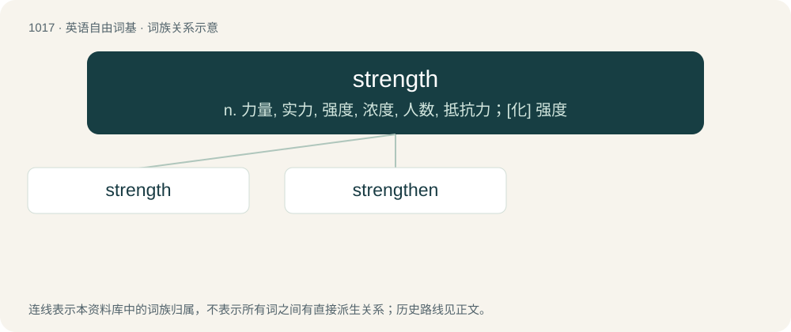

# 1097 · strength — n. 力量, 实力, 强度, 浓度, 人数, 抵抗力；\[化\] 强度

[总目录](../00_总目录_按常用程度.md)

**类型**：英语自由词基　｜　**来源语言**：见词源记录

## 核心含义与来源

- 核心含义：n. 力量, 实力, 强度, 浓度, 人数, 抵抗力；\[化\] 强度
- 英文含义：The quality or degree of being strong.
- 词形：strength

**来源记录 1**（名词；The quality or degree of being strong.）

From Middle English strengthe, from Old English strengþu (“strength”), from Proto-West Germanic \*strangiþu (“strongness; strength”), equivalent to strong + -th (abstract nominal suffix). Cognate with Dutch strengte (“strength”), German Low German Strengde, Strengte (“harshness; rigidity; strictness; severity”).

## 词族图

## 单词速览（常用到不常用）

| 单词 | 音标 | 释义 |
|---|---|---|
| [strength](#w-1) | 美 /ˈstɹeɪŋθ/；/ˈstɹɛŋθ/ | n. 力量, 实力, 强度, 浓度, 人数, 抵抗力；\[化\] 强度 |
| [strengthen](#w-2) | 英 /ˈstɹɛŋ(k)θən/ | vt. 加强, 变坚固；vi. 变强, 股票上涨 |

## 逐词详解

### 1. strength

**词性**：名词　｜　**音标**：美 /ˈstɹeɪŋθ/；/ˈstɹɛŋθ/

**中文释义**：n. 力量, 实力, 强度, 浓度, 人数, 抵抗力；\[化\] 强度

**英文义项**：The quality or degree of being strong. / The intensity of a force or power; potency.

**构词拆分**：strong + -th (abstract nominal suffix)

**词源与演化**：

From Middle English strengthe, from Old English strengþu (“strength”), from Proto-West Germanic \*strangiþu (“strongness; strength”), equivalent to strong + -th (abstract nominal suffix). Cognate with Dutch strengte (“strength”), German Low German Strengde, Strengte (“harshness; rigidity; strictness; severity”).

**例句**：

> It requires great strength to lift heavy objects.

该用例对应义项：The quality or degree of being strong.

### 2. strengthen

**词性**：动词　｜　**音标**：英 /ˈstɹɛŋ(k)θən/

**中文释义**：vt. 加强, 变坚固；vi. 变强, 股票上涨

**英文义项**：To make strong or stronger; to add strength to; to increase the strength of; to fortify. / To empower; to give moral strength to; to encourage; to enhearten.

**构词拆分**：strength + -en

**词源与演化**：

From rare Middle English strengthenen (14th c.), from earlier strengthen (12th c.), where -en is the infinitive ending. Probably the original form was reinterpreted as strength + -en around the time when the infinitive ending was being apocopated in late Middle English.

**用法示例／搭配（非完整句）**：

> strengthen one's willpower

该用例对应义项：To make strong or stronger; to add strength to; to increase the strength of; to fortify.
