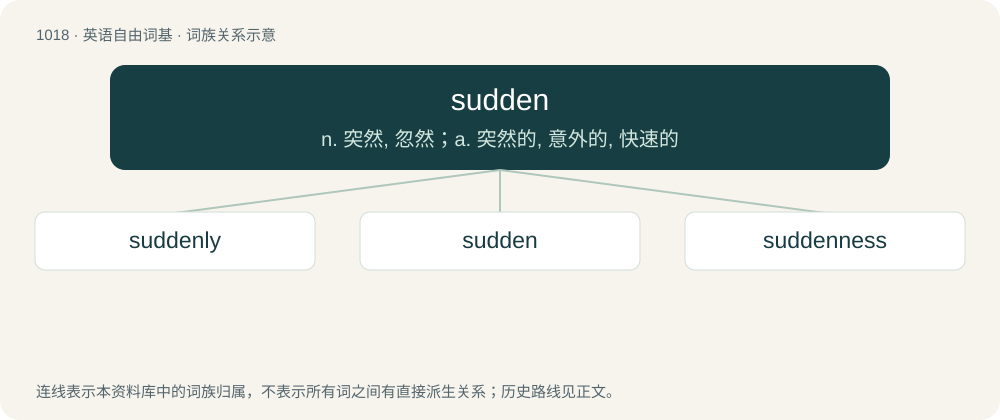

# 1098 · sudden — n. 突然, 忽然；a. 突然的, 意外的, 快速的

[总目录](../00_总目录_按常用程度.md)

**类型**：英语自由词基　｜　**来源语言**：见词源记录

## 核心含义与来源

- 核心含义：n. 突然, 忽然；a. 突然的, 意外的, 快速的
- 英文含义：Occurring quickly with little or no warning or expectation; instantly.
- 词形：sudden

**来源记录 1**（形容词；Occurring quickly with little or no warning or expectation; instantly.）

From Middle English sodeyn, sodain, from Anglo-Norman sodein, from Old French sodain, subdain (“immediate, sudden”), from Vulgar Latin \*subitānus (“sudden”), from Latin subitāneus (“sudden”), from subitus (“sudden", literally, "that which has come stealthily”), originally the past participle of subīre (“to come or go stealthily”), from sub (“under”) + īre (“go”). Doublet of subitaneous. Displaced native Old English fǣrlīċ.

## 词族图

## 单词速览（常用到不常用）

| 单词 | 音标 | 释义 |
|---|---|---|
| [suddenly](#w-1) | /ˈsʌd.ən.li/ | adv. 突然, 意外, 忽然, 迅速, 即席作成, 即刻, 急速 |
| [sudden](#w-2) | /ˈsʌd.ən/ | n. 突然, 忽然；a. 突然的, 意外的, 快速的 |
| [suddenness](#w-3) | /ˈsʌdnnɪs/ | n. 意外, 突然 |

## 逐词详解

### 1. suddenly

**词性**：副词　｜　**音标**：/ˈsʌd.ən.li/

**中文释义**：adv. 突然, 意外, 忽然, 迅速, 即席作成, 即刻, 急速

**英文义项**：Happening quickly and with little or no warning; in a sudden manner.

**构词拆分**：sudden + -ly

**词源与演化**：

Inherited from Middle English sodenly, sodeynly, sodeinliche, sodaynlyche; equivalent to sudden + -ly.

**例句**：

> Suddenly, the heavens opened and we all got drenched.

该用例对应义项：Happening quickly and with little or no warning; in a sudden manner.

### 2. sudden

**词性**：形容词　｜　**音标**：/ˈsʌd.ən/

**中文释义**：n. 突然, 忽然；a. 突然的, 意外的, 快速的

**英文义项**：Occurring quickly with little or no warning or expectation; instantly.

**词源与演化**：

From Middle English sodeyn, sodain, from Anglo-Norman sodein, from Old French sodain, subdain (“immediate, sudden”), from Vulgar Latin \*subitānus (“sudden”), from Latin subitāneus (“sudden”), from subitus (“sudden", literally, "that which has come stealthily”), originally the past participle of subīre (“to come or go stealthily”), from sub (“under”) + īre (“go”). Doublet of subitaneous. Displaced native Old English fǣrlīċ.

**例句**：

> The sudden drop in temperature left everyone cold and confused.

该用例对应义项：Occurring quickly with little or no warning or expectation; instantly.

### 3. suddenness

**词性**：名词　｜　**音标**：/ˈsʌdnnɪs/

**中文释义**：n. 意外, 突然

**英文义项**：The state of being sudden.

**构词拆分**：sudden + -ness

**词源与演化**：

From sudden + -ness.

**例句**：

> With dramatic suddenness he struck a match, and by its light exposed a stain of blood upon the whitewashed wall.
