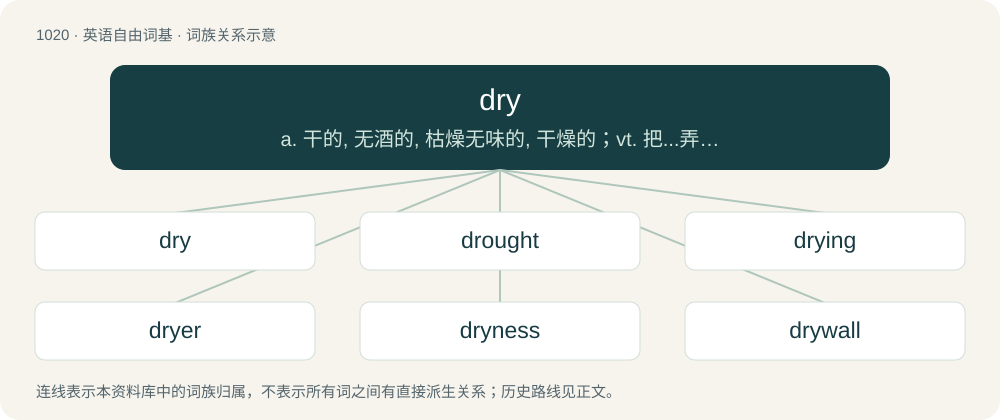

# 1100 · dry — a. 干的, 无酒的, 枯燥无味的, 干燥的；vt. 把...弄干；vi. 变干

[总目录](../00_总目录_按常用程度.md)

**类型**：英语自由词基　｜　**来源语言**：见词源记录

## 核心含义与来源

- 核心含义：a. 干的, 无酒的, 枯燥无味的, 干燥的；vt. 把...弄干；vi. 变干
- 英文含义：Free from or lacking moisture.
- 词形：dry

**来源记录 1**（形容词；Free from or lacking moisture.）

Adjective and noun from Middle English drye, dryge, drüȝe, from Old English drȳġe (“dry; parched, withered”), from Proto-West Germanic \*drūgī, \*draugī, from Proto-Germanic \*drūgiz, \*draugiz (“dry, hard”), from Proto-Indo-European \*dʰerǵʰ- (“to strengthen; become hard”), from \*dʰer- (“to hold, support”). The verb derives from Middle English drien, from Old English drȳġan (“to dry”), from Proto-West Germanic \*drūgijan, from Proto-Germanic \*drūgiz (“hard, desiccated, dry”), from Proto-Indo-European \*dʰerǵʰ- (“strong, hard, solid”). cognates and related terms Cognate with Scots dry, drey (“dry”), North Frisian drüg, driig, Saterland Frisian druuch (“dry”), West Frisian droech (“dry”), Dutch droog (“dry”), Low German dröög (“dry”), German dröge (“dull”), Icelandic draugur (“a dry log”). Related also to German trocken (“dry”), West Frisian drege (“long-lasting”), Danish drøj (“tough”), Swedish dryg (“lasting, hard”), Icelandic drjúgur (“ample, long”), Latin firmus (“strong, firm, stable, durable”). See also drought, drain, dree.

## 词族图

## 单词速览（常用到不常用）

| 单词 | 音标 | 释义 |
|---|---|---|
| [dry](#w-1) | 英 /ˈdɹaɪ̯/；/ˈdɹaɪ̯/ | a. 干的, 无酒的, 枯燥无味的, 干燥的；vt. 把...弄干；vi. 变干 |
| [drought](#w-2) | /dɹaʊt/ | n. 干旱, 缺乏 |
| [drying](#w-3) | /ˈdɹaɪ.ɪŋ/ | \[计\] 干燥的；\[化\] 干燥 |
| [dryer](#w-4) | 英 /ˈdɹaɪə/；美 /ˈdɹaɪɚ/ | n. 干衣机, 干燥剂；\[化\] 干燥剂; 催干剂; 干燥器; 干燥设备; 烘箱 |
| [dryness](#w-5) | 英 /ˈdɹaɪ.nəs/ | n. 干燥, 干燥无味, 冷淡 |
| [drywall](#w-6) | 英 /ˈdraɪˌwɔːl/；美 /ˈdraɪˌwɔl/ | 干式墙 |
| [dryly](#w-7) | /ˈdɹaɪ.li/ | adv. 冷淡地, 枯躁无味地 |
| [dryland](#w-8) | /ˈdrailænd/ | n. 旱地 |
| [drydock](#w-9) | /ˈdraidɔk/ | (使)入干船坞 |

## 逐词详解

### 1. dry

**词性**：形容词　｜　**音标**：英 /ˈdɹaɪ̯/；/ˈdɹaɪ̯/

**中文释义**：a. 干的, 无酒的, 枯燥无味的, 干燥的；vt. 把...弄干；vi. 变干

**英文义项**：Free from or lacking moisture. / Unable to produce a liquid, as water, (petrochemistry) oil, or (agriculture) milk.

**词源与演化**：

Adjective and noun from Middle English drye, dryge, drüȝe, from Old English drȳġe (“dry; parched, withered”), from Proto-West Germanic \*drūgī, \*draugī, from Proto-Germanic \*drūgiz, \*draugiz (“dry, hard”), from Proto-Indo-European \*dʰerǵʰ- (“to strengthen; become hard”), from \*dʰer- (“to hold, support”). The verb derives from Middle English drien, from Old English drȳġan (“to dry”), from Proto-West Germanic \*drūgijan, from Proto-Germanic \*drūgiz (“hard, desiccated, dry”), from Proto-Indo-European \*dʰerǵʰ- (“strong, hard, solid”). cognates and related terms Cognate with Scots dry, drey (“dry”), North Frisian drüg, driig, Saterland Frisian druuch (“dry”), West Frisian droech (“dry”), Dutch droog (“dry”), Low German dröög (“dry”), German dröge (“dull”), Icelandic draugur (“a dry log”). Related also to German trocken (“dry”), West Frisian drege (“long-lasting”), Danish drøj (“tough”), Swedish dryg (“lasting, hard”), Icelandic drjúgur (“ample, long”), Latin firmus (“strong, firm, stable, durable”). See also drought, drain, dree.

**例句**：

> This towel's dry. Could you wet it and cover the chicken so it doesn't go dry as it cooks?

该用例对应义项：Free from or lacking moisture.

### 2. drought

**词性**：名词　｜　**音标**：/dɹaʊt/

**中文释义**：n. 干旱, 缺乏

**英文义项**：A period of unusually low rainfall, longer and more severe than a dry spell. / A longer than expected term without success, particularly in sport.

**构词拆分**：By surface analysis, dry + -t (abstract nominal suffix)

**词源与演化**：

From Middle English droughte, droghte, drouȝte, from Old English drūgaþ. Cognate with Dutch droogte, Low German Dröögde. By surface analysis, dry + -t (abstract nominal suffix).

**例句**：

> Sri Lanka ended their ten-game drought with a consolation win over Bangladesh.

该用例对应义项：A longer than expected term without success, particularly in sport.

### 3. drying

**词性**：名词　｜　**音标**：/ˈdɹaɪ.ɪŋ/

**中文释义**：\[计\] 干燥的；\[化\] 干燥

**英文义项**：The act of drying. / A method of food preservation by removing water.

**构词拆分**：From dry + -ing.

**词源与演化**：

From dry + -ing.

**例句**：

> Daniel covered the scion with grafting tape to protect it from drying.

### 4. dryer

**词性**：名词　｜　**音标**：英 /ˈdɹaɪə/；美 /ˈdɹaɪɚ/

**中文释义**：n. 干衣机, 干燥剂；\[化\] 干燥剂; 催干剂; 干燥器; 干燥设备; 烘箱

**英文义项**：One who, or that which, dries; any device or facility employed to remove water or humidity, e.g. a desiccative / A catalyst used to promote the drying of paints and varnishes by oxidative crosslinking.

**构词拆分**：dry + -er (agent noun suffix)

**词源与演化**：

From Middle English driere, dreyere (“one who dries”), equivalent to dry + -er (agent noun suffix).

**例句**：

> I need to buy more anti-static sheets for the clothes dryer.

### 5. dryness

**词性**：名词　｜　**音标**：英 /ˈdɹaɪ.nəs/

**中文释义**：n. 干燥, 干燥无味, 冷淡

**英文义项**：A lack of moisture. / The degree to which something is dry.

**构词拆分**：dry + -ness

**词源与演化**：

Inherited from Middle English dryenesse, drynesse; equivalent to dry + -ness.

**例句**：

> Have you had any persistent itching, rash, or dryness anywhere on your body?

### 6. drywall

**词性**：名词　｜　**音标**：英 /ˈdraɪˌwɔːl/；美 /ˈdraɪˌwɔl/

**中文释义**：干式墙

**英文义项**：A building material comprising a sheet of gypsum sandwiched between two pieces of heavy paper, used mainly for interior walls and ceilings. / A wall made of this.

**构词拆分**：dry + wall

**词源与演化**：

From dry + wall.

**例句**：

> Sledgehammers are often used in demolition work, for breaking through drywall or masonry walls.

### 7. dryly

**词性**：副词　｜　**音标**：/ˈdɹaɪ.li/

**中文释义**：adv. 冷淡地, 枯躁无味地

**英文义项**：In a dry manner.

**构词拆分**：dry + -ly

**词源与演化**：

From dry + -ly.

**例句**：

> The barfly dryly brushes off suitors.

### 8. dryland

**词性**：名词　｜　**音标**：/ˈdrailænd/

**中文释义**：n. 旱地

**英文义项**：Land that is arid, but not so dry as to be a desert.

**构词拆分**：dry + land

**词源与演化**：

From dry + land.

### 9. drydock

**词性**：名词　｜　**音标**：/ˈdraidɔk/

**中文释义**：(使)入干船坞

**英文义项**：A dock that can be drained of water and is used in the repair and construction of ships.

**构词拆分**：dry + dock

**词源与演化**：

From dry + dock.
