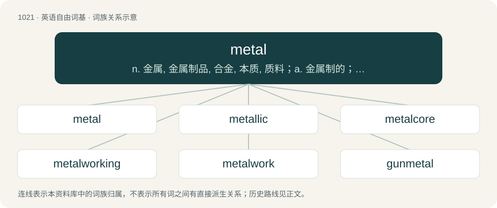

# 1101 · metal — n. 金属, 金属制品, 合金, 本质, 质料；a. 金属制的；vt. 以金属覆盖

[总目录](../00_总目录_按常用程度.md)

**类型**：英语自由词基　｜　**来源语言**：见词源记录

## 核心含义与来源

- 核心含义：n. 金属, 金属制品, 合金, 本质, 质料；a. 金属制的；vt. 以金属覆盖
- 英文含义：Any of a number of chemical elements in the periodic table that form a metallic bond with other metal atoms; generally shiny, somewhat malleable and hard, often a conductor of heat and electricity.
- 词形：metal

**来源记录 1**（名词；Any of a number of chemical elements in the periodic table that form a metallic bond with other metal atoms; generally shiny, somewhat malleable and hard, often a conductor of heat and electricity.）

From Middle English metal, a borrowing from Old French metal, from Latin metallum (“metal, mine, quarry, mineral”), itself a borrowing from Ancient Greek μέταλλον (métallon, “mine, quarry, metal”).

## 词族图

## 单词速览（常用到不常用）

| 单词 | 音标 | 释义 |
|---|---|---|
| [metal](#w-1) | /ˈmɛ.təl/ | n. 金属, 金属制品, 合金, 本质, 质料；a. 金属制的；vt. 以金属覆盖 |
| [metallic](#w-2) | 英 /mɪˈtæl.ɪk/；美 /məˈtæl.ɪk/ | a. 金属的, 含金属的, 产生金属的；\[经\] 金属的 |
| [metalcore](#w-3) |  | 【英文】A subgenre of rock music which fuses extreme metal and hardcore punk. |
| [metalworking](#w-4) | /ˈmetəl,w\\\\ːkiŋ/ | n. 金属加工术, 金属工 |
| [metalwork](#w-5) | /ˈmetəlwəːk/ | n. 金属制品, 金属加工；\[机\] 金工 |
| [gunmetal](#w-6) | 英 /ˈɡʌnmɛt(ə)l/；美 /ˈɡʌnmɛt(ə)l/ | n. 炮铜, 青铜, 炮铜色 |

## 逐词详解

### 1. metal

**词性**：名词　｜　**音标**：/ˈmɛ.təl/

**中文释义**：n. 金属, 金属制品, 合金, 本质, 质料；a. 金属制的；vt. 以金属覆盖

**英文义项**：Any of a number of chemical elements in the periodic table that form a metallic bond with other metal atoms; generally shiny, somewhat malleable and hard, often a conductor of heat and electricity. / Any material with similar physical properties as those chemical elements, especially as a combination of several of them, such as an alloy.

**词源与演化**：

From Middle English metal, a borrowing from Old French metal, from Latin metallum (“metal, mine, quarry, mineral”), itself a borrowing from Ancient Greek μέταλλον (métallon, “mine, quarry, metal”).

**例句**：

> We have American Airlines tickets, but it's on British Airways metal.

该用例对应义项：The actual airline operating a flight, rather than any of the codeshare operators.

### 2. metallic

**词性**：形容词　｜　**音标**：英 /mɪˈtæl.ɪk/；美 /məˈtæl.ɪk/

**中文释义**：a. 金属的, 含金属的, 产生金属的；\[经\] 金属的

**英文义项**：Of, relating to, or characteristic of metal. / Made of or containing metal.

**构词拆分**：metal + -ic

**词源与演化**：

From Latin metallicus, from metallum (“metal”), from Ancient Greek μέταλλον (métallon). Equivalent to metal + -ic.

**例句**：

> The strange metallic note of the meadow lark, suggesting the clash of vibrant blades.

该用例对应义项：containing or made of or resembling or characteristic of a metal

### 3. metalcore

**词性**：名词

**英文义项**：A subgenre of rock music which fuses extreme metal and hardcore punk.

**构词拆分**：metal + -core

**词源与演化**：

From metal + -core.

**例句**：

> I've never heard metalcore like that.

### 4. metalworking

**词性**：名词　｜　**音标**：/ˈmetəl,w\\\\ːkiŋ/

**中文释义**：n. 金属加工术, 金属工

**英文义项**：The art and craft of shaping metal.

**构词拆分**：metal + working

**词源与演化**：

From metal + working.

**用法示例／搭配（非完整句）**：

> metalworking industry

该用例对应义项：The art and craft of shaping metal.

### 5. metalwork

**词性**：名词　｜　**音标**：/ˈmetəlwəːk/

**中文释义**：n. 金属制品, 金属加工；\[机\] 金工

**英文义项**：Objects made of metal. / The act of shaping metal, metalworking.

**构词拆分**：metal + -work

**词源与演化**：

From metal + -work.

**例句**：

> The local blacksmith made all the metalwork for this reconstructed old house.

该用例对应义项：Objects made of metal.

### 6. gunmetal

**词性**：名词　｜　**音标**：英 /ˈɡʌnmɛt(ə)l/；美 /ˈɡʌnmɛt(ə)l/

**中文释义**：n. 炮铜, 青铜, 炮铜色

**英文义项**：An alloy of 88% copper, 10% tin and 2% zinc, originally used for making guns. / A dark grey or bluish-grey colour; gunmetal grey.

**构词拆分**：gun + metal

**词源与演化**：

From gun + metal.
