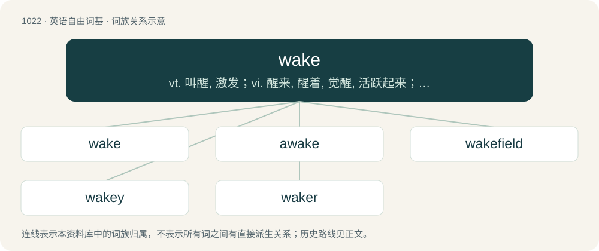

# 1102 · wake — vt. 叫醒, 激发；vi. 醒来, 醒着, 觉醒, 活跃起来；n. 守侯, 守夜, 尾迹, 痕迹

[总目录](../00_总目录_按常用程度.md)

**类型**：英语自由词基　｜　**来源语言**：见词源记录

## 核心含义与来源

- 核心含义：vt. 叫醒, 激发；vi. 醒来, 醒着, 觉醒, 活跃起来；n. 守侯, 守夜, 尾迹, 痕迹
- 英文含义：(often followed by up) To stop sleeping.
- 词形：wake

**多个词源／构词路径**：同一拼写可能有不同来源；以下按词性和含义分别列出。

**来源记录 1**（动词；(often followed by up) To stop sleeping.）

A merger of two verbs of related/similar form and meaning: \* Middle English waken, Old English wacan, from Proto-West Germanic \*wakan, from Proto-Germanic \*wakaną. \* Middle English wakien, Old English wacian, from Proto-West Germanic \*wakēn, from Proto-Germanic \*wakāną.

**来源记录 2**（名词；A period after a person's death before or after the body is buried, cremated, etc.; in some cultures accompanied by a party or collectively sorting through the deceased's personal effects.）

From Middle English wake, from Old English wacu, from Proto-Germanic \*wakō, related to the verb \*wakjaną.

**来源记录 3**（名词；The path left behind a ship on the surface of the water.）

Probably from Middle Low German or Middle Dutch wake, from or akin to Old Norse vǫk (“a hole in the ice”) ( &gt; Danish våge, Icelandic vök), from Proto-Germanic \*wakwō (“wetness”), from Proto-Indo-European \*wegʷ- (“moist, wet”).

## 词族图

## 单词速览（常用到不常用）

| 单词 | 音标 | 释义 |
|---|---|---|
| [wake](#w-1) | /ˈweɪ̯k/ | vt. 叫醒, 激发；vi. 醒来, 醒着, 觉醒, 活跃起来；n. 守侯, 守夜, 尾迹, 痕迹 |
| [awake](#w-2) | /əˈweɪk/ | 【英文】To become conscious after having slept. |
| [wakefield](#w-3) | /ˈweikfiːld/ | n. 韦克菲尔德（英格兰北部城市） |
| [wakey](#w-4) | 英 /ˈweɪ.ki/ | 【英文】The day on which one wakes up and travels home. |
| [waker](#w-5) |  | 唤醒的人；瓦克（品牌名） |

## 逐词详解

### 1. wake

**词性**：动词　｜　**音标**：/ˈweɪ̯k/

**中文释义**：vt. 叫醒, 激发；vi. 醒来, 醒着, 觉醒, 活跃起来；n. 守侯, 守夜, 尾迹, 痕迹

**英文义项**：(often followed by up) To stop sleeping. / (often followed by up) To make somebody stop sleeping; to rouse from sleep.

**词源与演化**：

A merger of two verbs of related/similar form and meaning: \* Middle English waken, Old English wacan, from Proto-West Germanic \*wakan, from Proto-Germanic \*wakaną. \* Middle English wakien, Old English wacian, from Proto-West Germanic \*wakēn, from Proto-Germanic \*wakāną.

**例句**：

> Wake old feelings of hatred.

该用例对应义项：arouse or excite feelings and passions

### 2. awake

**词性**：动词　｜　**音标**：/əˈweɪk/

**英文义项**：To become conscious after having slept. / To cause (somebody) to stop sleeping.

**构词拆分**：By surface analysis, a- + wake

**词源与演化**：

From Middle English awaken and awakien, from Old English āwacan and āwacian. By surface analysis, a- + wake.

**例句**：

> It took her some time to awake to the dangers of her situation.

该用例对应义项：Used in a phrasal verb: to awake to (“to become awake of something and its possibile effects or results.”).

### 3. wakefield

**词性**：名词　｜　**音标**：/ˈweikfiːld/

**中文释义**：n. 韦克菲尔德（英格兰北部城市）

**英文义项**：The electron density wave structure which immediately follows an intense laser beam or relativistic charged particle beam as it passes through a plasma; the electric field or potential associated with such a structure.

**构词拆分**：wake + field

**词源与演化**：

From wake + field.

### 4. wakey

**词性**：名词　｜　**音标**：英 /ˈweɪ.ki/

**英文义项**：The day on which one wakes up and travels home.

**构词拆分**：wake + -y

**词源与演化**：

From wake + -y (diminutive suffix).

**例句**：

> Wakey wakey, rise and shine! There's a lot to do today!

### 5. waker

**词性**：形容词

**中文释义**：唤醒的人；瓦克（品牌名）

**英文义项**：Watchful; vigilant; alert.

**构词拆分**：wake + -er

**词源与演化**：

From Middle English wakyr, from Old English wacor, waccor (“watchful, vigilant”), from Proto-West Germanic \*wakr, from Proto-Germanic \*wakraz (“awake, watchful”), equivalent to wake + -er. Cognate with Scots wakir (“watchful”), Dutch wakker (“awake”), German wacker (“awake, alert, capable, brave”), Swedish vacker (“wakeful, watchful, fair, comely”). Also precisely cognate with Sanskrit वज्र (vájra, “adamantine”), both ultimately from Proto-Indo-European \*wóǵ-ros (“strong, lively”), and therefore a doublet of vajra. Further related through the same Indo-European root to vigil, vigor, and vegetable.
