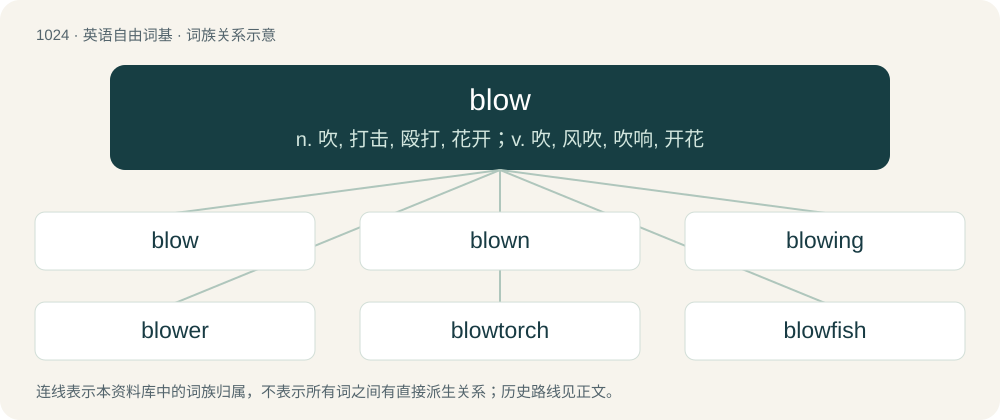

# 1103 · blow — n. 吹, 打击, 殴打, 花开；v. 吹, 风吹, 吹响, 开花

[总目录](../00_总目录_按常用程度.md)

**类型**：英语自由词基　｜　**来源语言**：见词源记录

## 核心含义与来源

- 核心含义：n. 吹, 打击, 殴打, 花开；v. 吹, 风吹, 吹响, 开花
- 英文含义：To produce an air current.
- 词形：blow

**多个词源／构词路径**：同一拼写可能有不同来源；以下按词性和含义分别列出。

**来源记录 1**（动词；To produce an air current.）

From Middle English blowen, from Old English blāwan (“to blow, breathe, inflate, sound”), from Proto-West Germanic \*blāan, from Proto-Germanic \*blēaną (“to blow”) (compare German blähen), from Proto-Indo-European \*bʰleh₁- (“to swell, blow up”) (compare Latin flō (“to blow”) and Old Armenian բեղուն (bełun, “fertile”)).

**来源记录 2**（形容词；Blue.）

From Middle English blo, bloo, from Old English blāw (“blue”), from Proto-Germanic \*blēwaz (“blue, dark blue, grey, black”), from Proto-Indo-European \*bʰlēw- (“yellow, blond, grey”). Cognate with Latin flavus (“yellow”). Doublet of blue.

**来源记录 3**（名词；An instance of the act of striking or hitting.）

From Middle English blowe, blaw, northern variant of blēwe, from Proto-Germanic \*blewwaną (“to beat”) (compare Old Norse blegði (“wedge”), German einbläuen, Middle Dutch blouwen). Related to block.

**来源记录 4**（动词；To blossom; to cause to bloom or blossom.）

From Middle English blowen, from Old English blōwan, from Proto-Germanic \*blōaną (compare Dutch bloeien, German blühen), from Proto-Indo-European \*bʰleh₃- (compare Latin florēre (“to bloom”)).

## 词族图

## 单词速览（常用到不常用）

| 单词 | 音标 | 释义 |
|---|---|---|
| [blow](#w-1) | 英 /bləʊ/；美 /bloʊ/ | n. 吹, 打击, 殴打, 花开；v. 吹, 风吹, 吹响, 开花 |
| [blown](#w-2) | 英 /bləʊn/；美 /bloʊn/ | a. 吹制的, 喘气的, 开着花的；blow的过去分词 |
| [blowing](#w-3) | 英 /ˈbləʊ.ɪŋ/；美 /ˈbloʊ.ɪŋ/ | \[机\] 吹制 |
| [blower](#w-4) | 英 /ˈbləʊ.ə/；美 /ˈbloʊ.ɚ/ | n. 吹制工, 鼓风机, 吹风机；\[化\] (鼓;吹;扇;排)风机 |
| [blowtorch](#w-5) | 英 /ˈbləʊˌtɔːtʃ/；美 /ˈbloʊˌtoɹt͡ʃ/ | n. 喷灯；\[机\] 喷灯 |
| [blowfish](#w-6) | 英 /ˈbləʊˌfɪʃ/；美 /ˈbloʊˌfɪʃ/ | n. 河豚 |
| [blowhole](#w-7) | /ˈbləʊhəʊl/ | n. 喷水孔, 通风孔, 通气孔；\[机\] 气孔 |

## 逐词详解

### 1. blow

**词性**：动词　｜　**音标**：英 /bləʊ/；美 /bloʊ/

**中文释义**：n. 吹, 打击, 殴打, 花开；v. 吹, 风吹, 吹响, 开花

**英文义项**：To produce an air current. / To propel by an air current (or, if under water, a water current), usually with the mouth.

**词源与演化**：

From Middle English blowen, from Old English blāwan (“to blow, breathe, inflate, sound”), from Proto-West Germanic \*blāan, from Proto-Germanic \*blēaną (“to blow”) (compare German blähen), from Proto-Indo-European \*bʰleh₁- (“to swell, blow up”) (compare Latin flō (“to blow”) and Old Armenian բեղուն (bełun, “fertile”)).

**例句**：

> There’s nothing more thrilling to the whale watcher than to see a whale surface and blow.

该用例对应义项：To exhale visibly through the spout the seawater which it has taken in while feeding.

### 2. blown

**词性**：形容词　｜　**音标**：英 /bləʊn/；美 /bloʊn/

**中文释义**：a. 吹制的, 喘气的, 开着花的；blow的过去分词

**英文义项**：Distended, swollen, or inflated. / Panting and out of breath.

**构词拆分**：blow + -n

**词源与演化**：

From Middle English blawen, from Old English blāƿen, blāwen, past participle of Old English blāwan. Morphologically blow + -n.

**例句**：

> Cattle are said to be blown when gorged with green food which develops gas.

该用例对应义项：Distended, swollen, or inflated.

### 3. blowing

**词性**：名词　｜　**音标**：英 /ˈbləʊ.ɪŋ/；美 /ˈbloʊ.ɪŋ/

**中文释义**：\[机\] 吹制

**英文义项**：The act of one who blows, or that which blows.

**构词拆分**：blow + -ing

**词源与演化**：

From Middle English blowynge, blowyng, from Old English blāwung (“blowing”), equivalent to blow + -ing.

**用法示例／搭配（非完整句）**：

> the puffings and blowings of an unfit runner

该用例对应义项：The act of one who blows, or that which blows.

### 4. blower

**词性**：名词　｜　**音标**：英 /ˈbləʊ.ə/；美 /ˈbloʊ.ɚ/

**中文释义**：n. 吹制工, 鼓风机, 吹风机；\[化\] (鼓;吹;扇;排)风机

**英文义项**：A person who blows. / A fissure from which firedamp issues, often in quantity for many years.

**构词拆分**：blow + -er

**词源与演化**：

From Middle English blowere, blower, from Old English blāwere; equivalent to blow + -er.

**例句**：

> Get on the blower and call headquarters right away!

该用例对应义项：Telephone.

### 5. blowtorch

**词性**：名词　｜　**音标**：英 /ˈbləʊˌtɔːtʃ/；美 /ˈbloʊˌtoɹt͡ʃ/

**中文释义**：n. 喷灯；\[机\] 喷灯

**英文义项**：A tool which projects a controlled stream of a highly flammable gas over a spark in order to produce a controlled flame. / A jet fighter.

**构词拆分**：blow + torch

**词源与演化**：

From blow + torch.

**例句**：

> Have you ever lighted a cigarette with a blowtorch?

### 6. blowfish

**词性**：名词　｜　**音标**：英 /ˈbləʊˌfɪʃ/；美 /ˈbloʊˌfɪʃ/

**中文释义**：n. 河豚

**英文义项**：Any species of fish of the family Tetraodontidae that have the ability to inflate themselves to a globe several times their normal size by swallowing water or air when threatened. / A delicacy popular in Japan, consisting of the fish served raw as sushi or perhaps fried. It may, if improperly prepared, contain considerably deadly levels of neurotoxins.

**构词拆分**：blow + fish

**词源与演化**：

From blow + fish.

**例句**：

> Blowfish is a delicacy in Japan.

### 7. blowhole

**词性**：名词　｜　**音标**：/ˈbləʊhəʊl/

**中文释义**：n. 喷水孔, 通风孔, 通气孔；\[机\] 气孔

**英文义项**：The spiracle, on the top of the head, through which cetaceans breathe. / A hole in sea ice where cetaceans and pinnipeds come to breathe.

**构词拆分**：blow + hole

**词源与演化**：

From blow + hole.
